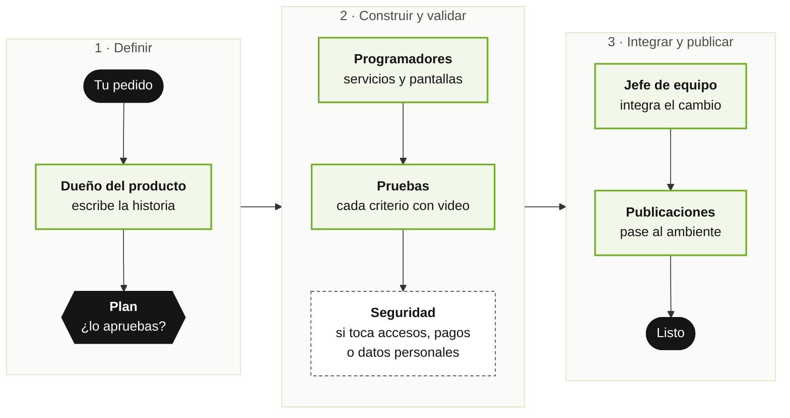
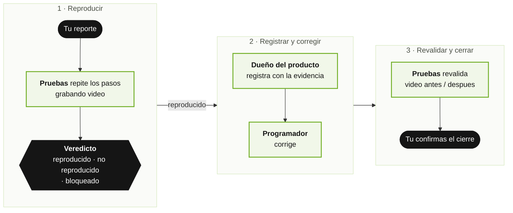

# Dev Team — Manual de Usuario

**Version del plugin:** 2.18.x · **Integrantes del equipo:** 23 · **Comandos:** 33

> **Manual general de todos los equipos.** Existe un manual que explica juntos a todos los
> equipos de FAAST (Mesa de Servicios → Dev Team → Marketing) y como se pasan el trabajo:
> [`GUIDE.md` en la raiz del repositorio](../../GUIDE.md), tambien en PDF (`GUIDE.pdf`). Este
> manual cubre solo el Dev Team.

Dev Team es un **equipo completo de desarrollo de software formado por asistentes de
inteligencia artificial**. Funciona como una empresa de software en miniatura: hay
alguien que escribe lo que el negocio necesita, un estudio de diseño completo,
alguien que decide como se construye, programadores, un equipo de pruebas, un
encargado de seguridad, uno de publicar versiones y uno que documenta. Tu hablas
con ellos en lenguaje normal y ellos hacen el trabajo, pidiendote confirmacion antes
de cada paso importante.

No necesitas saber programar para usarlo. Este manual esta escrito para cualquier
persona: quien recien empieza, quien dirige un area, quien nunca ha abierto una
herramienta tecnica. La instalacion se explica **paso a paso, desde cero**, al comienzo de
la Parte 1 ([Antes de empezar](#antes-de-empezar-instalacion-paso-a-paso)). La parte tecnica
de configuracion (para quien administra) esta al final, separada, en el **Anexo tecnico**.

---

## Indice

**Parte 1 — Para todas las personas**
- [Antes de empezar: instalacion paso a paso](#antes-de-empezar-instalacion-paso-a-paso)
1. [En dos minutos: como se usa](#1-en-dos-minutos-como-se-usa)
2. [Conoce al equipo](#2-conoce-al-equipo)
3. [Las palabras que vas a escuchar](#3-las-palabras-que-vas-a-escuchar)
4. [Las reglas de la casa](#4-las-reglas-de-la-casa)
5. [Que puedes pedir (lista de comandos)](#5-que-puedes-pedir-lista-de-comandos)

**Parte 2 — Situaciones reales, paso a paso**
- [Caso 1: Tengo una idea y quiero empezar un proyecto](#caso-1--tengo-una-idea-y-quiero-empezar-un-proyecto)
- [Caso 2: Tengo un documento de requerimientos](#caso-2--tengo-un-documento-de-requerimientos)
- [Caso 2b: Tengo una propuesta o un plan y quiero el tablero completo armado](#caso-2b--tengo-una-propuesta-o-un-plan-y-quiero-el-tablero-completo-armado)
- [Caso 3: Ya tengo un proyecto andando y quiero que el equipo lo tome](#caso-3--ya-tengo-un-proyecto-andando-y-quiero-que-el-equipo-lo-tome)
- [Caso 4: Necesito una funcionalidad nueva, de principio a fin](#caso-4--necesito-una-funcionalidad-nueva-de-principio-a-fin)
- [Caso 5: Quiero ver como se vera el producto antes de construirlo (equipo de diseño)](#caso-5--quiero-ver-como-se-vera-el-producto-antes-de-construirlo-equipo-de-diseño)
- [Caso 6: Algo no funciona (reportar y corregir un error)](#caso-6--algo-no-funciona-reportar-y-corregir-un-error)
- [Caso 7: Algo falla y nadie sabe en que parte esta el problema](#caso-7--algo-falla-y-nadie-sabe-en-que-parte-esta-el-problema)
- [Caso 8: Pruebas — como se comprueba que todo funciona](#caso-8--pruebas-como-se-comprueba-que-todo-funciona)
- [Caso 8b: Registrar y repetir un flujo de negocio](#caso-8b--registrar-y-repetir-un-flujo-de-negocio)
- [Caso 9: Base de datos — revisar, comparar y preparar cambios](#caso-9--base-de-datos-revisar-comparar-y-preparar-cambios)
- [Caso 10: Publicar una version en un ambiente (pase)](#caso-10--publicar-una-version-en-un-ambiente-pase)
- [Caso 10b: Contenerizar, probar en local y desplegar a un servidor](#caso-10b--contenerizar-probar-en-local-y-desplegar-a-un-servidor)
- [Caso 11: Revisar la seguridad](#caso-11--revisar-la-seguridad)
- [Caso 12: La memoria del proyecto (wiki)](#caso-12--la-memoria-del-proyecto-wiki)
- [Caso 12b: Un documento de negocio en PDF o Word](#caso-12b--un-documento-de-negocio-en-pdf-o-word)
- [Caso 13: Ver al equipo trabajar](#caso-13--ver-al-equipo-trabajar)
- [Caso 14: Trabajar por sprints (Scrum)](#caso-14--trabajar-por-sprints-scrum)
- [Caso 15: Hacer que un integrante piense mas (o gaste menos)](#caso-15--hacer-que-un-integrante-piense-mas-o-gaste-menos)

**Parte 3 — Preguntas frecuentes y problemas comunes**
- [Preguntas frecuentes](#preguntas-frecuentes)
- [Si algo no anda](#si-algo-no-anda)

**Anexo tecnico (para quien instala y configura)**
- [A. Instalacion y actualizacion](#a-instalacion-y-actualizacion)
- [B. Configuracion del proyecto](#b-configuracion-del-proyecto)
- [C. La carpeta de coordinacion](#c-la-carpeta-de-coordinacion)
- [D. Cuidar el consumo](#d-cuidar-el-consumo)
- [E. Solucion de problemas tecnicos](#e-solucion-de-problemas-tecnicos)

---

# Parte 1 — Para todas las personas

## Antes de empezar: instalacion paso a paso

Esta seccion es para quien nunca ha instalado nada parecido. Se hace **una sola vez por
computador** y toma unos 15 minutos. Si alguien de tu area ya lo dejo instalado, salta al
**Paso 8**.

**Que es Claude Code y donde se usa.** Claude Code es el programa de Anthropic en el que
trabaja este equipo. Es una conversacion: tu escribes en lenguaje normal y Claude responde y
hace el trabajo sobre las carpetas de tu computador. El Dev Team es un **plugin**: un
"paquete" que se le agrega a Claude Code y que trae a los 23 integrantes y sus comandos.
Claude Code se puede usar en tres lugares:

| Donde | Como se ve | Para quien |
|---|---|---|
| **La terminal** | Una ventana de texto con un cursor que parpadea. En Mac es la aplicacion "Terminal"; en Windows, "PowerShell" | La forma recomendada; es donde se hace la instalacion |
| **VS Code** | Un panel de conversacion dentro del editor VS Code (extension "Claude Code") | Quien ya trabaja en VS Code |
| **La aplicacion de escritorio de Claude** | La aplicacion Claude para Mac o Windows, en su seccion de Claude Code | Quien prefiere ventanas y botones |

Los pasos de instalacion se hacen en la terminal. Despues, el equipo se usa igual desde
cualquiera de los tres lugares. Si en VS Code o en la aplicacion no te aparecen los comandos
`/dev-team:...`, usa la terminal.

**Paso 1 — Lo que necesitas tener.** Un computador Mac, Windows o Linux con internet, y una
**cuenta de Claude con acceso a Claude Code** (normalmente la entrega tu empresa). No
necesitas cuenta de GitHub para instalar: el catalogo de FAAST es publico.

**Paso 2 — Abrir la terminal.**
- **Mac:** presiona `Cmd + Espacio`, escribe `Terminal` y presiona Enter.
- **Windows:** presiona la tecla Windows, escribe `PowerShell` y presiona Enter.

*Que ves:* una ventana con una linea que termina en `%`, `$` o `>` y un cursor parpadeando.
Ahi se pega cada instruccion de este manual y se presiona **Enter**.

**Paso 3 — Instalar Claude Code.** Copia la linea que corresponde a tu computador, pegala en
la terminal y presiona Enter:

```bash
# Mac o Linux
curl -fsSL https://claude.ai/install.sh | bash
```
```powershell
# Windows (PowerShell)
irm https://claude.ai/install.ps1 | iex
```

*Que ves:* unas lineas de avance y, al final, un mensaje de que quedo instalado. Si tu
empresa usa otro metodo, sigue la guia oficial de Anthropic (code.claude.com/docs). Cierra la
terminal, abrela de nuevo y comprueba:

```bash
claude --version
```
*Que ves:* un numero de version, por ejemplo `2.1.301 (Claude Code)`. Si dice "command not
found" o "no se reconoce", cierra y abre la terminal otra vez.

**Paso 4 — Iniciar sesion.** Escribe:

```bash
claude
```
*Que ves la primera vez:* te pide elegir los colores de la pantalla, luego como iniciar
sesion (elige tu cuenta de Claude); se abre tu navegador para que autorices el acceso y vuelves
a la terminal. Queda la pantalla de bienvenida de Claude Code con un recuadro para escribir.
Para salir de Claude Code escribe `/exit` y presiona Enter.

**Paso 5 — Agregar el catalogo de FAAST (el "marketplace").** Es la tienda interna de donde
salen los equipos de FAAST. Con Claude Code cerrado (en la terminal normal), pega:

```bash
claude plugin marketplace add faast-app/faast-claude-marketplace
```
*Que ves:* un mensaje de confirmacion de que el catalogo `faast-marketplace` quedo agregado.
Se hace una sola vez por computador.

**Paso 6 — Instalar el Dev Team.**

```bash
claude plugin install dev-team@faast-marketplace
```
*Que ves:* un mensaje de que el plugin `dev-team` quedo instalado. Queda disponible en todas
tus carpetas.

> **Si prefieres hacerlo desde dentro de Claude Code** (con la conversacion abierta), los
> pasos 5 y 6 se escriben asi: `/plugin marketplace add faast-app/faast-claude-marketplace`
> y `/plugin install dev-team@faast-marketplace`. El resultado es el mismo.

**Paso 7 — Reiniciar y comprobar.** Si tenias Claude Code abierto, cierralo (`/exit`) y
vuelvelo a abrir: el equipo se carga al iniciar la sesion. En VS Code, cierra y abre el panel
de Claude Code. Para comprobar que quedo instalado:

```bash
claude plugin list
```
*Que ves:* la lista de plugins instalados. Debe aparecer algo asi:
```
❯ dev-team@faast-marketplace
  Version: 2.18.0
  Scope: user
  Status: ✔ enabled
```
"enabled" significa que esta activo.

**Paso 8 — Abrir la carpeta del proyecto.** Claude Code trabaja sobre la carpeta en la que
lo abres. Abrelo **en la carpeta de tu proyecto** (la que contiene sus repositorios) o en una
carpeta vacia donde quieras crear uno nuevo:

```bash
cd ruta/de/tu/carpeta
claude
```
Para no escribir la ruta: escribe `cd ` (con un espacio), **arrastra la carpeta** desde el
Finder o el Explorador de archivos a la terminal y presiona Enter. En VS Code: *Archivo →
Abrir carpeta* y luego abre el panel de Claude Code.

*Que ves:* la primera vez que abres una carpeta, Claude Code te pregunta si confias en sus
archivos. Responde que si para que el equipo pueda trabajar en ella.

**Paso 9 — Tu primer pedido.** En el recuadro para escribir, pon:

```
/dev-team:start
```
Al escribir `/dev-team:` aparece una lista con todos los comandos del equipo; puedes elegir de
ahi. *Que ves:* el equipo revisa donde estas y te ofrece opciones en lenguaje simple: crear un
proyecto nuevo, tomar uno que ya existe o seguir trabajando. La primera vez, el integrante que
prepara la oficina (**setup**) revisa que la computadora tenga todo lo necesario y te pide **una
sola confirmacion** para instalar lo que falte. Durante el trabajo, Claude Code puede mostrarte
en pantalla un aviso para **aprobar un permiso** (por ejemplo, ejecutar una instruccion): leelo
y apruebalo si corresponde a lo que pediste.

**Como actualizar cuando hay novedades.** No tienes que estar pendiente: al abrir una sesion,
el plugin revisa si hay una version nueva y te pregunta si quieres actualizar. Si prefieres
hacerlo a mano, en la terminal (con Claude Code cerrado):

```bash
claude plugin marketplace update faast-marketplace
claude plugin update dev-team@faast-marketplace
```
Despues **cierra y vuelve a abrir Claude Code**: lo nuevo se carga al iniciar. Con `claude
plugin list` confirmas que la version cambio.

**Si algo falla durante la instalacion**
- *"command not found" / "no se reconoce" al escribir `claude`:* cierra y abre la terminal; si
  sigue, repite el Paso 3.
- *No aparecen los comandos `/dev-team:...`:* cierra y abre Claude Code (Paso 7) y revisa con
  `claude plugin list` que diga "enabled".
- *Error al instalar el plugin diciendo que no lo encuentra:* usa el nombre completo,
  `dev-team@faast-marketplace`, y verifica que hiciste el Paso 5.
- Para lo demas, el [Anexo E](#e-solucion-de-problemas-tecnicos).

---

## 1. En dos minutos: como se usa

1. Instalas el plugin una sola vez (ver [Antes de empezar](#antes-de-empezar-instalacion-paso-a-paso)).
2. Abres Claude Code **en la carpeta de tu proyecto** (o en la carpeta donde quieres
   crearlo), como en el Paso 8 de la instalacion.
3. Escribes esto y describes lo que necesitas, como se lo dirias a una persona:

```
/dev-team:start
```

Ejemplos de lo que puedes escribir despues (o en la misma linea):

| Lo que escribes | Lo que pasa |
|---|---|
| `/dev-team:start` | El equipo mira donde estas y te propone que hacer |
| `/dev-team:start quiero un sistema para avisar a clientes con pagos por vencer` | Arranca un proyecto nuevo desde tu idea |
| `/dev-team:start los analistas necesitan filtrar las cobranzas por fecha` | Convierte tu necesidad en trabajo para el equipo |
| `/dev-team:bug al pasar a la pagina 2 aparecen registros repetidos` | Pruebas reproduce el problema, lo confirma con fotos y recien ahi se registra |
| `/dev-team:start ¿en que estamos?` | Te resume el estado del proyecto |

**Tres cosas que siempre van a pasar:**
- **Te presentan el plan antes de hacer nada** que cambie el producto. Tu dices
  "adelante", "cambia esto" o "mejor de otra forma".
- **Todo queda con pruebas y con fotos** (capturas de pantalla) que demuestran que
  funciona.
- **Nada se publica sin pasar controles.** El equipo se controla a si mismo.

> **Lo que espera tu respuesta no se pierde.** Si un integrante te hizo una pregunta y no
> alcanzaste a responder, queda anotada como pendiente y el equipo te la recuerda al abrir
> la siguiente sesion, en una lista corta, para que decidas como seguir.

> Si solo tienes una pregunta rapida ("¿que estados tiene una solicitud?"),
> preguntala directo, sin `/dev-team:start`. Es mas rapido y consume menos.

---

## 2. Conoce al equipo

Piensa en una empresa de software pequeña con su propio estudio de diseño y su equipo
de seguridad. Estos son sus 23 integrantes, con lo que cada uno hace y cuando te vas a
cruzar con ellos.

| Integrante | Que hace, en palabras simples | Cuando aparece |
|---|---|---|
| 🧰 **setup** (el que prepara la oficina) | Revisa que la computadora tenga todo lo necesario e instala lo que falte, con tu permiso | Al empezar un proyecto o cuando algo no esta instalado |
| 📋 **product-owner** (el dueño del producto) | Escribe lo que el negocio necesita en lenguaje claro: historias, errores, prioridades. Lleva el tablero de tareas | Siempre que pides algo nuevo o reportas un problema |
| 📐 **architect** (el arquitecto) | Decide como se construye: en cuantas partes, con que tecnologias, como se conectan | Al crear un proyecto o ante una decision estructural |
| 🎨 **ui-designer** (el director de diseño) | Dirige el estudio de diseño y diseña las pantallas: te presenta dos o tres caminos con algo real para ver, y arma la propuesta completa para que decidas | Antes de construir cualquier pantalla o producto nuevo |
| 🧭 **ux-researcher** (el investigador de experiencia) | Entiende a las personas que usaran el sistema: que quieren lograr, donde se traban, cual es el camino mas corto. Dibuja los flujos y los bocetos | Producto o flujo nuevo, rediseños, "los usuarios se pierden" |
| 🖌️ **visual-designer** (el diseñador grafico e ilustrador) | Identidad de marca, logo, colores, letras, iconos e ilustraciones con caracter propio | Identidad, material grafico, paginas de presentacion |
| 🎞️ **motion-designer** (el animador) | Da vida a las pantallas: transiciones, respuestas al tocar, y videos de producto o lanzamiento | Toda pantalla con interaccion; demostraciones y lanzamientos |
| 🧊 **artist-3d** (el artista 3D) | Escenas y objetos en tres dimensiones para la web, rapidos y con version simple para equipos modestos | Cuando el 3D aporta de verdad: producto fisico, datos espaciales, marca |
| 📐 **design-engineer** (el maquetador experto) | Convierte el diseño elegido en un prototipo que se navega como el producto real y en el "diccionario" de colores, letras y medidas que usaran los programadores. Lo sincroniza con Pencil, Figma o Penpot si los usas | Al final de toda propuesta; antes de programar |
| 🎯 **lead** (el jefe de equipo) | Coordina, arma el plan, reparte el trabajo, exige que se cumplan los controles y es el unico que integra los cambios al producto | Detras de cada tarea; lo ves al aprobar planes |
| ⚙️ **backend** (programador de "la cocina") | Construye la logica y los servicios que no se ven | Al construir funcionalidades |
| 🖥️ **frontend** (programador de pantallas) | Construye lo que el usuario ve y toca | Al construir pantallas |
| 🗄️ **dba** (el de las bases de datos) | Cuida los datos: estructura, cambios, comparaciones, preparacion de cambios para publicar | Cambios de datos y publicaciones |
| 🔎 **qa** (jefe de pruebas) | Planifica las pruebas, reparte a sus dos especialistas y da el veredicto final: aprobado o rechazado | Al terminar cualquier trabajo |
| 🖱️ **qa-frontend** (probador de pantallas) | Prueba las pantallas como un usuario real, con fotos de cada paso | Pruebas de pantallas |
| 🔌 **qa-backend** (probador de servicios) | Prueba que los servicios respondan exactamente lo prometido | Pruebas de servicios y datos |
| 📦 **release-manager** (encargado de publicaciones) | Arma la solicitud formal para publicar una version en un ambiente, revisa que los cambios de datos esten bien hechos y puede rechazarlos | Cada vez que hay que "pasar" algo a un ambiente |
| 🚢 **infra** (el de la infraestructura) | Prepara los servidores, los paquetes de instalacion de cada componente (contenedores) y la publicacion automatica | Publicaciones y configuracion de ambientes |
| 🛡️ **cybersec** (jefe de seguridad) | Dirige el equipo de seguridad: define el alcance y la autorizacion, reparte, junta los hallazgos y firma el informe. Es un control: nada grave abierto llega al producto | Cambios sensibles y auditorias de seguridad |
| 🥷 **pentester** (hacker etico) | Ataca la aplicacion con permiso, como un atacante real, para encontrar brechas (ver datos de otro, saltarse el ingreso) antes que alguien malo | Pruebas de intrusion autorizadas |
| 🔬 **appsec** (seguridad del codigo) | Revisa el codigo por dentro: claves escritas por error, piezas externas con fallas de seguridad conocidas, errores de acceso y de cifrado | Revision de seguridad del codigo |
| ☁️ **cloudsec** (seguridad de plataforma) | Revisa servidores, contenedores, la red, los certificados de seguridad del sitio y la publicacion automatica; que nada quede expuesto a internet sin querer | Revision de seguridad de infraestructura |
| 📚 **tech-writer** (el documentador) | Mantiene la documentacion y la memoria del proyecto (la wiki) | Al cerrar funcionalidades y al final del dia |

> **Profesionales de su oficio:** cada integrante trabaja con el estandar de un profesional
> experimentado de su area: sigue un metodo paso a paso, entrega en un formato fijo, revisa
> su propio trabajo con una lista de control antes de entregarlo y evita los errores tipicos
> de su oficio.

> **Sobre el costo:** cada integrante usa un "cerebro" (modelo de IA) del tamaño justo
> para su trabajo, para no gastar de mas. El que prepara la oficina y el documentador
> usan el mas economico; el resto uno intermedio; el arquitecto puede subirse a uno
> mas potente si el proyecto lo amerita (ver [Caso 15](#caso-15--hacer-que-un-integrante-piense-mas-o-gaste-menos)).

---

## 3. Las palabras que vas a escuchar

El equipo intenta hablar claro, pero hay palabras del oficio que conviene conocer:

| Palabra | Que significa |
|---|---|
| **Claude Code** | El programa donde conversas con el equipo. Se usa en la terminal, en VS Code o en la aplicacion de escritorio de Claude |
| **Plugin** | Un paquete que se le agrega a Claude Code. Dev Team es un plugin: trae a los integrantes y sus comandos |
| **Comando** | Una instruccion que empieza con `/`, como `/dev-team:start`. Le dice al equipo que tipo de trabajo quieres; despues del comando escribes tu pedido en palabras normales |
| **Sesion** | Cada vez que abres Claude Code. "Reiniciar la sesion" es cerrarlo (`/exit`) y volver a abrirlo |
| **Historia de usuario (HU)** | Una necesidad escrita desde el punto de vista de quien la usa: "Como analista quiero filtrar por fecha para encontrar los pagos de un periodo". Lleva criterios que dicen cuando esta lista |
| **Criterio de aceptacion** | Cada condicion concreta que debe cumplirse para dar la historia por terminada. Se escriben como "Dado…, cuando…, entonces…" |
| **Tablero de tareas (tracker)** | Donde viven las historias y los errores: GitHub o Azure DevOps, segun tu empresa |
| **Sprint** | Un periodo corto de trabajo (normalmente 2 semanas) con un objetivo claro |
| **Bug** | Un error: algo que deberia funcionar de una forma y funciona de otra |
| **Ambiente** | Una copia del sistema para un proposito: desarrollo, pruebas, demostracion, produccion (la que usan los clientes) |
| **Ambiente de pruebas / productivo** | Cada proyecto declara de que clase es cada uno de sus ambientes. En uno **de pruebas** (desarrollo, QA, certificacion, puente, demo… lo que el proyecto declare) un giro, un pago o una aprobacion son pruebas normales. En uno **productivo** mueven dinero y datos reales, y cada accion delicada necesita tu autorizacion |
| **Pase** | Publicar una version en un ambiente. Lleva una solicitud formal |
| **Evidencia** | Fotos (capturas de pantalla), videos cortos y registros que demuestran lo que se probo y que paso |
| **Informe de conformidad** | El aviso de quien publico una version: que quedo instalado, en que ambiente, y que esta funcionando. Ayuda a pruebas a saber que version esta probando, pero es **opcional**: sin el, pruebas anota que version vio y valida igual |
| **Pendiente** | Algo que quedo esperando tu respuesta o una decision tuya. Queda registrado y el equipo te lo recuerda al abrir cada sesion |
| **Carpeta del proyecto** | La carpeta donde el equipo guarda su trabajo (tareas, notas, fotos, memoria). Esta **al lado** de los repositorios, nunca adentro |
| **Repositorio** | La carpeta donde vive el codigo de un componente, con su historial de cambios |
| **Rama** | Una copia de trabajo separada dentro del repositorio, para que cada cambio no interfiera con los demas |
| **Componente / servicio** | Cada pieza del sistema que se construye y se publica por separado (por ejemplo, "avisos", "pantallas de gestion" o la "puerta de entrada", la pieza por la que pasan todas las llamadas hacia las demas) |
| **Servidor** | El computador, normalmente remoto, donde queda instalado el sistema para que otros lo usen |
| **Contenedor (Docker)** | Un paquete que lleva un componente con todo lo que necesita para funcionar igual en cualquier computador o servidor. "Contenerizar" es armar ese paquete |
| **Script de base de datos** | Un archivo con instrucciones para cambiar la estructura o los datos de una base de datos. Se prepara, se revisa y lo ejecuta quien corresponde |
| **Migracion** | Un script de base de datos que vive junto al codigo y se aplica solo, cada vez que se publica el componente |
| **Integrar (merge)** | Llevar un cambio terminado y aprobado al producto principal. Solo lo hace el jefe de equipo |
| **Plan primero** | La regla de que nadie cambia nada sin mostrarte antes el plan y esperar tu "adelante" |
| **Nota de traspaso (handoff)** | La forma en que los integrantes se pasan trabajo entre ellos: un mensaje escrito que queda guardado. Todo es trazable |
| **Wiki** | La memoria del proyecto: paginas cortas con lo que se decidio y por que |
| **Propuesta de diseño** | El paquete que entrega el estudio de diseño para que decidas: quien lo usa, como fluye, dos o tres caminos visuales, el recomendado, el prototipo navegable y el plan. Se lee como una presentacion |
| **Prototipo navegable** | Una version de las pantallas que se abre en el navegador y se recorre haciendo clic, con textos y datos reales, pero sin estar programada por detras |
| **Tokens de diseño** | El "diccionario" oficial de colores, letras, espacios y tiempos de animacion. Diseño y programacion usan el mismo, asi nada se inventa a mano |
| **Pencil / Figma / Penpot** | Herramientas de dibujo de pantallas. El equipo puede sincronizar su trabajo con la que uses; si no usas ninguna, entrega igual en archivos que se abren en el navegador |

---

## 4. Las reglas de la casa

Estas reglas estan siempre activas. No hay que pedirlas.

1. **Plan primero.** Antes de construir o corregir algo, el jefe de equipo te presenta
   el plan (que, quien, donde, riesgos) y espera tu confirmacion. Nada se ejecuta sin
   tu OK.
2. **Todo se escribe en lenguaje de negocio.** Las historias y los errores los
   entiende cualquier persona. Lo tecnico va aparte, entre los integrantes.
3. **Se trabaja por sprints**, con un objetivo por sprint, tareas estimadas y
   prioridades por valor para el negocio.
4. **Nada se integra al producto sin la aprobacion de pruebas**, con evidencia.
4b. **Ninguna pantalla nueva se programa sin diseño aprobado por ti.** El estudio de
   diseño te muestra caminos reales, eliges, y solo entonces se construye exactamente eso.
   Los ajustes pequeños dentro de lo que ya existe no lo necesitan.
5. **Pruebas siempre dice que version probo.** Todo veredicto indica el ambiente y la
   version exacta. Si quien publico emitio el informe de conformidad, se usa ese; si no
   (lo desplego otra persona, o el desarrollador solo puede levantarlo en su computadora),
   pruebas anota la version que ve en la aplicacion o la que tu le indicas, y valida igual.
   Solo se detiene si no hay forma de saber la version o si se ve que el cambio no esta
   instalado. Un proyecto puede volver a exigir el informe como requisito.
6. **A la primera falla, se reporta.** Si algo esta caido o no funciona al primer
   intento, pruebas toma la foto, marca el bloqueo y avisa. No insiste, no busca
   atajos, no toca nada.
7. **Pruebas no arregla errores.** Reproduce, documenta y reporta. Corregir es
   trabajo del programador responsable. Asi la evidencia es objetiva.
8. **Toda prueba deja evidencia, y la evidencia se ve dentro del ticket.** Las fotos
   y videos aparecen dentro del error o la historia, no como un enlace aparte. Se
   guardan en la carpeta del proyecto y, en GitHub, en un espacio apartado que
   existe solo para eso. Nunca se mezclan con el codigo.
9. **Seguridad revisa lo sensible** (accesos, claves, datos personales) y nunca
   modifica codigo: reporta y el responsable corrige.
10. **Solo el jefe de equipo integra cambios al producto.** Cada integrante trabaja
    en su propia copia, en una tarea a la vez.
11. **Publicar una version pasa por un control.** El encargado de publicaciones
    revisa el paquete completo y puede rechazar cambios de datos mal preparados.
12. **Los programadores preguntan antes de pedir revision formal** de un cambio.
    No todo lo lleva.
13. **Solo el jefe de equipo puede pedir ayuda a otros integrantes.** Los demas
    hacen su trabajo directo. Esto evita que el costo se dispare.
14. **Nada de nombres ni datos escritos a mano.** Personas, correos, responsables y
    rutas salen de la configuracion del proyecto o se te preguntan.
15. **Todo queda registrado automaticamente.** La actividad del equipo se guarda sola
    y alimenta la oficina virtual y las metricas.
16. **Nada del equipo se guarda dentro de los repositorios.** Tareas, notas de
    traspaso, fotos, metricas, memoria y accesos viven en la carpeta del proyecto. Al
    repositorio solo va lo que es del producto: codigo, cambios de base de datos para el
    despliegue automatico, documentacion tecnica y la automatizacion de publicacion. Un
    control impide guardar la carpeta del equipo dentro de un repositorio; si un proyecto
    antiguo la tiene adentro, el equipo te avisa y te propone moverla.
17. **Tus pedidos valen aunque los pases por la sesion o por el jefe de equipo.** Si
    escribes "dile al encargado de datos que revise X", el integrante lo hace: no exige
    que le escribas a el directamente. La unica excepcion: cuando Claude Code te pide
    aprobar un permiso en pantalla, eso lo apruebas tu.
18. **En pruebas no se frena en cada paso; en productivo, si.** En un ambiente de
    pruebas, giros, pagos y aprobaciones son acciones normales de prueba y el equipo las
    hace sin pedirte OK una por una. En un ambiente productivo pide tu autorizacion
    antes de cada accion delicada. Y **antes de cambiar parametros o datos en una base
    de datos, siempre pide tu OK**, sea el ambiente que sea.
19. **Los pendientes no se pierden.** Lo que espera tu respuesta queda registrado y
    aparece al iniciar cada sesion hasta que lo resuelvas.

---

## 5. Que puedes pedir (lista de comandos)

Recuerda: con `/dev-team:start` y una frase basta. Esta lista es para cuando ya sabes
exactamente que quieres.

**Todos los dias**

| Escribes | Que consigues |
|---|---|
| `/dev-team:start` | El punto de partida: mira tu situacion y te guia |
| `/dev-team:status` | Resumen del proyecto: sprint, pendientes, bloqueos |
| `/dev-team:standup` | El dia de un vistazo: que hizo cada uno, que esta en curso, que esta bloqueado |
| `/dev-team:sync` | Sincroniza con el tablero de tareas (trae lo nuevo, sube avances) |
| `/dev-team:inbox` | Un integrante revisa las notas de traspaso que tiene pendientes |
| `/dev-team:retro` | Retrospectiva del sprint con datos y acciones concretas |

**Proyectos**

| Escribes | Que consigues |
|---|---|
| `/dev-team:new-project {idea o documento}` | Proyecto nuevo completo: arquitectura, carpetas, tareas, memoria |
| `/dev-team:onboard {nombre}` | El equipo toma un proyecto que ya existe |
| `/dev-team:project {sub}` | Arma un tablero (Project de GitHub) completo desde una propuesta o plan: `crear`, `agregar`, `verificar`, `espejo` (ver [Caso 2b](#caso-2b--tengo-una-propuesta-o-un-plan-y-quiero-el-tablero-completo-armado)) |
| `/dev-team:setup` | Revisa e instala lo que la computadora necesita |

**Trabajo**

| Escribes | Que consigues |
|---|---|
| `/dev-team:refine {pedido}` | El dueño del producto convierte tu pedido en historias en el tablero |
| `/dev-team:assign-task` | El jefe de equipo reparte el trabajo (con plan primero) |
| `/dev-team:handoff` | Crear una nota de traspaso entre integrantes |
| `/dev-team:bug {que paso}` | Reportar un problema: pruebas lo reproduce y confirma con evidencia ANTES de registrarlo (ver [Caso 6](#caso-6--algo-no-funciona-reportar-y-corregir-un-error)) |
| `/dev-team:bug #12 #15 #21` | Varios tickets a la vez: se reproducen en paralelo y recibes una tabla con el veredicto de cada uno |
| `/dev-team:hotfix {incidente}` | Correccion urgente con los controles intactos (reproducir, plan, arreglo minimo, revalidacion con evidencia, seguridad si aplica) |
| `/dev-team:flow {sub}` | Registrar, grabar y re-ejecutar un flujo de negocio paso a paso (ver [Caso 8b](#caso-8b--registrar-y-repetir-un-flujo-de-negocio)) |
| `/dev-team:doc {tipo} {ref}` | El dueño del producto genera un documento de negocio en PDF y Word (ver [Caso 12b](#caso-12b--un-documento-de-negocio-en-pdf-o-word)) |

**Diseño**

| Escribes | Que consigues |
|---|---|
| `/dev-team:design {lo que necesitas}` | La propuesta de diseño completa: usuarios y flujos, caminos visuales, prototipo navegable y presentacion (ver [Caso 5](#caso-5--quiero-ver-como-se-vera-el-producto-antes-de-construirlo-equipo-de-diseño)) |
| `/dev-team:design pantalla HU-42` | Propuesta ligera de una sola pantalla |
| `/dev-team:design identidad` | Marca: logo, colores, letras, aplicaciones y manual de marca |
| `/dev-team:design review {direccion}` | Revision de diseño de algo que ya existe, con hallazgos y fotos |
| `/dev-team:design video {tema}` | Video de producto, demostracion o lanzamiento |

**Calidad**

| Escribes | Que consigues |
|---|---|
| `/dev-team:test-plan {HU}` | El plan de pruebas de una historia |
| `/dev-team:e2e {HU}` | Pruebas de una historia con fotos por criterio (ver [Caso 8](#caso-8--pruebas-como-se-comprueba-que-todo-funciona)) |
| `/dev-team:e2e run` | Comprobar que todo lo que funcionaba sigue funcionando |
| `/dev-team:review-pr {n}` | Revisar un cambio propuesto antes de integrarlo (en GitHub se llama "pull request" o PR) |
| `/dev-team:security-audit` | Auditoria de seguridad (revision del codigo y de los servidores, sin atacar) |
| `/dev-team:pentest {alcance}` | Prueba de intrusion autorizada (ethical hacking) con alcance y tu OK (ver [Caso 11](#caso-11--revisar-la-seguridad)) |
| `/dev-team:security-report PENTEST-{n}` | Informe de seguridad en PDF con evidencia |
| `/dev-team:git-check` | Revisar el estado del repositorio (que cambios hay sin guardar, en que rama estas) antes de guardar cambios |

**Publicaciones y operacion**

| Escribes | Que consigues |
|---|---|
| `/dev-team:db-health` | Chequeo de salud de la base de datos |
| `/dev-team:deploy-check` | ¿Esta listo para publicarse? (revisa que el paquete de instalacion cumpla el estandar) |
| `/dev-team:deploy {sub}` | Probar en tu computador, ver un servidor sin tocarlo, instalar en un servidor de forma guiada, pasar un componente del modo antiguo al nuevo (cutover) o revisar que cumpla el estandar (ver [Caso 10b](#caso-10b--contenerizar-probar-en-local-y-desplegar-a-un-servidor)) |
| `/dev-team:pase {ambiente}` | La solicitud de pase completa (documento + cambios de datos revisados) |
| `/dev-team:document {tema}` | Actualizar documentacion |

**Memoria y visibilidad**

| Escribes | Que consigues |
|---|---|
| `/dev-team:wiki query {pregunta}` | Preguntarle a la memoria del proyecto |
| `/dev-team:team-office` | Ver al equipo trabajar en vivo (oficina virtual) |
| `/dev-team:team-metrics` | Quien hizo que, cuanto tardo, cuanto consumio |

---

# Parte 2 — Situaciones reales, paso a paso

Cada caso muestra la situacion, **que escribes exactamente**, que hace el equipo y
que recibes al final. Los ejemplos son de una empresa financiera ficticia, pero
aplican a cualquier negocio.

---

## Caso 1 — Tengo una idea y quiero empezar un proyecto

**Situacion:** quieres un sistema que avise a los clientes cuando tienen pagos por
vencer. Tienes la idea, no tienes nada mas.

**Que escribes:**
```
/dev-team:new-project sistema de avisos de cobranza: avisa por correo a los
clientes con pagos proximos a vencer, con plantillas configurables y reportes
de envio. Lo usan los analistas de cobranza. Se conecta con nuestro sistema
central.
```

**Que hace el equipo:**
1. **setup** revisa que la computadora tenga lo necesario y te pide UNA confirmacion
   para instalar lo que falte.
2. **El arquitecto** analiza la idea y te presenta una propuesta concreta, en una
   pagina: en cuantas partes se divide el sistema, que hace cada una, como se
   guardan los datos y en que orden se construye. Por ejemplo:
   ```
   Propuesta — Avisos de Cobranza
   Partes: 1) Avisos y plantillas  2) Programador de vencimientos
           3) Puerta de entrada     4) Pantallas de gestion
   Datos: cada parte con su propia base de datos
   Etapas: 1) plantillas + envio manual  2) envio automatico  3) reportes
   ```
3. **Tu decides.** Puedes decir "prefiero todo en un solo lugar", "quita la puerta
   de entrada", "usa la base de datos que ya tenemos". El arquitecto ajusta y vuelve
   a presentar hasta tu OK.
4. Eliges donde vivira el tablero de tareas (GitHub o Azure DevOps) y el equipo crea
   las carpetas de cada parte con todo lo basico ya armado. Te pregunta tambien que
   ambientes usara el proyecto y cuales son de pruebas y cuales productivos. La carpeta
   de trabajo del equipo queda en la carpeta del proyecto, al lado de los
   repositorios, nunca adentro.
5. **El dueño del producto** convierte la idea en historias reales en tu tablero,
   escritas para que cualquiera las entienda:
   > "Como analista de cobranza quiero configurar la plantilla del aviso de
   > vencimiento para adaptar el tono a cada cliente" — con sus criterios de
   > aceptacion, estimacion y prioridad.
6. Se crea la memoria del proyecto (wiki) y se activan las metricas.

**Recibes:** un proyecto listo para trabajar, un tablero con las historias
priorizadas y la arquitectura documentada. El siguiente paso tipico es
`/dev-team:assign-task` para empezar la primera historia.

---

## Caso 2 — Tengo un documento de requerimientos

**Situacion:** el cliente entrego un documento (Word, PDF o texto) con lo que
necesita.

**Que escribes:**
```
/dev-team:new-project docs/Requerimientos_Portal_Proveedores.docx
```

**Que cambia respecto al Caso 1:**
- El arquitecto **lee el documento completo** y relaciona cada requerimiento con una
  parte del sistema y una etapa. Antes de proponer, **te señala vacios y
  ambiguedades**: "el documento no dice si los proveedores entran con su clave de la
  empresa o con una clave propia. ¿Cual es?".
- El dueño del producto arma las historias **indicando de que requerimiento sale
  cada una** (por ejemplo, "RQ-07 → Consultar estado de facturas"), para que nada del
  documento quede afuera.
- Si el documento trae bocetos de pantallas, el diseñador los toma como referencia
  (ver [Caso 5](#caso-5--quiero-ver-como-se-vera-el-producto-antes-de-construirlo-equipo-de-diseño)).

> Mientras mas decisiones traigas tomadas (tablero, tecnologias preferidas), menos
> preguntas te hara el equipo. Todo lo que no traigas, el arquitecto lo propone y tu
> solo apruebas o ajustas.

---

## Caso 2b — Tengo una propuesta o un plan y quiero el tablero completo armado

**Situacion:** tienes una propuesta aprobada, un plan por etapas o una lista de
pendientes (por ejemplo, "Dockerizacion de todos los componentes en cuatro fases") y
quieres verla convertida en un **tablero de GitHub ordenado**: por fases, por
categorias, con cada historia escrita como corresponde. No unas pocas historias sueltas,
sino el plan entero.

**Que escribes:**
```
/dev-team:project crear docs/Propuesta_Dockerizacion.docx
```

**Que hace el dueño del producto:**
1. **Lee la propuesta completa.** Si algo critico no esta claro, te hace como maximo tres
   preguntas.
2. **Ordena el plan:** las **fases** (cada una con su objetivo y una condicion clara para
   darla por terminada), las **categorias** (grandes temas que agrupan historias), y dentro
   de cada fase las historias, las decisiones que hay que tomar y los riesgos, ademas de lo
   que ya esta hecho.
3. **Redacta cada item en lenguaje de negocio:** las historias con "Como… quiero… para…" y
   sus criterios "Dado… cuando… entonces…"; las decisiones con quien decide y cuando se dan
   por cerradas; los riesgos con como se reducen. Cada fase cierra con su item "Salida de la
   Fase N".
4. **Plan primero, en modo prueba:** te muestra que se crearia, que ya existe y se
   reutiliza, y cuantos items quedan por fase y por categoria, sin tocar GitHub todavia.
5. **Te pregunta "¿Creo esto en GitHub?"** Sin tu si claro, no se escribe nada.
6. Con tu OK, arma el tablero: historias reales (nunca borradores), agrupadas bajo su
   categoria, con fase, categoria, prioridad, tipo y estado completos, etiquetas, una meta
   por fase y las vistas listas. Si se corta a mitad de camino, se vuelve a correr y sigue
   donde quedo, sin duplicar.

**Recibes:** el enlace al tablero, cuantos items quedaron por fase y por categoria,
ejemplos de titulos y lo que queda por hacer a mano (en GitHub, elegir como se agrupa cada
vista; la herramienta no lo permite de forma automatica). El tablero queda reflejado tambien
en la lista de tareas local del proyecto. Por ejemplo:
```
Tablero "Dockerizacion" creado — https://github.com/orgs/tu-empresa/projects/59
Fase 1 Preparacion: 9 items · Fase 2 Piloto: 12 · Fase 3 Despliegue: 18 · Fase 4 Cierre: 6
Categorias: Componentes (24) · Servidores (11) · Decisiones (6) · Riesgos (4)
Ejemplo: "Contenerizar el servicio de avisos de cobranza" (Fase 2 · Componentes · Alta)
A mano: en cada vista, elegir "Agrupar por Fase"
```

**Despues, para mantenerlo:**
```
/dev-team:project agregar {nuevo pedido o documento}   # suma items sin duplicar lo existente
/dev-team:project verificar                            # revisa la salud del tablero (solo mira)
/dev-team:project verificar --corregir                 # corrige lo que encontro, con tu OK
/dev-team:project espejo                               # actualiza la lista de tareas local
```

> Diferencia con `/dev-team:refine`: refine crea **unas pocas historias** a partir de un
> pedido; `/dev-team:project` arma o completa **un tablero entero** ordenado por fases y
> categorias. Es para GitHub; si tu tablero es Azure DevOps, usa `/dev-team:refine`.

---

## Caso 3 — Ya tengo un proyecto andando y quiero que el equipo lo tome

**Situacion:** un sistema real que ya existe, con varias partes, tareas abiertas y
una base de datos en uso. Quieres que el equipo lo opere desde hoy.

**Que escribes** (parado en la carpeta que contiene el proyecto):
```
/dev-team:onboard backoffice
```

**Que hace el equipo:**
1. **setup** revisa la computadora y te pregunta si el tablero es GitHub, Azure
   DevOps o si por ahora se trabaja solo en local.
2. Reconoce las partes del sistema, con que estan hechas y como estan organizadas.
   **Nunca propone cambiar tu forma de organizarlo.**
3. Configura el acceso del encargado de bases de datos (te pide los datos de
   conexion una vez; se guardan protegidos, fuera del codigo) y prueba que conecta.
4. Trae las tareas reales del tablero y arma el sprint actual.
5. Arma un mapa de donde esta cada cosa, para que nadie pierda tiempo buscando.
6. Te pregunta que ambientes usa el proyecto y de que clase es cada uno (de pruebas o
   productivo). No supone nada por el nombre: lo que declares define cuando el equipo
   avanza solo y cuando te pide autorizacion.
7. Deja su carpeta de trabajo en la carpeta del proyecto, **fuera del repositorio**. Si
   el proyecto ya traia esa carpeta guardada dentro del repositorio (version antigua), te
   avisa y te propone moverla; no la mueve sin tu OK.
8. Crea la memoria del proyecto y le carga lo que descubrio.
9. Si el proyecto no tiene un espacio de pruebas automaticas, te ofrece crearlo.

**Recibes:** un equipo que conoce tu proyecto y puede trabajar. Prueba con
`/dev-team:status` para ver el resumen. Recibes algo asi:
```
Proyecto backoffice — 5 componentes · tablero: GitHub · ambientes: qa (pruebas), produccion (productivo)
Sprint actual: 14 historias (3 terminadas, 6 en curso, 5 por empezar)
Bloqueos: ninguno · Pendientes tuyos: confirmar la clase del ambiente "demo"
```

> Si el proyecto tiene varias partes en carpetas separadas, abre Claude Code siempre
> desde la carpeta que las contiene a todas. Si trabajas "solo local", las tareas
> viven en un archivo del proyecto y puedes conectar un tablero despues con
> `/dev-team:setup tracker`.

---

## Caso 4 — Necesito una funcionalidad nueva, de principio a fin

**Situacion:** los analistas necesitan filtrar las cobranzas por rango de fechas.

**Que escribes:**
```
/dev-team:refine los analistas necesitan filtrar las cobranzas por rango de fechas
```

**Asi se ve el camino completo** (en negro, lo que decides tu). Si pruebas rechaza, vuelve a los programadores; si ajustas el plan, vuelve al dueño del producto:



**Que hace el equipo:**

**0. Plan primero.** El jefe de equipo te presenta el plan y espera tu OK:
```
Plan propuesto — Filtro de fechas en cobranzas
Que:     filtro desde/hasta en el listado de cobranzas (pantalla y servicio)
Quien:   dueño del producto escribe la historia → programador de servicios y
         programador de pantallas trabajan en paralelo → pruebas valida → se integra
Riesgos: la consulta por rango puede ser lenta con muchos registros; el encargado
         de datos revisara si hace falta un indice (un atajo de busqueda)
¿Apruebas, ajustas, o lo abordamos de otra forma?
```

**1. El dueño del producto** escribe la historia en tu tablero:
```
Filtrar las cobranzas por rango de fechas

Como analista de cobranzas
quiero filtrar el listado por fecha desde/hasta
para encontrar rapidamente los pagos de un periodo.

Criterios de aceptacion
1. Dado un rango valido, cuando filtro, entonces veo solo cobranzas del rango.
2. Dado un rango invalido (desde mayor que hasta), cuando filtro, entonces veo el
   mensaje "El rango de fechas no es valido" y el listado no cambia.
3. Dado el filtro activo, cuando lo limpio, entonces vuelvo al listado completo.
Estimacion: 3 puntos
```
2. **El jefe de equipo reparte:** los dos programadores trabajan a la vez, cada uno
   en su copia, y el jefe de pruebas prepara el plan de pruebas al mismo tiempo.
3. **Los programadores terminan** y avisan a pruebas que esta listo, idealmente con el
   **informe de conformidad** (que quedo disponible, en que version, y que esta
   funcionando). Si no lo hay — porque lo desplego otra persona o porque el programador
   solo puede levantarlo en su computadora — pruebas anota la version que ve y valida igual.
4. **El equipo de pruebas** valida cada criterio: el probador de pantallas recorre la
   aplicacion como un usuario y deja fotos de cada paso; el probador de servicios
   comprueba las respuestas. El jefe de pruebas consolida un solo veredicto:
   **APROBADA** o **RECHAZADA**.
5. **El jefe de equipo** verifica que todo este en orden (pruebas aprobo, seguridad
   si aplica) e integra el cambio al producto.
6. La historia pasa a "terminada" en tu tablero, con la evidencia adentro.
7. **El documentador** deja registro en la memoria del proyecto.

**Recibes:** la funcionalidad integrada, la historia cerrada con pruebas y fotos, y la
memoria del proyecto al dia.

---

## Caso 5 — Quiero ver como se vera el producto antes de construirlo (equipo de diseño)

**Situacion:** necesitas el nuevo "Portal de proveedores" (o una sola pantalla, o una
marca nueva) y quieres decidir con algo real frente a tus ojos antes de que alguien
programe una linea.

**Que escribes:**
```
/dev-team:design portal de proveedores: los proveedores consultan el estado de sus
facturas, suben documentos y ven pagos programados. Debe sentirse confiable y simple,
lo usaran personas de 25 a 65 años, muchas desde el celular.
```

**Que hace el estudio de diseño:**
1. **El director de diseño te hace como maximo tres preguntas** (tono de la marca,
   referencias que te gusten, restricciones) y escribe el brief: el problema, para quien,
   como se mide el exito.
2. **Dos integrantes trabajan a la vez:** el investigador de experiencia define quienes
   son los usuarios, que quieren lograr y el camino mas corto para lograrlo (dibuja los
   flujos y bocetos grises que se pueden recorrer); el diseñador grafico propone la
   direccion de arte: colores, letras, iconos, ilustraciones y, si no existe, la marca.
3. **El director de diseño te presenta dos o tres caminos** para las pantallas clave.
   Cada camino se abre en tu navegador y se ve como el producto terminado, con datos
   reales, en computador y en celular. Los caminos son de verdad distintos, no tres
   tonos de lo mismo:
   ```
   Camino A "Escritorio de trabajo"  — denso, tabla protagonista, para quien entra todos los dias
   Camino B "Guiado"                 — paso a paso, tarjetas grandes, para quien entra una vez al mes
   Camino C "Estado de cuenta"       — parecido a una cartola bancaria, familiar y sobrio
   ```
4. **Tu eliges** ("el B, pero con la tabla del A para el listado de facturas"). Nada
   avanza sin tu decision.
5. **Con la direccion elegida entran el animador y, si aporta, el artista 3D:** como
   responden los botones, como aparecen las pantallas, que se mueve y que no (siempre
   con una version tranquila para quien prefiere menos movimiento); y una escena 3D solo
   si tiene sentido, con su version simple para equipos modestos.
6. **El maquetador experto arma el prototipo navegable** de alta fidelidad: se recorre
   completo en el navegador, con todos los estados (cargando, error, vacio, exito), y
   deja el "diccionario" oficial de colores, letras y medidas que usaran los
   programadores. Si tu empresa usa Pencil, Figma o Penpot, lo sincroniza alli.
7. **Recibes la propuesta de diseño**, una presentacion que se lee sola (y su PDF):
   ```
   .coordination/design/DSN-001-portal-proveedores/
   ├── propuesta.html / propuesta.pdf   la presentacion: problema, usuarios, flujos, caminos,
   │                                    recomendado, marca, movimiento, prototipo, plan, decision
   ├── 01-ux/        flujos y bocetos          ├── 04-motion/  movimiento y prototipo animado
   ├── 02-ui/        los caminos A, B, C       ├── 05-3d/      escena 3D (si aplica)
   ├── 03-visual/    marca, iconos, ilustraciones
   └── 06-prototipo/ el prototipo navegable + tokens + DESIGN.md
   ```
   Lo que abres para decidir es `propuesta.html` (en el navegador) o `propuesta.pdf`. Los
   "tokens" son el diccionario de colores y medidas y `DESIGN.md` es la guia escrita del diseño
   para los programadores: no necesitas abrirlos.
8. Con tu OK final, el director de diseño le entrega al programador de pantallas
   exactamente que construir. Pruebas compara despues lo construido con el prototipo.

**Recibes:** decisiones tomadas por ti con algo real en la mano, una marca y un sistema
visual coherentes, y cero "no era asi como lo imaginaba".

**Variantes rapidas:**
```
/dev-team:design pantalla HU-42          # una sola pantalla, dos caminos, prototipo de esa pantalla
/dev-team:design identidad               # logo, colores, letras, aplicaciones, manual de marca
/dev-team:design motion                  # revisar y proponer el movimiento del producto actual
/dev-team:design review https://...      # revision de diseño de lo que ya existe, con fotos
/dev-team:design video lanzamiento v2    # video de producto o lanzamiento
```

> El estudio trabaja con herramientas de ultima generacion (Pencil, Figma, Penpot,
> generadores de imagenes, HyperFrames para video) **si las tienes**. Si no tienes
> ninguna, entrega igual: todo se abre en el navegador. `/dev-team:setup design` te
> dice que tienes y que podrias agregar.

---

## Caso 6 — Algo no funciona (reportar y corregir un error)

**Situacion:** "al pasar a la pagina 2 del listado de cobranzas aparecen registros
que ya vi en la pagina 1".

**Que escribes:**
```
/dev-team:bug al pasar a la pagina 2 del listado de cobranzas aparecen
registros que ya vi en la pagina 1
```

**La regla de este comando:** nada se registra ni se corrige hasta que pruebas haya
**reproducido el problema y lo confirme con evidencia**. "Me paso una vez" no es un
error registrado: es un reporte pendiente de reproduccion.



Si no se reproduce, se te pide lo que falta (usuario, dato, hora); si algo impide probar, se avisa
que bloquea. Si la revalidacion sigue fallando, vuelve al programador.

**Que hace el equipo (reproducir → confirmar → registrar → corregir → volver a probar → cerrar):**
1. **Se ordena tu reporte** en pasos como usuario, que esperabas y que paso. Si falta un
   dato indispensable (direccion, usuario, un registro que debe existir), te lo preguntan
   una sola vez, todo junto.
2. **Pruebas reproduce el problema** en el ambiente correcto (anotando que version
   esta instalada) siguiendo tus pasos exactos, como un usuario, con una foto por paso
   (`00-listado-pagina-1.png`, `01-pagina-2-repetidos.png`), un video corto y el registro
   de lo que respondio el sistema. Lo repite una segunda vez para saber si pasa siempre o
   a veces. Si algo esta caido antes de llegar al punto, toma la foto, marca el bloqueo y
   avisa. No insiste.
3. **Pruebas emite el veredicto**, explicito y con evidencia:
   - **REPRODUCIDO** (siempre o intermitente): se sigue al paso 4.
   - **NO REPRODUCIDO**: no se registra nada. Te muestran que probaron, donde, con que
     version y la foto de que funciono bien, y te piden lo que falta para volver a intentar
     (otro usuario, otro dato, hora exacta). Si igual quieres registrarlo, queda como
     "no reproducible, requiere informacion", nunca como error confirmado.
   - **BLOQUEADO**: se destraba el ambiente y se vuelve a intentar.
4. **El dueño del producto registra el error en el tablero**, en lenguaje claro:
   > **"El listado de cobranzas muestra pagos repetidos al cambiar de pagina"**
   > Pasos como usuario, que se esperaba y que paso, gravedad e impacto, y las
   > **fotos dentro del ticket**.
   Esto ocurre **antes** de hablar de quien lo corrige, aunque ya se sospeche la causa.
5. **Plan primero:** el jefe de equipo te presenta el plan de correccion y espera tu OK.
6. **El programador** corrige en su copia; **pruebas escribe una prueba automatica**
   que reproduce el error, para que no vuelva a pasar sin que nadie se entere.
7. **Pruebas vuelve a probar** el mismo recorrido con la correccion instalada, con una
   tanda de fotos nueva, y da el veredicto.
8. **El dueño del producto comenta en el mismo ticket** (que se corrigio, el
   veredicto, las fotos nuevas) y **te pregunta si lo cierra**. Nunca lo cierra solo.

**Recibes:** primero, la certeza de si el problema existe y como se produce; luego el
error corregido, con toda la historia y las fotos dentro del ticket, y una prueba
automatica que impide que vuelva.

**Varios problemas a la vez.** Si tienes una lista de tickets reportados (por ejemplo,
todo lo que llego del cliente esta semana), puedes pedir que se reproduzcan todos:
```
/dev-team:bug #12 #15 #21
/dev-team:bug --nuevos          # todos los reportes que aun no se han reproducido
```
Primero te muestran la lista para que confirmes. Luego varios probadores trabajan a la
vez, uno por ticket, y recibes una tabla con el veredicto de cada uno:
```
✅ #12 Registros repetidos al paginar   REPRODUCIDO (siempre)  → registrado, gravedad Alta
❌ #15 Total no cuadra en exportacion    NO REPRODUCIDO         → falta: archivo de ejemplo y filtro usado
⛔ #21 Login lento                       BLOQUEADO              → el ambiente no responde; escalado
```
Solo los reproducidos pasan a correccion, en un unico plan que el jefe de equipo te
presenta con el orden sugerido. Cada ticket conserva su veredicto y su evidencia propia.

**Ejemplo de lo que te responde pruebas:**
```
Reproduccion del problema "Registros repetidos al cambiar de pagina"
Veredicto: REPRODUCIDO (pasa siempre) en el ambiente de pruebas, version 2.4.1
Pasos: 2 · Evidencia: 3 fotos, video de 18 s · Sin errores ocultos
→ Error registrado: #1234 (con las fotos dentro) · Gravedad sugerida: Alta
Siguiente paso: el jefe de equipo te presenta el plan de correccion para tu OK.
```

---

## Caso 7 — Algo falla y nadie sabe en que parte esta el problema

**Situacion:** "el ingreso funciona si se prueba directo contra el servicio, pero
desde la aplicacion instalada falla". Puede ser la pantalla, la puerta de entrada, el
servicio de accesos o la configuracion de los servidores. Nadie sabe donde.

**Que escribes:**
```
/dev-team:start el ingreso falla desde la aplicacion instalada (error generico),
pero el mismo usuario funciona probando directo contra el servicio
```

**Que hace el equipo:**
1. **El jefe de equipo** te presenta el plan de investigacion:
   ```
   Plan — El ingreso falla solo desde la aplicacion
   1. Pruebas reproduce el problema en el ambiente de pruebas, con fotos y el
      registro de lo que la aplicacion intento hacer
   2. Se aisla por capas, varios integrantes a la vez, cada uno en su parte:
      - probador de servicios: ¿responde bien directo? ¿y pasando por la puerta de entrada?
      - infraestructura: ¿la configuracion instalada es la correcta?
   3. Con la parte culpable identificada → se registra el error → correccion dirigida
   Nada se toca hasta tu OK.
   ```
2. **Pruebas reproduce UNA vez** con evidencia: la foto del error y el registro que
   muestra que respondio realmente el sistema.
3. **Investigacion en paralelo**, cada uno en su parte. Ejemplo real: directo al
   servicio responde bien; pasando por la puerta de entrada responde "metodo no
   permitido". Infraestructura revisa la configuracion instalada (no la de
   desarrollo) y encuentra que no dirige las llamadas al lugar correcto.
4. **El dueño del producto registra el error** apuntando a la parte real, en lenguaje
   claro, con toda la evidencia.
5. Corrige el responsable de esa parte y **pruebas vuelve a probar el recorrido
   completo sobre el sistema realmente instalado**, no sobre la version de escritorio
   del programador.

**Recibes:** la parte exacta donde esta el problema, con la prueba de cada paso. Por ejemplo:
```
Investigacion — El ingreso falla solo desde la aplicacion
Directo al servicio de accesos: responde bien (foto 01)
Pasando por la puerta de entrada: rechaza la llamada, "metodo no permitido" (foto 02)
Causa ubicada: la configuracion instalada de la puerta de entrada no dirige el ingreso al lugar correcto
→ Error registrado: #1301 · responsable: infraestructura · siguiente: plan de correccion para tu OK
```

**Por que funciona:** comparar "directo" contra "pasando por el medio" aisla la capa
sin leer una linea de codigo; y probar siempre sobre lo realmente instalado evita que
este tipo de errores se esconda durante dias.

---

## Caso 8 — Pruebas: como se comprueba que todo funciona

El equipo de pruebas trabaja con una meta clara: **equivocarse como maximo una vez
cada mil criterios revisados**. Para eso no "mira" la pantalla y opina: cada criterio
se comprueba con una verificacion concreta, queda una foto con el elemento resaltado,
y la historia solo se aprueba si pasa 7 controles. Tu no tienes que instalar ni
configurar nada: las herramientas de prueba vienen incluidas.

**Pedir el plan de pruebas de una historia:**
```
/dev-team:test-plan HU-42
```
→ una tabla con cada criterio: cual se probara de forma automatica, cual a mano, que
casos extremos se agregan y que datos de prueba hacen falta.

**Validar una historia (lo mas habitual):**
```
/dev-team:e2e HU-42
```
→ Primero pruebas confirma **que version esta probando**: la del informe de conformidad
si existe, o la que muestra la aplicacion, o la que tu le indicas. Luego recorre la aplicacion como lo haria un usuario y,
por cada criterio, deja **tres fotos** (antes, la accion, el resultado con el
elemento resaltado) y una **comprobacion** que dice si se cumple o no. Con eso arma
un **informe por criterio**, como este:

```
CA-2 · Mostrar error con rango invalido — CUMPLE
| Paso | Accion                                            | Foto                 |
| 1    | Estado inicial del filtro                         | ca2-01-inicial.png   |
| 2    | Ingreso rango 31/02 → 01/01 y presiono Filtrar    | ca2-02-accion.png    |
| 3    | Mensaje "El rango de fechas no es valido" visible | ca2-03-resultado.png |
Comprobacion: el texto esta visible → OK · Sin errores ocultos · Sin llamadas fallidas
```

Despues escribe las pruebas automaticas, una por criterio y con el mismo nombre, para
que ese criterio quede protegido de aqui en adelante.

**Los 7 controles para aprobar.** El jefe de pruebas revisa, en este orden, que:
1. Todos los criterios tienen su comprobacion y su foto.
2. Las pruebas automaticas de la historia pasaron **dos veces seguidas**. Si una pasa
   una vez y falla otra, no cuenta: se aparta y se investiga.
3. Lo que ya funcionaba sigue funcionando.
4. Las pantallas clave se ven igual que la version aprobada; si cambiaron, el
   diseñador o el dueño del producto lo aprobo.
5. Las pantallas nuevas son usables por personas con discapacidad (sin fallas graves
   de accesibilidad).
6. Los servicios responden exactamente lo que prometen: se les envian cientos de
   solicitudes validas e invalidas generadas automaticamente y ninguna los rompe.
7. Durante el recorrido no hubo errores ocultos (mensajes de error que la pantalla no muestra)
   ni llamadas fallidas entre la pantalla y los servicios.

Si falla cualquiera, la historia vuelve **RECHAZADA** con el informe. No existe
"aprobada con observaciones": una observacion es un error (se registra) o no es nada.

**Comprobar que todo sigue funcionando** (por ejemplo antes de publicar):
```
/dev-team:e2e run
```
→ corre todas las pruebas dos veces. Cada fallo se clasifica: o es un **error del
producto** (se registra con evidencia) o es una **prueba fragil** (se aparta y se
repara la prueba, nunca el producto). Por ejemplo:
```
Regresion completa — ambiente qa, version 2.4.1 — 2 corridas
148 pruebas: 146 pasan las dos veces
1 error del producto: "Exportar cobranzas" deja el archivo vacio → registrado #1240 con fotos
1 prueba fragil: "Cerrar sesion" fallo una vez y paso otra → apartada para repararla
```

**Otras cosas que puedes pedirle a pruebas:**
```
/dev-team:e2e plan HU-42        # explora la aplicacion y propone el plan de pruebas
/dev-team:e2e generate HU-42    # convierte ese plan en pruebas automaticas
/dev-team:e2e heal              # repara pruebas fragiles (nunca cambia lo que debe cumplirse)
/dev-team:e2e visual            # compara las pantallas clave con la version aprobada
/dev-team:e2e a11y              # revisa la accesibilidad de las pantallas
/dev-team:e2e api HU-42         # comprueba que los servicios de la historia respondan lo prometido
/dev-team:e2e explorar http://localhost:4200   # recorre libremente y reporta lo que encuentre
```
En el ultimo ejemplo, `http://localhost:4200` es la direccion de la aplicacion cuando corre en
tu propio computador; puedes poner cualquier direccion de un ambiente de pruebas.

**Ver que tan preciso esta siendo el equipo de pruebas:**
```
/dev-team:team-metrics
```
→ entre otras cosas, cuantas historias aprobadas volvieron despues como error. La meta
es una de cada mil o menos.

**Donde quedan las fotos.** Siempre en la carpeta del proyecto (nunca dentro de un
repositorio), una subcarpeta por historia o error. Cuando hay un error, las fotos se muestran dentro del ticket. Si el
proyecto esta en GitHub, se publican en un espacio apartado que existe solo para eso
y nunca se mezclan con el codigo.

**Evidencia mas rica y facil de analizar.** Ademas de las fotos, cada prueba deja una
**grabacion navegable** (una traza que muestra, paso a paso, que se toco, que respondio
el sistema, la red y los mensajes internos en cada momento) y un **video con las acciones
marcadas y capitulos por paso** — no para saltarse nada, sino para entender el video
mejor. Las capturas van con el elemento resaltado y una nota de que mirar, y cada carpeta
lleva un pequeño resumen que explica que muestra cada archivo. **Cuando se corrige un
error y hay que verificarlo**, la evidencia pone lado a lado el "antes" y el "despues"
para que se vea el arreglo de un vistazo, y todo se entrega dentro del ticket, con la
version en que se probo.

**Videos que se ven bien.** Los videos de evidencia se graban **a tamaño real**: ocupan
toda la pantalla y el texto se lee nitido, sin una imagen chica en una esquina. Llevan un
**capitulo por paso** con un titulo que se entiende ("Doble clic en Confirmar giro"), y se
entregan en **MP4**, que abre en cualquier equipo (Windows, Mac, Teams, el navegador). En
el ticket aparece una **portada** del video que, al hacer clic, abre el video completo.
Pruebas revisa cada video antes de entregarlo: **si uno salio chico o borroso, se vuelve a
grabar**; un video que no se lee no cuenta como evidencia.

---

## Caso 8b — Registrar y repetir un flujo de negocio

**Situacion:** cada vez que hay que crear una operacion de factoring de punta a punta
(cargar la operacion, aprobarla, firmarla, desembolsar) alguien lo hace de memoria. Lo
quieres **registrado, ordenado y repetible**, con evidencia.

Un flujo se guarda en una carpeta ordenada, por ejemplo `flujos/factoring/creacion-operacion/`,
con sus pasos numerados, sus verificaciones y sus puntos de control. Se maneja con un comando:

**Crear el flujo (darlo de alta):**
```
/dev-team:flow crear factoring/creacion-operacion
```
Te hace unas pocas preguntas (que hace, que caminos tiene, en que ambiente, donde hay
pasos delicados) y arma la carpeta con su estructura.

**Grabarlo mientras lo recorres:**
```
/dev-team:flow grabar factoring/creacion-operacion
```
Vas haciendo el flujo por la pantalla y el equipo captura cada paso (que se toca, que
responde el sistema, una foto de cada uno) y arma el instructivo. Si el ambiente es **de
pruebas**, grabar, aprobar o confirmar un giro son acciones de prueba normales y se hacen
sin frenar. Si es **productivo**, en cada paso que escribe algo importante se detiene y te
pide tu OK en el momento.

**Repetirlo despues, con garantias:**
```
/dev-team:flow ejecutar factoring/creacion-operacion
```
Primero te muestra el plan y espera tu OK. Luego: revisa que todo este en su sitio
(solo mirando), y si el flujo cambia algun parametro sensible lo hace el encargado de
datos con resguardo (anota el valor original para devolverlo al final) y **siempre con tu
OK en ese momento**. Ejecuta paso a paso con fotos y verifica el resultado:
- **En un ambiente de pruebas**, los giros, pagos y aprobaciones del flujo se hacen sin
  frenar: ya pediste correr el flujo y son pruebas normales.
- **En un ambiente productivo**, **se detiene antes de cada accion importante para pedir
  tu OK**.

Al cerrar te pregunta si restaurar los parametros. Si algo falla, se detiene y avisa: no
reintenta a ciegas, porque cada intento crea datos nuevos.

Al terminar recibes algo asi:
```
Flujo factoring/creacion-operacion — ambiente puente (pruebas) — version 2.0.44
Pasos: 6 de 6 completados · Operacion creada: 10432 · Estado final: Desembolsada
Verificacion final: la operacion existe y quedo en el estado esperado → OK
Evidencia: 12 fotos, video con capitulos por paso · Parametros restaurados: si
```

**Otras:** `/dev-team:flow listar` muestra los flujos que ya tienes; `/dev-team:flow
verificar {flujo}` chequea que esten dadas las condiciones sin ejecutar nada. Los flujos
se guardan y se comparten; las fotos de cada corrida quedan en la carpeta del proyecto.

---

## Caso 9 — Base de datos: revisar, comparar y preparar cambios

**Chequeo de salud:**
```
/dev-team:db-health full
```
→ revisa como esta organizada la base, los indices (atajos que aceleran las busquedas) que
no se usan, las consultas lentas y cuanto ocupa cada parte. Si no hay conexion configurada,
la pide una vez y la guarda protegida. Recibes un resumen como este:
```
Salud de la base "cobranzas" — estado: aceptable
3 consultas lentas (la peor tarda 4,2 s: listado de cobranzas filtrado por fecha)
2 indices que nadie usa · la tabla de avisos crecio 40 % este mes
Recomendacion: un indice por fecha en cobranzas (el encargado de datos prepara el script, sin ejecutarlo)
```

**Comparar dos bases de datos** (por ejemplo, la de pruebas contra la de produccion
del cliente, antes de publicar):
```
/dev-team:start compara la base de datos de pruebas contra la de produccion del
cliente ACME, te paso los accesos de ambas
```
→ el encargado de datos compara **solo leyendo**: jamas escribe en ninguna de las
dos. Entrega un informe de diferencias y los archivos para nivelarlas, **generados
pero no ejecutados**: tu decides cuando y donde correrlos.

**Preparar los cambios de datos para publicar.** El encargado de datos entrega
siempre en el mismo formato, en archivos numerados por tipo de cambio (crear tablas,
modificar tablas, vistas, datos, procedimientos, actualizaciones) y organizados por
motor (el tipo de base de datos: MySQL, SQL Server…) y por base de datos. Cada archivo se puede ejecutar varias veces sin romper
nada, respeta acentos y eñes, y no depende de nombres de una instalacion particular.
El encargado de publicaciones lo revisa y puede rechazarlo (ver Caso 10).

**Dos tipos de cambios de datos, dos formatos.** Conviene no confundirlos:
- **Las migraciones del repositorio** viven junto al codigo y las aplica sola la
  publicacion automatica, cada vez que se despliega el componente. Es lo unico de base de
  datos que se guarda en el repositorio.
- **Los cambios que viajan en un pase** (a certificacion, puente, demo, preprod o
  produccion, o que se entregan a otro equipo o a un cliente) van **siempre** en el formato
  por tipo de cambio descrito arriba. Aunque el cambio ya exista como migracion en el
  repositorio, el pase lleva su propio paquete en ese formato. Si alguien entrega "las
  migraciones del repositorio" como cambios del pase, el encargado de publicaciones lo
  rechaza y pide el paquete correcto.

---

## Caso 10 — Publicar una version en un ambiente (pase)

**Situacion:** hay que publicar la version 2.4.0 de Avisos de Cobranza en el ambiente
**Preprod de Peru**, con cambios de datos.

**Que escribes:**
```
/dev-team:pase preprod PE — Avisos de Cobranza v2.4.0, lleva cambios de base de datos
```

**Que hace el encargado de publicaciones:**
1. Reune lo que falte: que componentes van y en que version exacta (la real, no
   inventada), y quien aprueba (sale de la configuracion, nunca escrito a mano).
2. **Control "pase completo":** rechaza si faltan componentes, hay dos versiones para
   lo mismo, hay mas de una rama por componente, hay ramas de otro pais, o no esta
   claro el tema. El pase se pide una sola vez, completo. Nada de "te mando el resto
   despues".
3. **Revisa los cambios de datos** que entrego el encargado de datos: que esten en el
   formato acordado, ordenados por motor, base y tipo, y que se puedan ejecutar mas
   de una vez sin romper nada. **Si algo esta mal, los rechaza** e indica archivo,
   linea y regla. Tambien rechaza que se le entreguen las migraciones del repositorio en
   lugar del paquete del pase (ver "Dos tipos de cambios de datos" en el Caso 9).
4. Arma el paquete de cambios de datos (`Scripts.zip`) con esa misma organizacion.
5. Llena la **solicitud de pase** en formato simple, de una o dos paginas: para que
   es, que componentes van y en que version, que temas incluye, que acciones hay que
   hacer, que ramas se usaron (una por componente, limpias) y que cambios de datos
   lleva. Sin relatos largos ni detalles tecnicos innecesarios.
6. Deja el **correo listo para enviar** (asunto, tabla de componentes, acciones y la
   solicitud de aprobacion a la persona correcta). Si tu Outlook esta conectado, lo
   deja como borrador; si no, como archivo de texto. **Tu lo envias.**
7. Entrega la **carpeta del pase completa**:
   ```
   Release v2.4.0 16julio2026 - Avisos Cobranza/
   ├── Solicitud de Pase Ambientes - Preprod PE.pdf
   ├── Solicitud de Pase Ambientes - Preprod PE.docx
   ├── Scripts.zip
   ├── S3.zip                (plantillas u otros archivos que hay que subir, si aplica)
   └── correo-pase.txt
   ```

**Cuando lleva documento:** certificacion, puente, demostracion (Chile, Peru,
Colombia), preprod (Colombia, Peru) y produccion de clientes. Ambientes internos: solo
si lo pides.

**Despues de publicar:** lo ideal es que quien instalo emita el **informe de
conformidad** (que quedo instalado y en que version). Es opcional: si no llega, pruebas
anota la version que ve en el ambiente y valida igual. Si tu proyecto necesita que el
informe sea obligatorio, se configura asi (ver [Anexo B](#b-configuracion-del-proyecto)).

---

## Caso 10b — Contenerizar, probar en local y desplegar a un servidor

"Contenerizar" es armar, para cada componente, un **paquete de instalacion** (contenedor)
que lleva todo lo que necesita para funcionar igual en tu computador y en cualquier
servidor. "Desplegar" es instalar ese paquete en un servidor. El equipo sigue un **estandar
de contenedores y despliegue**: cada componente atiende por una sola puerta interna (un solo
"puerto"), nunca corre con permisos de administrador, no lleva claves adentro, su numero de
version vive en un solo archivo y tiene una carpeta fija en el servidor. Todo esto lo maneja
el encargado de infraestructura con un comando:

**Probar en tu maquina:**
```
/dev-team:deploy local {servicio}
```
Arma el contenedor y lo levanta en tu computador, te dice en que direccion responde (por
ejemplo `http://localhost:8080`, que se abre en el navegador) y confirma que quedo sano.
Antes te pregunta si la base de datos es **local (en Docker, con datos de prueba)** o **remota (la de desarrollo compartida)** y recuerda tu eleccion.

**Ver que hay en un servidor SIN tocar nada:**
```
/dev-team:deploy inventario {servidor}
```
Solo mira y anota: que componentes estan instalados, en que version, si estan sanos, en
que carpeta y en que puerto. **No cambia ni borra nada.** Es el paso previo obligatorio
antes de desplegar, justamente para no pisar algo que ya estaba. Recibes algo asi:
```
Inventario del servidor qa-01 (solo lectura — no se cambio nada)
avisos-cobranza   v2.3.9   sano       ~/deploy/avisos-cobranza/qa/   puerto 8101
portal-web        v1.8.0   sano       ~/deploy/portal-web/qa/        puerto 8102
reportes          v0.9.4   detenido   (en el modo antiguo, sin contenedor)
Guardado en el inventario del proyecto
```

**Desplegar a un servidor (con tu permiso):**
```
/dev-team:deploy servidor {instancia} {servicio}
```
Primero inventaria, luego te presenta el plan (que version va, a donde, que cambia, y a
que version se vuelve si algo falla) y **espera tu OK**. Recien ahi despliega, verifica
salud, deja registro y emite el informe de conformidad, para que pruebas sepa
exactamente que version quedo instalada.
Si el destino es un ambiente formal (certificacion, puente, demo, preprod, produccion),
la solicitud de pase sigue yendo por `/dev-team:pase` (Caso 10).

**Otras:** `/dev-team:deploy cutover {servicio}` pasa un componente del modo viejo al
nuevo sin cortar el servicio; `/dev-team:deploy estandar {servicio}` revisa que el
componente cumpla el estandar; `/dev-team:deploy-check` responde "¿esta listo para
publicarse?". **Regla de oro:** para descubrir, solo mira; para cambiar algo, siempre
plan y tu confirmacion. Nunca borra lo de otros componentes.

---

## Caso 11 — Revisar la seguridad

Seguridad no es una persona: es un **equipo profesional** con un jefe (Cybersec Lead)
y tres especialistas — uno que revisa el codigo (appsec), uno que revisa la
infraestructura (cloudsec) y uno que **ataca de verdad, con permiso** (pentester,
ethical hacking) para encontrar las brechas antes que un atacante real. Hay dos formas
de pedir su trabajo:

**Revision rapida (sin atacar la aplicacion en funcionamiento):**
```
/dev-team:security-audit
```
Revisa el codigo, las claves escritas por error, las piezas externas que usa el sistema y
tienen fallas de seguridad conocidas, y la configuracion de los servidores. No necesita
permisos especiales, solo confirmar que revisa un componente tuyo.

**Prueba de intrusion autorizada (ethical hacking):**
```
/dev-team:pentest {que quieres que prueben}
```
Aqui el equipo ataca la aplicacion instalada como lo haria un atacante: intenta ver
datos de otro cliente, saltarse el ingreso, saltarse pasos obligatorios, o colar
instrucciones dañinas escribiendolas en los campos de un formulario. **Antes de tocar nada te presenta un documento de alcance y autorizacion** (que
se prueba, que NO, en que ambiente) y espera tu OK por escrito. Solo prueba lo que es
tuyo, nunca sistemas de terceros, nunca de forma destructiva, y todo lo sensible sale
tachado de los informes.

**Recibes:** hallazgos clasificados por gravedad (critico, alto, medio, bajo), cada uno
con la prueba de que existe (paso a paso reproducible), su evidencia (imagenes) y la
recomendacion de como corregirlo. Por ejemplo:
```
PENTEST-003 — Portal de proveedores (ambiente qa) — 4 hallazgos
ALTO   Un proveedor puede ver las facturas de otro cambiando el numero en la direccion · prueba paso a paso + 2 fotos
MEDIO  La sesion no se cierra sola tras 8 horas sin uso
BAJO   El sitio muestra la version del servidor en sus respuestas
BAJO   Falta una proteccion del navegador contra paginas falsas que imitan el portal
Siguiente: el programador de servicios corrige el ALTO; seguridad lo vuelve a probar
```
Para un documento formal presentable a gerencia:
```
/dev-team:security-report PENTEST-{numero}
```
que arma un **informe en PDF** con resumen ejecutivo, hallazgos, evidencia embebida y
plan de correccion. **Seguridad nunca cambia codigo:** corrige el responsable de la
parte afectada y seguridad vuelve a probar (reprueba). Nada con un hallazgo grave
abierto llega al producto.

---

## Caso 12 — La memoria del proyecto (wiki)

En vez de que el equipo relea decenas de notas viejas cada dia, mantiene una memoria
ordenada: una pagina por servicio, por historia, por error, por decision y por
publicacion. Los integrantes la leen antes de trabajar. Tu tambien puedes usarla.

```
/dev-team:wiki query ¿por que elegimos guardar los avisos en una base separada?
```
→ responde solo con lo que esta en la memoria, citando las paginas. Si no lo sabe, lo
dice.

```
/dev-team:wiki ingest    # al cierre del dia: guarda lo aprendido hoy
/dev-team:wiki lint      # revisa la salud de la memoria (enlaces rotos, paginas viejas)
```

Solo el documentador escribe en la memoria; todos los demas la leen. Si tienes la
aplicacion gratuita **Obsidian**, puedes abrir la carpeta de la wiki y ver un mapa
visual de como se conecta todo (historias con servicios, errores con correcciones,
decisiones con su razon).

---

## Caso 12b — Un documento de negocio en PDF o Word

**Situacion:** necesitas presentar una funcionalidad a gerencia, o entregar al cliente un
documento de una historia, o un acta de que algo quedo aceptado. Los tickets estan muy
bien para el equipo, pero quieres un **documento presentable**.

El dueño del producto lo arma en lenguaje de negocio (sin tecnicismos) y te lo entrega en
**PDF y Word**:
```
/dev-team:doc hu HU-42                  # el documento de una historia
/dev-team:doc especificacion {epica}   # una funcionalidad completa (varias historias)
/dev-team:doc sprint actual             # informe del sprint para gerencia
/dev-team:doc aceptacion HU-42          # acta de entrega, con la evidencia de las pruebas
```

**Que hace:** toma el contenido REAL de los tickets (no inventa nada), lo redacta como lo
entiende una persona de negocio, con los criterios en formato "Dado… cuando… entonces…", y
deja lo tecnico (numeros de ticket, versiones) en un anexo aparte al final. Lo genera desde
una plantilla y lo convierte a PDF (para presentar o firmar) y a Word (para editar o
compartir), con los acentos intactos. Los documentos quedan en la carpeta del proyecto y
puedes elegir un solo formato con `--formato pdf` o `--formato docx`. Por ejemplo, con
`/dev-team:doc hu HU-42` recibes:
```
Documento de historia — "Filtrar las cobranzas por rango de fechas" (HU-42)
HU - Filtrar las cobranzas por rango de fechas - v1 - 16-10-2026.pdf   (para presentar o firmar)
HU - Filtrar las cobranzas por rango de fechas - v1 - 16-10-2026.docx  (para editar)
Contenido: objetivo, quien lo usa, 3 criterios de aceptacion, anexo con ticket y version
```

Esto **complementa** los tickets, no los reemplaza. La documentacion tecnica (manuales del
codigo, la descripcion de lo que responde cada servicio, diagramas de arquitectura) la hace el documentador con
`/dev-team:document`; los documentos de negocio los hace el dueño del producto con `/dev-team:doc`.

---

## Caso 13 — Ver al equipo trabajar

**La oficina virtual, en vivo:**
```
/dev-team:team-office
```
→ se abre una pagina en tu navegador con los 23 integrantes en sus salas. Cuando uno
trabaja, se ve un anillo verde y "escribiendo…" con su tarea debajo; si esta
bloqueado, se pone rojo; cuando uno le pasa trabajo a otro, vuela un sobre; cuando
termina, confetti. A un costado, el hilo de actividad. Es solo para mirar y no
consume nada.

**Las metricas, para tomar decisiones:**
```
/dev-team:team-metrics
```
→ por integrante: tareas terminadas, cuanto tardaron, cuanto consumieron y en que
"cerebro" corren, con alertas concretas ("seguridad consume el 18 % con el 4 % de
las tareas: considera bajarle el modelo"). Incluye la precision del equipo de
pruebas.

**El estado en texto:**
```
/dev-team:status
```
→ el resumen del proyecto en pocas lineas (ver el ejemplo del [Caso 3](#caso-3--ya-tengo-un-proyecto-andando-y-quiero-que-el-equipo-lo-tome)).

---

## Caso 14 — Trabajar por sprints (Scrum)

```
1. /dev-team:refine {lo que se necesita este sprint}
   → el dueño del producto crea o refina las historias, con estimacion
2. Planificacion: el dueño del producto propone el objetivo del sprint y las
   historias candidatas; el jefe de equipo valida cuanto cabe
3. /dev-team:assign-task
   → plan primero y reparto del trabajo
4. Durante el sprint:
   /dev-team:status        cada mañana (tu reunion diaria)
   /dev-team:sync          para reflejar los avances en el tablero
   /dev-team:team-office   si quieres verlo en vivo
   (nada entra al sprint en curso sin tu decision explicita)
5. Revision: el dueño del producto verifica historia por historia contra sus
   criterios; lo que no se termino vuelve al listado, no se arrastra en silencio
6. Retrospectiva: acuerdos de mejora para el siguiente sprint
7. /dev-team:wiki ingest
   → el sprint queda en la memoria del proyecto
```

---

## Caso 15 — Hacer que un integrante piense mas (o gaste menos)

Cada integrante usa un "cerebro" de un tamaño: **economico**, **intermedio** o
**potente**. Mas potente piensa mejor pero cuesta mas. Por defecto el equipo ya esta
en el minimo razonable. Lo unico que suele valer la pena subir es el arquitecto en
proyectos complejos.

**La forma facil:** pidelo en palabras, por ejemplo *"sube al arquitecto al cerebro potente
en este proyecto"*, y el equipo hace el cambio en la configuracion (te muestra que cambia
antes). Si prefieres hacerlo a mano, estas son las lineas que se agregan:

**Para este proyecto** (en el archivo de configuracion del proyecto, `.coordination/config.json`):
```json
"team": { "models": { "architect": "opus" } }
```
**Para todos tus proyectos** (en tu configuracion personal, `~/.claude/dev-team.config.json`):
```json
{ "team": { "models": { "architect": "opus" } } }
```

Si hay configuracion en el proyecto y en la personal, gana la del proyecto. Los
valores son `haiku` (economico), `sonnet` (intermedio) y `opus` (potente). Dos
integrantes no se pueden cambiar: el que prepara la oficina y el documentador, que
siempre usan el economico.

---

# Parte 3 — Preguntas frecuentes y problemas comunes

## Preguntas frecuentes

**¿Tengo que saber que integrante hace cada cosa?**
No. `/dev-team:start` y describe lo que necesitas. El equipo se organiza.

**¿Con quien estoy hablando cuando escribo? Siempre responde "la sesion".**
Es por diseño: tu conversacion principal actua como el coordinador operativo del
equipo (arma planes, reparte, exige controles) sin pagar el costo de un integrante
aparte. El jefe de equipo como integrante existe para gestion profunda: sprint,
prioridades, revision de cambios e integracion al producto. Si quieres llamarlo
directamente: `/dev-team:assign-task` o escribe "que el lead revise el sprint".

**¿Puedo pedirle algo a un integrante a traves de la sesion?**
Si. "Dile al encargado de datos que compare las dos bases" o "que pruebas revise la
historia 42" funciona: la sesion le pasa tu pedido tal cual y el integrante lo toma como
si se lo hubieras dicho a el. No tienes que escribirle por separado. Lo unico que no se
puede pasar asi es la aprobacion de un permiso que te pide Claude Code en pantalla: esa
la das tu.

**¿Puedo confiar en que no haran nada sin avisarme?**
Si. Plan primero es regla: todo lo que construye o corrige te presenta el plan y
espera tu OK. Solo lo que es de lectura (mirar, resumir, buscar) corre directo.

**¿Por que en pruebas el equipo hace giros y aprobaciones sin preguntarme?**
Porque en un ambiente de pruebas son acciones de prueba normales: preguntarte en cada
paso solo haria lento el trabajo. En un ambiente productivo es al reves: cada accion
delicada espera tu autorizacion. Cada proyecto declara la clase de sus ambientes; si
aparece uno sin declarar, el equipo te pregunta una vez y lo recuerda. Cambiar
parametros o datos de una base de datos siempre lleva tu OK, en cualquier ambiente.

**Deje una pregunta del equipo sin responder. ¿Se pierde?**
No. Queda registrada como pendiente y, al abrir la siguiente sesion, el equipo te
muestra la lista de lo que espera tu respuesta para que decidas como seguir.

**¿Por que no veo las tareas ni las fotos del equipo en el repositorio?**
Porque no van ahi. El trabajo del equipo vive en la carpeta del proyecto, al lado de
los repositorios. Al repositorio solo va lo que es del producto (codigo, migraciones de
base de datos, documentacion tecnica y la automatizacion de publicacion). Asi el
repositorio queda limpio y nada interno se publica por error.

**¿Funciona sin GitHub ni Azure DevOps?**
Si. En "solo local" las tareas viven en un archivo del proyecto. Puedes conectar un
tablero despues con `/dev-team:setup tracker`.

**¿Por que pruebas no arregla los errores que encuentra?**
Por diseño: pruebas reproduce y reporta con evidencia; el programador corrige. Asi la
evidencia es objetiva y corrige quien conoce el codigo.

**¿Que pasa si pruebas se topa con algo caido?**
Toma la foto de ese primer intento, marca el bloqueo y avisa de inmediato. No
reintenta, no busca atajos, no toca nada. Es ley.

**¿Donde quedan las fotos de las pruebas?**
En la carpeta del proyecto, una subcarpeta por historia o error, con un informe por
criterio. Cuando hay un error, se muestran dentro del ticket. En GitHub se publican
en un espacio apartado que existe solo para eso y nunca se mezclan con el codigo; un
cambio de codigo que traiga fotos adentro se rechaza. En Azure DevOps se adjuntan al
ticket y se ven embebidas.

**Pruebas dice que no puede abrir el navegador.**
El navegador de pruebas (Playwright, la herramienta con la que pruebas maneja el
navegador) viene incluido con el plugin desde la version 2.8.0. Casi siempre basta con
cerrar y abrir la sesion. Si antes alguien lo configuro a mano, pide
`/dev-team:setup playwright`: detecta si hay uno duplicado y dice como quitarlo.

**¿Necesito Figma o Pencil para que el equipo diseñe?**
No. Todo lo que entrega el estudio de diseño se abre en el navegador. Si tu empresa ya
usa Pencil, Figma o Penpot, el equipo sincroniza su trabajo alli; si no, no cambia nada.

**¿Por que los programadores no pueden hacer la pantalla directo?**
Porque decidir con algo real a la vista es mas barato que corregir despues de programar.
Para ajustes pequeños dentro de lo que ya existe no hace falta pasar por diseño.

**¿El encargado de datos puede escribir en las bases cuando compara dos?**
No. Solo lee. Los archivos para nivelar se generan y tu decides cuando ejecutarlos.

**¿Siempre se pide revision formal de un cambio al terminar?**
No. Los programadores preguntan primero. Hay entregables que no lo llevan.

**¿Necesito Obsidian para la memoria del proyecto?**
No. Son paginas de texto y el equipo las usa igual. Obsidian solo agrega el mapa
visual para las personas.

**¿Puedo usar solo una parte del equipo?**
Si. Cada comando funciona por separado: solo el chequeo de base de datos, solo
refinar historias, solo un pase, solo pruebas.

**¿El equipo respeta mi proyecto tal como esta?**
Si. Al tomar un proyecto existente nunca propone cambiar como esta organizado ni con
que esta hecho, salvo que lo pidas.

**Tengo proyectos creados con versiones viejas del plugin. ¿Hay que migrar algo?**
No. Al abrir una sesion, el plugin completa solo lo que falte y, si la memoria esta
vacia, te ofrece una vez llenarla. Si en un proyecto antiguo la carpeta del equipo quedo
guardada dentro de un repositorio, te avisa y te propone moverla a la carpeta del
proyecto; no hace nada sin tu OK. Si falta declarar la clase de los ambientes, te lo
pregunta la primera vez que haga falta.

**¿Como me entero de que salio una version nueva?**
Automatico: al abrir una sesion el plugin compara tu version con la publicada (una
vez cada 6 horas) y te avisa, preguntando si quieres actualizar. Para hacerlo a mano, ver
"Como actualizar" en [Antes de empezar](#antes-de-empezar-instalacion-paso-a-paso).

## Si algo no anda

**Actualice el plugin pero el equipo sigue igual.**
Cierra y abre la sesion (escribe `/exit` y vuelve a abrir Claude Code). Todo lo nuevo se
carga al inicio.

**La oficina virtual se ve vacia.**
Casi siempre es que no se reinicio la sesion despues de actualizar. Se llena a medida
que el equipo trabaja.

**Un integrante quiso pedirle ayuda a otro y fue bloqueado.**
Correcto, es el diseño: solo el jefe de equipo puede hacerlo. El integrante hace su
trabajo directo o deja una nota al jefe.

**Pruebas no quiere validar.**
Pruebas solo se detiene si no puede saber que version esta probando o si ve que el
cambio no esta instalado. Dile la version ("en puente esta la 2.0.44") o pide a quien
instalo que emita el informe de conformidad. Si tu proyecto esta configurado para
exigir el informe, sin el no se valida.

**Un integrante dice que no puede guardar en esa carpeta.**
Es el control que impide guardar el trabajo del equipo dentro de un repositorio. Acepta
la propuesta de mover la carpeta a la carpeta del proyecto (o pide ayuda a quien
configura, ver [Anexo C](#c-la-carpeta-de-coordinacion)).

**Claude Code me pide aprobar un permiso a mitad de un trabajo.**
Es normal y lo apruebas tu en pantalla. Es lo unico que el equipo no puede dar por
autorizado aunque tu pedido haya llegado a traves de la sesion.

**Un video de evidencia se ve chico o borroso.**
No deberia pasar: pruebas revisa cada video y lo regraba si salio mal. Si te llega uno
asi, pide que lo regraben; un video que no se lee no cuenta como evidencia.

**Un pase fue rechazado.**
Es el control funcionando. El rechazo indica archivo, linea y regla; lo corrige el
encargado de datos y se vuelve a revisar.

**Los integrantes tardan en arrancar.**
Abre la sesion desde la carpeta que contiene todo el proyecto y manten la memoria al
dia (`/dev-team:wiki ingest`). Con eso el arranque lee una pagina en vez de muchos
archivos.

Para problemas al instalar, ver "Si algo falla durante la instalacion" en
[Antes de empezar](#antes-de-empezar-instalacion-paso-a-paso); para problemas de
configuracion, el [Anexo E](#e-solucion-de-problemas-tecnicos).

---

# Anexo tecnico (para quien instala y configura)

## A. Instalacion y actualizacion

Los comandos de instalacion, verificacion y actualizacion (marketplace `faast-marketplace`,
plugin `dev-team@faast-marketplace`, con su forma de terminal `claude plugin ...` y su forma
dentro de la sesion `/plugin ...`) estan explicados paso a paso en
[Antes de empezar: instalacion paso a paso](#antes-de-empezar-instalacion-paso-a-paso). Aqui
solo va lo que necesita quien administra el entorno.

**Requisitos** (el agente `setup` los valida e instala con una confirmacion): git ·
Docker · Node.js ≥ 18 · `gh` (GitHub) o `az` (Azure DevOps) · cliente de BD
(mysql/sqlcmd/psql) · Playwright (el navegador de pruebas; el servidor MCP viene
incluido en el plugin) · `pipx` para Schemathesis (contratos de API).

**Si ya tenias un servidor MCP `playwright` registrado a mano** en tu configuracion
personal, quitalo para no duplicar herramientas: `claude mcp remove playwright`. El
del plugin queda.

## B. Configuracion del proyecto

Todo vive en `.coordination/config.json`, dentro de la **carpeta del proyecto** (nunca
dentro de un repo; lo crean `new-project` y `onboard`):

```json
{
  "project": "backoffice",
  "topology": "multi",
  "tracker": {
    "provider": "azure",
    "azure": { "org": "{org}", "project": "{proyecto}" },
    "reviewer": "{email-del-reviewer}",
    "overheadEpicId": 1234,
    "areaPath": "{Proyecto}\\{Equipo}",
    "iterationPath": "{Proyecto}\\Sprint {N}"
  },
  "git": {
    "defaultBranch": "develop",
    "identity": { "name": "{Nombre Apellido}", "email": "{email-del-proyecto}" }
  },
  "pase": {
    "templatePath": "(opcional — default: plantilla del plugin)",
    "outputDir": "(opcional — default: .coordination/pases/)",
    "elaboradoPor": "{Nombre Apellido}",
    "to": ["mesa-de-servicio@...", "plataformas@..."],
    "cc": ["dev@...", "qa@..."],
    "aprobador": "{Nombre del que da el V.B}"
  },
  "team": { "models": { "architect": "opus" } },
  "urls": { "dev": "http://localhost:3000" },
  "ambientes": {
    "desa":   { "clase": "pruebas",    "url": "http://localhost:3000" },
    "qa":     { "clase": "pruebas",    "url": "https://qa.{dominio}" },
    "puente": { "clase": "pruebas",    "url": "https://puente.{dominio}" },
    "prod-cl": { "clase": "productivo", "url": "https://{dominio}" }
  },
  "qa": { "conformidad": "opcional" },
  "e2e": { "exists": true, "path": "e2e" },
  "design": { "tools": { "canvas": "pencil", "imagegen": "none", "video": "hyperframes" } },
  "deploy": {
    "registry": "ghcr.io/{org}",
    "inventoryPath": ".coordination/deploy/inventario-servidores.csv",
    "db": { "devTarget": "local-docker", "remoteHost": "(si devTarget=remota)" },
    "servers": [{ "instancia": "{repo}-qa", "host": "{dns-o-ip}", "acceso": "runner|ssh" }]
  },
  "doc": {
    "templatePath": "(opcional — default: plantilla del plugin)",
    "outputDir": "(opcional — default: .coordination/docs-negocio/)"
  }
}
```

| Campo | Efecto |
|-------|--------|
| `topology` | `mono` (un repo, servicios como carpetas) / `multi` (carpeta paraguas con un repo por servicio). Define como trabajan los agentes y donde vive `.coordination/` |
| `tracker.provider` | `github` / `azure`: donde viven HUs, items y PRs |
| `tracker.reviewer` | Reviewer que los devs ponen en cada PR |
| `tracker.overheadEpicId` | Epica/PBI padre para fixes sueltos sin epica propia |
| `git.defaultBranch` | Rama base obligatoria para ramificar (via `git fetch origin`) |
| `git.identity` | Identidad de commits del proyecto (nunca la default del agente) |
| `pase.*` | Plantilla, carpeta de salida, "elaborado por", destinatarios (`to`/`cc`) y `aprobador` del correo de pase |
| `team.models.{agente}` | Override de modelo en este proyecto (no aplica a setup/tech-writer). Personal: `~/.claude/dev-team.config.json`; proyecto gana |
| `urls.dev` | URL del ambiente que QA usa para validar |
| `ambientes.{nombre}.clase` | `pruebas` (giros, pagos, aprobaciones y desembolsos son acciones de prueba normales, sin OK paso a paso) / `productivo` (cada accion sensible exige autorizacion explicita). No se presupone por el nombre: si un ambiente no esta declarado, se pregunta UNA vez y se persiste. Cambios de parametros o de BD piden OK siempre |
| `qa.conformidad` | `opcional` (default: sin informe de conformidad QA registra la version observada — pantalla de version, `/health`, tag — o la indicada por el usuario, y valida) / `obligatoria` (sin informe, QA no inicia) |
| `tracker.github.{org,repo,project}` | Org, repo de issues y nombre EXACTO del Project que usa `/dev-team:project` (lo actualiza el script al ejecutar) |
| `e2e.path` | Donde vive la suite de pruebas (mono: `e2e/`; multi: repo `{proyecto}-e2e`), creada desde `templates/e2e-faast/` |
| `design.tools.canvas` | `pencil` / `figma` / `penpot` / `none`: lienzo con el que sincroniza el design-engineer (Figma: `claude mcp add --transport http --scope user figma https://mcp.figma.com/mcp`) |
| `design.tools.imagegen` | MCP de generacion de imagenes (opcional, API key del usuario) o `none` |
| `design.tools.video` | `hyperframes` (plugin de HeyGen, Node ≥ 22 + FFmpeg) o `none` |
| `deploy.registry` | Registry de imagenes (ej. GHCR del proyecto) para el estandar de despliegue |
| `deploy.inventoryPath` | Archivo del inventario de servidores (que corre en cada host); lo llena `/dev-team:deploy inventario` en solo lectura |
| `deploy.db` | `devTarget`: `local-docker` (BD en Docker con datos dummy) o `remota` (BD de desarrollo compartida) para pruebas locales. En ambientes reales la BD siempre es gestionada |
| `deploy.servers` | Instancias/hosts de despliegue y su metodo de acceso (runner/ssh). Valores del proyecto, nunca hardcodeados en el plugin |
| `doc.*` | Plantilla y carpeta de salida de los documentos de negocio del PO (`/dev-team:doc`, PDF+DOCX) |

**Skills de diseño recomendadas (opcionales).** El equipo de diseño trae las suyas en el
plugin; estas lo elevan: `npx skills add emilkowalski/skills`, `npx skills add
Leonxlnx/taste-skill`, `npx skills add pbakaus/impeccable`, `npx skills add tt-a1i/archify`;
video: `claude plugin marketplace add heygen-com/hyperframes && claude plugin install
core-skills@hyperframes`. `/dev-team:setup design` las detecta y las ofrece.

**Secretos que nunca entran a git** (los templates ya los ignoran): `.coordination/dba-access.json`,
`.coordination/qa-secrets.env`, `.coordination/setup-status.json`, y toda la carpeta
`.coordination/evidence/`. Como `.coordination/` vive fuera de los repos, ninguno de ellos
llega a un repo; el `.gitignore` de los templates queda como red de seguridad.

**Registro personal de proyectos** (`~/.claude/dev-team.config.json` → `proyectos`). Le dice
al plugin, por usuario y sin tocar el repo, en que carpeta del proyecto esta la coordinacion
de cada repo. Sirve cuando el repo no vive dentro de la carpeta del proyecto (p. ej. repos en
`~/Repositorios/` y proyecto en `~/Proyectos/`). La clave es la ruta de un repo o carpeta; el
valor, la carpeta que contiene `.coordination/`. Gana el prefijo mas largo:

```json
{
  "team": { "models": { "architect": "opus" } },
  "proyectos": {
    "~/Repositorios/front-backoffice": "~/Proyectos/backoffice",
    "~/Repositorios/micro-factoring":  "~/Proyectos/backoffice",
    "~/Repositorios/confirming2.0":    "~/Proyectos/confirming"
  }
}
```

`onboard` lo completa cuando el repo no esta dentro de una carpeta del proyecto, y la sesion
lo propone al detectar una coordinacion dentro de un repo.

## C. La carpeta de coordinacion

`.coordination/` es la memoria compartida del equipo. Vive en la **carpeta del
proyecto**, **nunca dentro de un repositorio git**: en multi-repo es la carpeta paraguas;
en mono-repo, la carpeta que contiene al repo unico (`{proyecto}/.coordination/` junto a
`{proyecto}/{proyecto}/`). La **canonica** es la que tiene `config.json`. Al repo solo va
codigo, migraciones de BD (`Migrations/Sql/`, `docs/database/migrations/`), documentacion
tecnica (README, ADR, OpenAPI, CHANGELOG), pipelines y configuracion del servicio.

**Como se resuelve la canonica** (en este orden): (1) el registro `~/.claude/dev-team.config.json`
→ `proyectos` (ver Anexo B); (2) el puntero legado `.coordination-root` en la raiz del repo
(una linea con la ruta; gitignored); (3) subir directorios buscando una `.coordination/` con
`config.json`, prefiriendo la que esta fuera de repos.

**Protecciones:** un hook bloquea escribir dentro de una `.coordination/` que este dentro de un
repo, y al iniciar sesion el plugin agrega localmente `.coordination/`, `.coordination-root`,
`.mesa/` y `.playwright-mcp/` a `.git/info/exclude` del repo abierto (nada se commitea). Si un
proyecto legado tiene la coordinacion dentro del repo, la sesion propone migrarla con OK:
acordar la carpeta del proyecto, moverla con `mv`, registrarla en `proyectos`; sacarla del
historial del repo es un PR aparte, solo si el usuario lo pide.

```
.coordination/
├── config.json           fuente de verdad (arriba)
├── handoffs/ (+archive/) comunicacion entre agentes ({de}-to-{para}-{fecha}.md)
├── wiki/                 memoria del proyecto (vault de Obsidian; solo escribe tech-writer)
├── metrics/              activity.jsonl (eventos via hooks + verdict/reopened/esperando_usuario/respondido manuales)
├── project-state/        spec y estado de /dev-team:project (<nombre>.spec.json, <nombre>.json)
├── evidence/             evidencia QA y de seguridad (PENTEST-*/) por HU/BUG (informe, capturas, trace, clips) — gitignored
├── pases/                carpetas de pase entregadas
├── deploy/               inventario de servidores (que corre en cada host) — lo llena /dev-team:deploy inventario
├── flows/                flujos de negocio registrados ({dominio}/{flujo}/: FLUJO.md, referencias, runbook) — se versionan
├── docs-negocio/         documentos de negocio del PO en PDF/DOCX (los genera /dev-team:doc)
├── retros/               retrospectivas del sprint con sus acuerdos (los genera /dev-team:retro)
├── env-reales/           .env reales tomados de los servidores — NUNCA en git
├── office/               la oficina virtual (se instala con /team-office)
├── test-plans/           planes de prueba de QA
├── design/               propuestas de diseño (DSN-nnn-*/: brief, ux, ui, visual, motion, 3d, prototipo, deck); `_media/` gitignored
├── backlog.md · sprint-actual.md · architecture.md · repos.md
├── dba-access.json       credenciales BD — NUNCA en git
├── qa-secrets.env        credenciales de QA — NUNCA en git
└── setup-status.json     estado del entorno — NUNCA en git
```

**Evidencia en GitHub:** rama huerfana `evidence` (permanente, jamas mergeada),
trabajada desde un worktree aparte, estructura `evidence/issues/<n>-<slug>/` y
`evidence/smokes/<fecha>-<nombre>/`, embed ``.
**En Azure DevOps:** attachment via API + `` en el HTML del WI. Un PR que incluya
`.coordination/evidence/` o imagenes de evidencia se bloquea en `/review-pr`.

## D. Cuidar el consumo

Revisa tu panel con `/usage`. Lo que mas ahorra:

1. **Sesiones cortas por tarea.** Una sesion de 3 horas relee 150k+ tokens en cada
   turno. `/compact` a mitad de una tarea larga; `/clear` o sesion nueva al cambiar
   de tema.
2. **Wiki al dia** (`/dev-team:wiki ingest` al cierre): la sesion siguiente arranca
   leyendo una pagina de 2-3k tokens en vez del historial.
3. **Pregunta directa = respuesta directa**, sin `/start` para preguntas simples.
4. **Modelo principal en sonnet** (`/model sonnet`).
5. **Solo los MCP necesarios** (`claude mcp list`).

**Protecciones automaticas del plugin:** los subagentes no pueden delegar (solo el
lead; un hook `PreToolUse` lo bloquea), los comandos corren inline (nunca como
subagentes), el logging de actividad va por hooks (cero tokens) y los agentes usan
contexto bajo demanda (si el handoff trae todo, trabajan sin releer).

**Leyendo `/usage`:** "subagents under dev-team:backend" alto = version vieja del
plugin (actualizar y reiniciar); "% at >150k context" alto = sesiones demasiado
largas; la primera interaccion tras el reset siempre pesa mas (cache fria).

## E. Solucion de problemas tecnicos

**"Failed to update plugin: Plugin dev-team not found"**
→ nombre completo: `claude plugin update dev-team@faast-marketplace`.

**Actualice pero los agentes siguen igual**
→ agentes, hooks y MCP del plugin cargan al inicio de sesion. Reiniciar. Verificar
con `claude plugin list`.

**QA no ve las tools `browser_*` / aparecen dos servidores `playwright`**
→ desde v2.8.0 el MCP viene en el plugin (`plugins/dev-team/.mcp.json`:
`@playwright/mcp` fijado, `--caps=testing,devtools,vision`, `--isolated`, salida en
`.coordination/evidence/_mcp/`). Si `claude mcp list` muestra dos `playwright`, el
personal se quita con `claude mcp remove playwright`. Si no muestra ninguno, la
sesion es vieja: reiniciar. `/dev-team:setup playwright` hace este diagnostico.

**La oficina virtual se ve vacia**
→ (1) ¿sesion reiniciada tras actualizar? (2) ¿el server apunta al `.coordination`
correcto? (`node .coordination/office/server.mjs --dir .coordination`) (3) `python3
--version`: los hooks lo necesitan.

**Handoffs o metricas aparecen en una `.coordination` equivocada (dentro de un repo)**
→ hay una `.coordination` huerfana (sin `config.json`) mas cerca del cwd que la
canonica. El plugin resuelve por canonicidad y, al abrir sesion sobre una huerfana,
propone fusionarla en la canonica y eliminarla (con OK). A mano: registrar el repo en
`~/.claude/dev-team.config.json` → `proyectos` (ver Anexo B), fusionar lo util y borrar el
desvio. El puntero `.coordination-root` sigue funcionando, pero el registro no deja nada
dentro del repo.

**Un agente dice que un hook le bloqueo escribir en `.coordination/`**
→ esa `.coordination/` esta dentro de un repo git (proyecto legado o creada por error).
Migrarla: acordar la carpeta del proyecto, `mv` de la carpeta, registrar
`"proyectos": {"<ruta del repo>": "<carpeta del proyecto>"}` y reiniciar la sesion. Si estaba
commiteada, sacarla del historial del repo es un PR aparte, solo con OK explicito.

**El video de evidencia salio chico en una esquina o con relleno gris**
→ la traza se encendio antes que el video en esa sesion del navegador. La secuencia correcta
(navegador limpio → `browser_resize` → `browser_start_video` con `size` = viewport →
`browser_video_show_actions` → recien ahi `browser_start_tracing`) esta en la skill
`visual-evidence`, seccion "Video a tamaño real". `normalizar_video.py` deja el `.mp4` (H.264)
y la portada; si responde `REPARADO` (codigo 2) y es la prueba principal, se regraba.

**`/dev-team:project` dice que no tiene acceso al Project**
→ falta el scope `project` en `gh`: `gh auth refresh -s project`. Si el tracker es Azure
DevOps, este comando no aplica: usar `/dev-team:refine`.

**El architect no uso opus aunque lo configure**
→ el override lo aplica quien invoca (lead/flujos) leyendo el config: verificar la
clave exacta `team.models.architect` en `.coordination/config.json` (proyecto) o
`~/.claude/dev-team.config.json` (personal), y que la sesion sea nueva.

**Los agentes tardan en arrancar**
→ (1) sesion abierta desde la carpeta paraguas + `/add-dir` para los repos; (2)
`repos.md` con las rutas locales reales; (3) wiki al dia.

**Un PR fue bloqueado por "evidencia en el PR"**
→ el diff incluye `.coordination/evidence/` o imagenes/clips de QA. Retirarlos del
PR (la evidencia va solo a la rama `evidence` o al tracker) y verificar que
`.coordination/evidence/` este en el `.gitignore` del repo.

**Un pase fue rechazado por el release-manager**
→ el handoff de rechazo lista archivo+linea+regla; lo corrige el DBA y se re-audita.
Nunca se "arregla" editando scripts ya aplicados.
