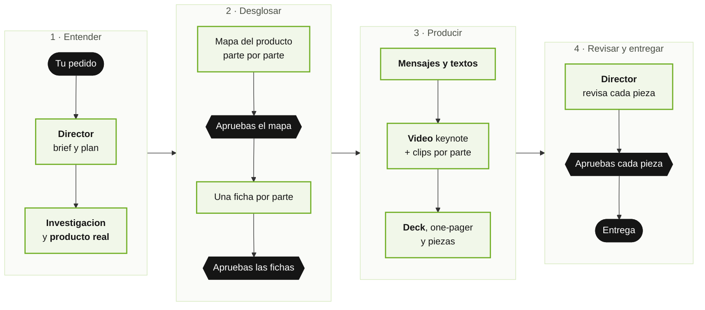
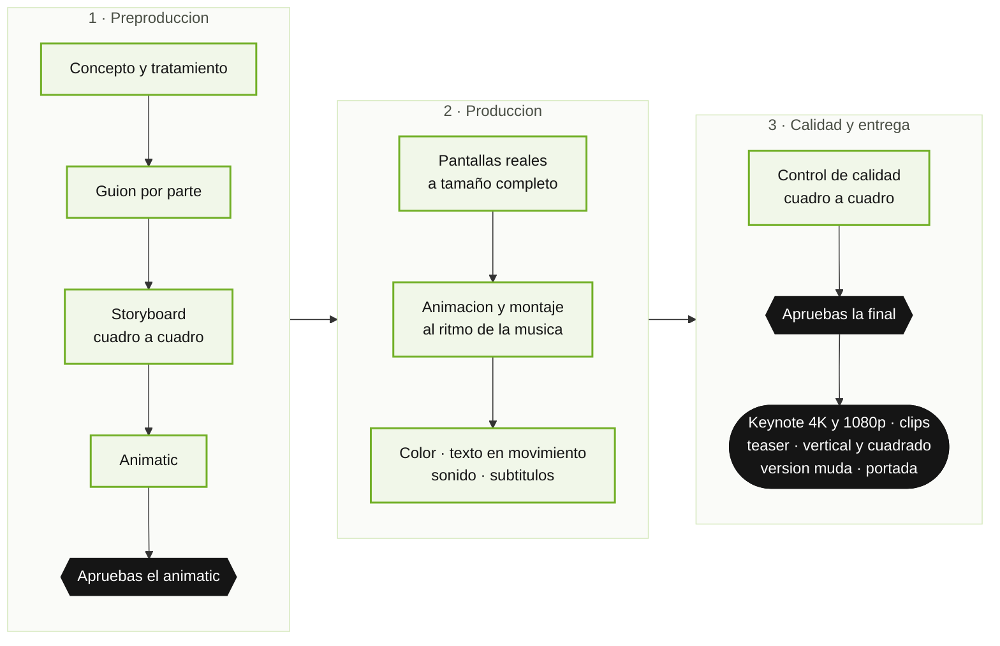

# Marketing, Ventas y Publicidad — Manual de Usuario

**Version del plugin:** 1.0.0 · **Integrantes del equipo:** 8 · **Comandos:** 10

Marketing es un **equipo de asistentes de inteligencia artificial que prepara todo lo necesario
para vender** lo que FAAST construye: la propuesta comercial para el CEO de una financiera, el
lanzamiento de un modulo, las mejoras que hay que contarle a la cartera de clientes. Produce
videos de presentacion con lenguaje de lanzamiento (como un keynote de Apple o la presentacion de
un auto de alta gama), presentaciones, one-pagers, panfletos, piezas para redes y estudios de
competencia, siempre con el producto **real** y con cada cifra respaldada.

Su idea central es simple: **una presentacion generica no vende**. Por eso el equipo nunca arma
"la presentacion del producto": primero lo **desglosa parte por parte**, te muestra cada parte con
su prueba, tu apruebas, y recien ahi se producen las piezas.

Tu decides que se vende, a quien y que sale; el equipo investiga, escribe, diseña y produce, y te
pide aprobacion antes de cada paso importante. No necesitas saber programar. Este manual esta
escrito para quien vende, para quien dirige un area y para quien nunca abrio una herramienta
tecnica. La parte tecnica (instalar y configurar a fondo) esta al final, separada, en el **Anexo
tecnico**.

---

## Indice

**Parte 1 — Para todas las personas**
- [Antes de empezar: instalacion paso a paso](#antes-de-empezar-instalacion-paso-a-paso)
1. [En dos minutos: como se usa](#1-en-dos-minutos-como-se-usa)
2. [Conoce al equipo](#2-conoce-al-equipo)
3. [Las palabras que vas a escuchar](#3-las-palabras-que-vas-a-escuchar)
4. [Las reglas de la casa](#4-las-reglas-de-la-casa)
5. [Que puedes pedir (lista de comandos)](#5-que-puedes-pedir-lista-de-comandos)

**Parte 2 — Situaciones reales, paso a paso**
- [Caso 1: Preparar la propuesta comercial de Faast2.0 para un CEO](#caso-1--preparar-la-propuesta-comercial-de-faast20-para-un-ceo)
- [Caso 2: Solo quiero el desglose del producto](#caso-2--solo-quiero-el-desglose-del-producto)
- [Caso 3: Investigar mercado, competencia y benchmark](#caso-3--investigar-mercado-competencia-y-benchmark)
- [Caso 4: Un video de lanzamiento (la pieza critica)](#caso-4--un-video-de-lanzamiento-la-pieza-critica)
- [Caso 5: Solo una presentacion (deck)](#caso-5--solo-una-presentacion-deck)
- [Caso 6: Un one-pager, un panfleto o piezas para redes](#caso-6--un-one-pager-un-panfleto-o-piezas-para-redes)
- [Caso 7: Mantener las tendencias al dia](#caso-7--mantener-las-tendencias-al-dia)
- [Caso 8: Cargar o validar la marca](#caso-8--cargar-o-validar-la-marca)
- [Caso 9: Ver el estado de una campana](#caso-9--ver-el-estado-de-una-campana)

**Parte 3 — Preguntas frecuentes y problemas comunes**
- [Preguntas frecuentes](#preguntas-frecuentes)
- [Si algo no anda](#si-algo-no-anda)

**Anexo tecnico (para quien instala y configura)**
- [A. Instalacion y actualizacion](#a-instalacion-y-actualizacion)
- [B. Configuracion del equipo](#b-configuracion-del-equipo)
- [C. La carpeta de marketing](#c-la-carpeta-de-marketing)
- [D. Cuidar el consumo](#d-cuidar-el-consumo)
- [E. Solucion de problemas tecnicos](#e-solucion-de-problemas-tecnicos)

---

# Parte 1 — Para todas las personas

## Antes de empezar: instalacion paso a paso

Esto se hace **una sola vez por computadora**. Toma unos 10 minutos. Si ya usas el equipo de
desarrollo (dev-team) o la Mesa de Servicios, el Paso 3 ya esta hecho y puedes saltarlo.

### Paso 1 — Tener Claude Code instalado y con tu sesion iniciada

Claude Code es el programa donde vive el equipo. Si no lo tienes, pidele a quien administra los
equipos de tu area que lo instale (o sigue la guia oficial de instalacion de Claude Code).

**Como saber si ya esta:** abre la terminal (ver Paso 2) y escribe:
```
claude --version
```
**Que ves:** un numero de version (por ejemplo `2.x.x`). Si en cambio dice "command not found" o
"no se reconoce", Claude Code no esta instalado.

**La primera vez que lo abres** (escribiendo `claude`), te pide iniciar sesion: se abre el
navegador, entras con tu cuenta de trabajo y vuelves a la terminal. Desde ahi queda recordado.

### Paso 2 — Abrir la terminal o el editor

La terminal es una ventana donde se escribe en vez de hacer clic. No te asustes: solo vas a
escribir lo que dice este manual.

| Si usas… | Como abrirla |
|---|---|
| **Mac** | Presiona `Cmd + Espacio`, escribe **Terminal** y presiona Enter |
| **Windows** | Abre el menu Inicio, escribe **Terminal** (o **PowerShell**) y presiona Enter |
| **Visual Studio Code** con la extension de Claude Code | Abre el panel de Claude Code desde la barra lateral; ahi escribes igual que en la terminal |

En la terminal escribe `claude` y presiona Enter.

**Que ves:** la pantalla de bienvenida de Claude Code y, abajo, una linea donde escribir. Todo lo
que sigue se escribe en esa linea.

### Paso 3 — Agregar el marketplace de FAAST

El "marketplace" es la tienda interna de FAAST de donde se instalan los equipos. Escribe:
```
/plugin marketplace add faast-app/faast-claude-marketplace
```
**Que ves:** un mensaje que confirma que el marketplace `faast-marketplace` quedo agregado.

> Si aparece un error de acceso, pide a quien administra GitHub en FAAST que te de acceso al
> repositorio `faast-app/faast-claude-marketplace`.

### Paso 4 — Instalar el equipo de Marketing

Escribe:
```
/plugin install marketing@faast-marketplace
```
**Que ves:** la confirmacion de que el plugin `marketing` quedo instalado. Si te pregunta para
quien instalarlo, elige la opcion para **tu usuario** (asi lo tienes en cualquier carpeta).

### Paso 5 — Reiniciar Claude Code

El equipo se carga al abrir Claude Code, asi que hay que cerrarlo y abrirlo. Escribe:
```
/exit
```
y luego vuelve a abrir con `claude`.

**Como comprobar que quedo bien:** escribe `/marketing:` (con los dos puntos) y espera un
segundo. **Que ves:** la lista de los 10 comandos del equipo (`/marketing:start`,
`/marketing:propuesta-comercial`, `/marketing:video`…). Si la ves, esta listo.

### Paso 6 — Abrir Claude Code en la carpeta del proyecto y el primer `/marketing:start`

El equipo trabaja "por proyecto" (por ejemplo, Faast2.0). Conviene abrir Claude Code **en la
carpeta del proyecto**, la misma donde trabajan el equipo de desarrollo o la Mesa.

1. En la terminal escribe `cd ` (con un espacio al final), **arrastra la carpeta del proyecto**
   desde el Finder o el Explorador hasta la ventana de la terminal (se pega su ruta sola) y
   presiona Enter.
2. Escribe `claude` y presiona Enter.
3. Escribe:
```
/marketing:start
```

**Que ves la primera vez:**
- El equipo te propone **donde crear su carpeta de trabajo** (en la carpeta del proyecto, nunca
  dentro de un repositorio de codigo) y te pide confirmarla.
- Te hace **una sola ronda de preguntas**, en un mensaje, con lo que ya detecto propuesto como
  opcion:
  - Que producto vas a vender y que version (por ejemplo, Faast2.0).
  - Donde estan sus fuentes: la carpeta del equipo de desarrollo, la de la Mesa, prototipos.
  - Si hay un **ambiente demo** con datos ficticios para capturar pantallas (su direccion web). El
    usuario y la clave **no se escriben en el chat**: quien configura los deja guardados en la
    computadora y al equipo solo se le dice el nombre con que se guardaron.
  - A quienes les vendes normalmente (CEO, gerente comercial, cliente final) y en que paises.
  - Si existe un manual de marca (si no, se parte de lo que el equipo ya verifico de FaaST).
- Revisa que la computadora tenga lo necesario para producir (video, documentos, capturas) y te
  dice que falta. **No instala nada sin tu OK.**
- Te ofrece cargar la marca (`/marketing:marca`) y sembrar la base de tendencias
  (`/marketing:tendencias`).
- Cierra mostrandote como empezar: `/marketing:propuesta-comercial "Faast2.0 para el CEO de ..."`.

**Que ves las siguientes veces:** un resumen de 3 lineas (campanas en curso, que espera tu
aprobacion, como esta la marca y las tendencias) y la pregunta de que quieres hacer.

> Lo que no sepas responder en la configuracion queda anotado como **pendiente**. No se inventa
> nada para "rellenar".

---

## 1. En dos minutos: como se usa

1. Alguien instala el plugin una vez (ver [Antes de empezar](#antes-de-empezar-instalacion-paso-a-paso)).
2. Abres Claude Code **en la carpeta del proyecto**.
3. Escribes esto y cuentas que quieres vender, como se lo dirias a un colega:

```
/marketing:start
```

Ejemplos de lo que puedes escribir despues (o en la misma linea):

| Lo que escribes | Lo que pasa |
|---|---|
| `/marketing:start` | El equipo mira en que estas y te propone que hacer |
| `/marketing:start propuesta de Faast2.0 para el CEO de una financiera de Chile` | Arma el paquete comercial completo: desglose, video, deck y one-pager |
| `/marketing:start necesito un video del modulo de confirming` | Prepara el video, partiendo por el desglose y la preproduccion |
| `/marketing:start ¿quienes compiten con nosotros en Peru?` | Investiga la competencia con fuente y fecha |
| `/marketing:start ¿como vamos?` | Te resume las campanas: que espera tu aprobacion, que esta listo |

**Asi avanza una campaña** (en negro, tus aprobaciones):



**Tres cosas que siempre van a pasar:**

- **El producto se muestra desglosado, parte por parte.** Primero te presentan el mapa del
  producto y una ficha por parte; tu apruebas. Sin eso no se produce ninguna pieza.
- **Nada se inventa.** Cada cifra lleva su fuente y su fecha; lo que no tiene respaldo se marca
  como supuesto, a la vista.
- **Ninguna pieza sale sin tu aprobacion.** Te presentan el plan antes de empezar y cada pieza
  antes de darla por terminada. El equipo nunca envia nada al cliente: eso lo haces tu.

> **Lo que espera tu respuesta no se pierde.** Si el equipo te dejo una pregunta o una pieza
> esperando tu aprobacion, queda anotada y te la recuerda al abrir la siguiente sesion, en una
> lista corta, para que decidas como seguir.

> Si solo quieres saber como van las cosas, `/marketing:estado` es rapido y no cambia nada.

---

## 2. Conoce al equipo

Piensa en una agencia de marketing pequeña, con su director, su investigador, su experto en el
producto, su estratega, su redactor, su diseñador de presentaciones, su productora de video y su
diseñador grafico. Estos son sus 8 integrantes.

| Integrante | Que hace, en palabras simples | Cuando aparece |
|---|---|---|
| 🎯 **director-marketing** (el director) | Arma el brief contigo, presenta el plan, reparte el trabajo, revisa cada pieza con su lista de control y te la trae para aprobar. Es el unico que puede pedir ayuda a los demas | Detras de cada campana; lo ves al aprobar planes y piezas |
| 🔭 **investigador-mercado** (el investigador) | Investiga el mercado, la competencia y las tendencias en fuentes publicas. Cada dato con su fuente, su fecha y que tan confiable es | Contexto de mercado, competencia, benchmark, tendencias |
| 🧩 **analista-producto** (el que conoce el producto) | Lee el producto de verdad (lo que hizo el equipo de desarrollo, lo que pidieron los clientes en la Mesa, el ambiente demo) y lo desglosa en partes con su ficha y sus pantallas reales. Nunca infla ni inventa funciones | Siempre primero: el mapa del producto |
| ♟️ **estratega-comercial** (el estratega) | Define la propuesta de valor, los mensajes para cada publico, el orden en que se cuentan las partes, las objeciones y "que gana el cliente" en numeros, con formula y supuestos | Despues del mapa, para cerrar fichas y antes del texto |
| ✍️ **redactor-publicitario** (el redactor) | Escribe los titulares, los textos de cada lamina, los guiones del video y los textos de impresos y redes, con la voz de FaaST | Cuando las fichas y la estrategia estan aprobadas |
| 🖥️ **disenador-presentaciones** (el de las presentaciones) | Arma el deck con estetica de lanzamiento: una seccion por parte, capturas reales, cifras grandes con su nota. En PowerPoint editable, PDF o version web | Para la propuesta, el benchmark o la version corta para enviar |
| 🎬 **director-motion** (la productora de video) | El video completo, como una productora: idea, guion, storyboard cuadro a cuadro, animatic, grabacion real del producto, produccion, sonido, entregas por formato y control de calidad cuadro a cuadro | Todo video; en toda propuesta comercial |
| 🎨 **disenador-grafico** (el diseñador grafico) | One-pagers, panfletos por parte, piezas para redes y la identidad de cada campana, sobre la marca FaaST, listos para imprimir o publicar | Impresos y redes |

> **Profesionales de su oficio:** cada integrante trabaja con el estandar de un profesional
> experimentado de su area: sigue un metodo paso a paso, entrega en un formato fijo, revisa su
> propio trabajo con una lista de control antes de entregarlo y evita los errores tipicos de su
> oficio.

> **El video es la pieza critica.** Es lo que el CEO ve primero y lo que se reenvia. Por eso la
> productora de video es el integrante mas exigente del equipo y toda propuesta comercial lo
> incluye.

> **Sobre el costo:** todos los integrantes usan el mismo "cerebro" intermedio por defecto. Si
> una campana lo amerita, se puede subir a uno mas potente para un integrante (ver
> [Anexo B](#b-configuracion-del-equipo)).

---

## 3. Las palabras que vas a escuchar

| Palabra | Que significa |
|---|---|
| **Campana** | Todo el trabajo para vender algo a alguien: "Faast2.0 para el CEO de Financiera Austral". Tiene un numero unico (`CMP-2026-001`) y su propia carpeta |
| **Brief** | La hoja de partida: que se vende, a quien, que decision debe tomar esa persona, que piezas, para cuando y que no se puede decir |
| **Mapa del producto** | La lista de las partes del producto (entre 4 y 10) con un nombre de negocio, su estado real y su evidencia. Es lo primero que se aprueba |
| **Parte** | Una unidad que un ejecutivo entiende como un resultado propio: "Aprobar en minutos", "Ver el riesgo antes de girar". Puede ser un modulo, una capacidad o una mejora |
| **Ficha** | La hoja de cada parte: que es y para quien, que problema resuelve y cuanto cuesta, como funciona con pantallas reales, que gana el cliente en numeros, antes y despues, y frente a la competencia |
| **Estado de una parte** | **Disponible** (funciona y hay evidencia), **en construccion** (se esta haciendo) u **hoja de ruta** (decidido, todavia sin construir). Lo que no esta disponible nunca se cuenta en presente |
| **Doble aprobacion** | Tu apruebas primero el mapa (que partes y en que orden) y despues las fichas. Recien ahi se producen piezas |
| **Pieza** | Cada cosa que se entrega: el video, el deck, el one-pager, un panfleto, un post |
| **Video keynote** | El video principal (2 a 4 minutos) con **un capitulo por parte**, como la presentacion de un lanzamiento |
| **Clip por parte** | Un video corto (6 a 15 segundos) de una sola parte, para usarlo suelto en un correo o en redes |
| **Teaser** | Un video de expectativa de 15 a 30 segundos, que muestra detalles sin explicar |
| **Version muda** | El mismo video sin sonido, con subtitulos, para LinkedIn o una sala sin audio |
| **Poster** | La imagen de portada de cada video |
| **Formatos 16:9, 9:16 y 1:1** | Horizontal (pantalla o proyector), vertical (historias, celular) y cuadrado (feed de redes). Los verticales y cuadrados se **recomponen**, no se recortan del horizontal |
| **Preproduccion** | Todo lo que se decide antes de producir un video: la idea, el tono, el guion y el storyboard |
| **Tratamiento** | Una pagina que describe como se va a sentir el video: luz, colores, ritmo, musica, como aparece el producto |
| **Storyboard** | El video dibujado plano por plano, con la duracion de cada uno y que se ve en pantalla |
| **Animatic** | Un borrador del video en tiempo real, con la musica, para aprobar el ritmo y los tiempos antes del detalle final |
| **Render** | La fabricacion del archivo final del video. Solo se hace con tu aprobacion |
| **Control de calidad cuadro a cuadro** | La revision final de cada video: que se vea nitido, que los textos se alcancen a leer, que el sonido este al nivel correcto. Termina en **APTO** o **NO APTO** |
| **Deck** | La presentacion (laminas), en PowerPoint editable, PDF o version web |
| **One-pager** | El producto desglosado en una sola hoja: un bloque por parte |
| **Panfleto** | Un impreso dedicado a **una** parte, cuando esa parte lo merece |
| **Benchmark** | La comparacion contra la competencia, parte por parte, con fuente. Dice donde FAAST gana, empata y pierde |
| **Fuente** | De donde sale un dato: un regulador, un estudio, un sitio. Cada una con su fecha y su nivel de confianza |
| **Supuesto** | Una estimacion propia cuando no hay dato publico. Siempre marcada como tal, con su calculo a la vista y como validarla con el cliente |
| **Tendencia / moda / señal** | Tendencia: algo sostenido que cambia decisiones. Moda: mucha visibilidad, poca sustancia. Señal: un indicio temprano que se vigila. Cada una con fecha de vencimiento |
| **Kit de marca** | Lo verificado de la marca FaaST: como se escribe el nombre, colores, tipografias, logo, voz, y lo que sigue pendiente de confirmar |
| **Ambiente demo** | Una copia del producto con datos ficticios donde se capturan pantallas y recorridos. Nunca se graba en produccion |
| **Entregables** | La carpeta donde quedan las piezas **aprobadas**, con su nombre final |
| **Pendiente** | Algo que quedo esperando tu respuesta o tu aprobacion. Queda registrado y el equipo te lo recuerda al abrir cada sesion |
| **Carpeta de marketing** | Donde el equipo guarda su trabajo (campanas, capturas, piezas, investigacion). Esta en la carpeta del proyecto, **fuera** de los repositorios de codigo |
| **Plan primero** | La regla de que nadie investiga en serio, desglosa ni produce sin mostrarte antes el plan y esperar tu "adelante" |

---

## 4. Las reglas de la casa

Estan siempre activas. No hay que pedirlas.

1. **El producto se muestra desglosado, parte por parte.** Nunca una presentacion generica
   ("FAAST es una plataforma integral que potencia tu negocio"). Toda campana empieza por el mapa
   del producto y una ficha por parte, y todas las piezas lo siguen: el deck tiene una seccion por
   parte, el video un capitulo por parte mas un clip por parte, el one-pager un bloque por parte.
   Si pides "una lamina de beneficios", el equipo te propone llevar cada beneficio al resultado de
   su parte.
2. **Nada se inventa.** Cada cifra, comparacion o afirmacion tiene fuente y fecha. Lo que no tiene
   respaldo se marca como **supuesto**, con su calculo en el anexo. Nada de "segun estudios".
3. **El producto se muestra real.** Toda pantalla es una captura del ambiente demo con datos
   ficticios, un prototipo del proyecto rotulado "Prototipo" o una maqueta rotulada "Concepto".
   Jamas una pantalla imaginada ni un panel generico. Si una parte no tiene nada visible, se
   muestra como hoja de ruta.
4. **Estado honesto.** Lo que esta en construccion o en la hoja de ruta se dice asi, nunca en
   presente. Una hoja de ruta honesta tambien vende.
5. **Ninguna pieza sale sin tu aprobacion.** Apruebas el mapa, las fichas, la preproduccion del
   video y cada pieza en cada version. Lo no aprobado no pasa a entregables. Y el equipo **nunca
   envia ni publica** nada: el envio o la presentacion al cliente la haces tu.
6. **Plan primero.** Antes de investigar, desglosar, producir una pieza o refrescar tendencias, te
   muestran en pocas lineas que se hara, quien lo hara y que se necesita de ti, y esperan tu OK.
   Mirar el estado o consultar no lo necesita.
7. **Confidencialidad.** En piezas para el cliente no aparecen nombres de clientes sin
   autorizacion, datos reales, numeros de tickets, rutas internas ni detalles de como esta
   construido el sistema. Lo que el equipo sabe por la Mesa o por los clientes es interno.
8. **La marca FaaST.** En piezas externas el nombre se escribe **FaaST** ("FaaST.app" solo donde
   va el dominio o el logo). La paleta es **verde, blanco y, a veces, negro**; **sin azul**,
   aunque aparezca en el sitio web. El logo nunca se redibuja, recolorea ni deforma. Los logos de
   los clientes que aparecen en el sitio estan **autorizados** y se usan tal cual, sin
   recolorear, anotando en el brief que pieza los usa.
9. **Precios solo de comercial.** El equipo no pone precios, descuentos, plazos ni condiciones.
   Mientras comercial no los entregue, la pieza dice "a definir por comercial".
10. **Marcas ajenas, nunca como propias; competidores, con respeto.** "No publica" no es "no
    tiene": para decir que un competidor no hace algo, tiene que estar documentado. De los
    grandes referentes (Apple, Ferrari, perfumes) se toma el lenguaje, nunca su marca, su musica
    ni sus frases.
11. **El video se trata como en una productora.** Nada se produce sin preproduccion aprobada, nada
    de "presentacion de fotos animadas", y nada se entrega sin el control de calidad cuadro a
    cuadro en APTO.
12. **Todo con licencia.** Musica, efectos de sonido, voz, tipografias: con licencia que cubra el
    uso (web, sala, redes), registrada.
13. **Las capturas, solo en ambientes de prueba con datos ficticios.** Nunca se graba el producto
    en produccion.
14. **La carpeta de marketing, fuera de los repositorios.** Campanas, capturas, piezas e
    investigacion viven en la carpeta del proyecto, nunca dentro de un repositorio de codigo. Un
    control impide guardarla dentro de uno; si alguna quedo adentro, el equipo te avisa y te
    propone moverla. Las carpetas de los otros equipos (desarrollo, Mesa) **solo se leen**, nunca
    se escriben.
15. **Tus pedidos valen aunque los pases por la sesion o por el director.** Si escribes "dile al
    redactor que acorte el titular de la parte 2", el integrante lo hace: no exige que le
    escribas a el directamente. La unica excepcion: cuando Claude Code te pide aprobar un permiso
    en pantalla, eso lo apruebas tu.
16. **Los pendientes no se pierden.** Lo que espera tu respuesta o tu aprobacion queda registrado
    y aparece al iniciar cada sesion hasta que lo resuelvas.

---

## 5. Que puedes pedir (lista de comandos)

Recuerda: con `/marketing:start` y una frase basta. Esta lista es para cuando ya sabes
exactamente que quieres.

**Todos los dias**

| Escribes | Que consigues |
|---|---|
| `/marketing:start` | El punto de partida: mira en que estas y te guia |
| `/marketing:estado` | Como van las campanas: que espera tu aprobacion, que esta trabado, que sigue (ver [Caso 9](#caso-9--ver-el-estado-de-una-campana)) |
| `/marketing:estado --esperando` | Solo lo que espera tu respuesta, ordenado por dias |

**Vender**

| Escribes | Que consigues |
|---|---|
| `/marketing:propuesta-comercial "{producto} para {publico}"` | El paquete completo para un ejecutivo: desglose, video keynote y clips, deck y one-pager (ver [Caso 1](#caso-1--preparar-la-propuesta-comercial-de-faast20-para-un-ceo)) |
| `/marketing:desglose` | El mapa del producto y una ficha por parte; siempre lo primero (ver [Caso 2](#caso-2--solo-quiero-el-desglose-del-producto)) |
| `/marketing:desglose actualizar` | Pone al dia el desglose cuando el producto avanzo |

**Piezas**

| Escribes | Que consigues |
|---|---|
| `/marketing:video keynote` | El video principal, con un capitulo por parte (ver [Caso 4](#caso-4--un-video-de-lanzamiento-la-pieza-critica)) |
| `/marketing:video clips` | Un clip de 6-15 segundos por cada parte |
| `/marketing:video parte P02` | El clip de una sola parte (y su version extendida si la pides) |
| `/marketing:video teaser` | Video de expectativa de 15-30 segundos |
| `/marketing:video redes` | Versiones vertical y cuadrada, con subtitulos, de los videos aprobados |
| `/marketing:video preproduccion` | Solo la idea, el tono, el guion, el storyboard y el animatic, para aprobar |
| `/marketing:video revisar {archivo}` | Control de calidad cuadro a cuadro de un video que ya existe |
| `/marketing:presentacion` | El deck de propuesta; tambien `benchmark` o `corta` para enviar (ver [Caso 5](#caso-5--solo-una-presentacion-deck)) |
| `/marketing:pieza one-pager` | El producto desglosado en una hoja (ver [Caso 6](#caso-6--un-one-pager-un-panfleto-o-piezas-para-redes)) |
| `/marketing:pieza panfleto P03` | Un panfleto dedicado a una parte |
| `/marketing:pieza redes linkedin` | Piezas para redes; con `--carrusel`, una parte por lamina |

**Saber**

| Escribes | Que consigues |
|---|---|
| `/marketing:investigar mercado` | Tamaño, crecimiento, regulacion y el costo de los problemas, por pais (ver [Caso 3](#caso-3--investigar-mercado-competencia-y-benchmark)) |
| `/marketing:investigar competencia` | Quienes compiten y que declaran publicamente |
| `/marketing:investigar benchmark` | La comparacion parte por parte contra la competencia |
| `/marketing:tendencias` | Refresca la base de tendencias; se puede programar semanal (ver [Caso 7](#caso-7--mantener-las-tendencias-al-dia)) |
| `/marketing:tendencias listar` | Ver las tendencias vigentes y vencidas, sin cambiar nada |

**Marca**

| Escribes | Que consigues |
|---|---|
| `/marketing:marca` | Carga el kit de marca FaaST verificado (ver [Caso 8](#caso-8--cargar-o-validar-la-marca)) |
| `/marketing:marca validar` | Revisa contrastes, licencias, logo y vigencia de las cifras |
| `/marketing:marca pendientes` | Lo que falta confirmar de la marca y a quien pedirlo |

---

# Parte 2 — Situaciones reales, paso a paso

Cada caso muestra la situacion, **que escribes exactamente**, que hace el equipo y que recibes al
final. Los ejemplos usan una financiera ficticia ("Financiera Austral", de Chile). Las partes, cifras
y pantallas de los ejemplos son **ilustrativas**: en un caso real salen de las fuentes del
proyecto, nunca del ejemplo.

## Caso 1 — Preparar la propuesta comercial de Faast2.0 para un CEO

**Situacion:** en tres semanas tienes reunion con el CEO de Financiera Austral. Quieres llegar con
algo que se recuerde: un video que abra la reunion, una presentacion que lo explique y una hoja
para dejarle. Y que todo muestre el producto real.

**Que escribes:**
```
/marketing:propuesta-comercial "Faast2.0 para el CEO de Financiera Austral" --pais CL --fecha 2026-11-06
```

Esto activa el flujo completo. Estos son sus pasos y lo que ves en cada uno.

### Paso 1 — El brief (una ronda, maximo cinco preguntas)

El director crea la campana (`CMP-2026-001-faast2-ceo-austral`) y te pregunta solo lo que no
encontro en ninguna fuente. Por ejemplo:

```
Brief — CMP-2026-001 · Faast2.0 para el CEO de Financiera Austral (CL)
1. ¿Que decision queremos que tome el CEO despues de verlo?
   a) agendar una demo con sus datos  b) aprobar un piloto acotado  c) firmar  d) otra: ___
2. ¿Conoce FaaST?  a) nada  b) de oidas  c) ya nos evaluo antes
3. ¿Podemos nombrar a algun cliente actual como caso? ¿Cual y quien lo autorizo?
4. ¿Hay precios? a) los entrega comercial (¿quien y cuando?)  b) la pieza dice "a definir por comercial"
5. ¿Como se usara?  a) reunion presencial con proyector  b) envio por correo  c) ambas
```

Lo que no sepas queda como pendiente en el brief, no se supone. La decision objetivo importa
mucho: "dar a conocer" no es una decision; "agendar una demo con sus datos" si.

### Paso 2 — El plan, antes de hacer nada

```
Plan — CMP-2026-001
Partes probables (primer barrido): aprobacion, riesgo, acceso seguro, multimarca, cumplimiento tributario
Orden: investigacion de mercado ∥ inventario del producto → mapa (tu apruebas) → fichas (tu apruebas)
       → estrategia y textos → video ∥ deck ∥ one-pager en paralelo
Necesito de ti: acceso al ambiente demo, autorizacion para mostrar el tiempo medido en demo
Piezas: keynote 3 min (+4K para sala, version muda) · un clip por parte · deck · one-pager
Fecha: preproduccion del video lista en 6 dias habiles; todo para el 06-11
¿Adelante?
```

Tu respondes "adelante", "cambia esto" o "mejor de otra forma".

### Paso 3 — El mapa del producto (primera aprobacion)

El que conoce el producto lee las fuentes reales (lo que construyo el equipo de desarrollo, lo
que pidieron los clientes en la Mesa, el ambiente demo) mientras el investigador revisa el
mercado. Recibes el mapa como tabla:

```
Mapa del producto — Faast2.0 para CEO de financiera (CL) · CMP-2026-001 · v1
| ID  | Parte                                  | Valor en una linea                        | Estado          | Pantalla           |
| P01 | Aprobar en minutos                     | Evaluar, decidir y girar en un solo flujo | disponible      | demo               |
| P02 | Ver el riesgo antes de girar           | Alertas del deudor antes de decidir       | disponible      | demo               |
| P03 | Una plataforma, muchas marcas          | Cada empresa con su logo y colores        | en construccion | prototipo          |
| P04 | Entrar seguro, sin claves que olvidar  | Cuenta de la empresa + segundo factor     | disponible      | demo               |
Orden propuesto: P01 → P02 → P04 → P03 (crecimiento → riesgo → seguridad → lo que viene)
Afirmaciones sin verificar (no van a piezas hasta confirmar): integracion con SUNAT.
¿Apruebas, quitas, unes, renombras o reordenas?
```

**Que puedes responder:** "apruebo", "apruebo pero P04 va al final", "une P02 y P04", "renombra
P03 como 'Tu marca, tu plataforma'". Tu respuesta queda registrada textual. Fijate en dos cosas:
los nombres son de **negocio** (nunca "Servicio de identidad" o "Core API"), y P03 dice **en
construccion**: el video y el deck la contaran como hoja de ruta, no como algo que ya existe.

### Paso 4 — Las fichas (segunda aprobacion)

Por cada parte aprobada se escribe su ficha, con sus pantallas reales capturadas en el ambiente
demo. Recibes una linea por ficha:

```
Fichas — CMP-2026-001
P01 Aprobar en minutos · hasta ~280 h/mes en 800 operaciones · estimacion (medicion en demo + supuestos S1, S2) · 3 pantallas demo · pendiente: tiempo actual real del cliente
P02 Ver el riesgo antes de girar · revisar al deudor en la misma pantalla en que decides · cualitativo · 3 pantallas demo · —
P04 Entrar seguro · cuenta de la empresa + segundo factor · cualitativo · 2 pantallas demo · —
P03 Una plataforma, muchas marcas · cada empresa con su marca sin desarrollo · hoja de ruta · prototipo rotulado · fecha a confirmar
¿Apruebas todas o alguna por separado?
```

Cada ficha responde seis preguntas: que es y para quien, que problema resuelve y cuanto cuesta,
como funciona paso a paso con pantallas reales, que gana el cliente en numeros, antes y despues,
y frente a la competencia. Agrega sus limites honestos y que se puede mostrar al cliente y que no.

> **Sin mapa y fichas aprobados no se produce ninguna pieza.** Si tienes apuro, el equipo comprime
> los tiempos (ver "Si la reunion es mañana" al final de este caso), pero no se salta el desglose.

### Paso 5 — Estrategia y textos

El estratega define la frase central, los tres pilares, el orden de las partes para un CEO y las
objeciones probables ("migrar un core es riesgoso", "son una empresa chica") con su respuesta
respaldada. El redactor escribe los titulares (3 a 5 opciones por parte, con la recomendada
marcada ★), el texto de cada lamina, el guion del video por capitulos y los textos del one-pager.
El director revisa que cada texto salga de su ficha.

Ejemplo de lo que ves para una parte:
```
P01 — Aprobar en minutos
★ "Aprobar ya no es esperar."   ·   "De tres pantallas a una."   ·   "Cada minuto cuenta. Ahora son cuatro."
Sub: "Evalua, decide y gira en un solo flujo."
Resultado: "De ~25 a ~4 minutos por operacion.[C1]"  Nota: "Estimacion; supuestos en anexo."
```

### Paso 6 — Produccion en paralelo (el video va primero)

Tres frentes trabajan a la vez:

- **Video** (el camino critico): primero te traen la **preproduccion** para aprobar: la idea en
  una frase, una pagina de tono, el guion y el storyboard por parte, y el **animatic** con la
  musica. Sin tu OK no se produce. Luego se graba el producto real, se produce, se mezcla el
  sonido y te muestran la vista previa. Todo el detalle esta en el
  [Caso 4](#caso-4--un-video-de-lanzamiento-la-pieza-critica).
- **Deck:** primero el storyboard (una fila por lamina), lo revisa el director, y luego se
  construye.
- **One-pager:** primero la identidad de la campana y un boceto de estructura, y luego la pieza.

### Paso 7 — La revision del director (antes de que tu veas nada)

Cada pieza pasa una lista de diez controles: sigue el desglose parte por parte; cada cifra con su
fuente; producto real; estado honesto; marca FaaST; confidencialidad; calidad de lanzamiento (una
idea por lamina, nada que parezca plantilla); accesibilidad (contraste, subtitulos, letra
legible); que los archivos abran y las tildes esten bien; y en el video, ademas, que no sea una
presentacion de fotos animadas y que su control de calidad este en APTO. Lo que falla vuelve al
especialista con la observacion concreta ("la lamina 14 tiene dos ideas: separala").

### Paso 8 — Tu aprobacion, pieza por pieza

Cada pieza te llega con su vista previa y tres lineas: que es, que tienes que decidir y que
cambiaria el director. Por ejemplo:

```
Deck de propuesta v1 — 28 laminas (4 secciones de parte) · vista previa: piezas/deck/preview/
Decidir: ¿abrimos con la cifra del problema o con el video?
Yo cambiaria: la lamina 9 (mercado) es densa; propongo pasarla al anexo.
```

Respondes "aprobado" o pides cambios en tus palabras ("la portada de P02 mas oscura", "saca la
lamina 9"). Un cambio genera una version nueva; la aprobada nunca se pisa.

### Paso 9 — La entrega

```
Propuesta CMP-2026-001 — Faast2.0 para CEO de Financiera Austral
Video:   entregables/Faast2.0-keynote-ceo-v1-2026-11-03.mp4 (+ 4K, muda, poster) · 4 clips (uno por parte)
Deck:    entregables/Faast2.0-deck-ceo-v2-2026-11-04.pptx | .pdf
Impreso: entregables/Faast2.0-one-pager-ceo-v1-2026-11-04.pdf
Pendiente: precios de comercial · validar con el cliente el tiempo actual por operacion
```

**Recuerda:** el envio o la presentacion al CEO la haces tu. El equipo te sugiere ademas que
reutilizar despues (los clips sueltos para redes, un panfleto por parte para la cartera).

**Variantes utiles del mismo pedido:**
- `--corta`: comprime los tiempos (mapa de 4 a 6 partes, keynote de 90 a 120 segundos).
- `--sin-impresos`: omite el one-pager. **El video keynote y los clips nunca se omiten.**
- `--formatos 16x9,9x16,1x1`: los clips tambien en vertical y cuadrado.

> **Si la reunion es mañana:** pide la version `--corta`. El equipo no se salta el desglose: lo
> hace mas chico y con fichas mas breves en el mismo dia, y te lo dice en el plan.

---

## Caso 2 — Solo quiero el desglose del producto

**Situacion:** todavia no hay reunion, pero quieres tener claro como se cuenta Faast2.0 parte por
parte, para usarlo despues en cualquier pieza.

**Que escribes:**
```
/marketing:desglose mapa --publico ceo
```

**Que hace el equipo:**
1. Te muestra el plan en cuatro lineas (que fuentes leera, si capturara en el ambiente demo, para
   que publico, cuando te trae el mapa) y espera tu OK.
2. El que conoce el producto lee las fuentes y propone entre 4 y 10 partes, cada una con nombre
   de negocio, estado real, la pantalla disponible y de donde salio. Si no hay campana abierta,
   crea una con un brief minimo.
3. Te presenta el mapa como en el [Caso 1, Paso 3](#paso-3--el-mapa-del-producto-primera-aprobacion)
   y registra tu decision.

**Despues, las fichas:**
```
/marketing:desglose fichas
```
Se escribe una ficha por parte (pueden hacerse en paralelo) y te llega una linea por ficha para
aprobar por lote o una por una.

**Otros usos:**
```
/marketing:desglose parte P05      # agregar o rehacer la ficha de una sola parte
/marketing:desglose actualizar     # el producto avanzo: propone cambios de estado y capturas nuevas
```

**Recibes:**
```
Desglose CMP-2026-002: 5 partes (3 disponibles · 1 en construccion · 1 hoja de ruta)
Mapa: APROBADO · Fichas: 5/5 aprobadas
Pendientes para ti: confirmar si la integracion con SUNAT ya opera en algun cliente
Siguiente: /marketing:video keynote · /marketing:presentacion · /marketing:pieza one-pager
```

**Como reconocer un buen nombre de parte:** empieza con un verbo o un resultado ("Aprobar en
minutos" si, "Motor de aprobaciones" no), un CEO entiende que gana con solo leerlo, no podria ser
el nombre de una funcion de cualquier software y tiene seis palabras o menos.

> **Cuando el producto avanza** (algo paso de "en construccion" a "disponible", hay un prototipo
> nuevo), `actualizar` lo detecta, te propone el cambio con su evidencia y marca las piezas que
> necesitan una version nueva. Una ficha aprobada nunca se reescribe en silencio.

---

## Caso 3 — Investigar mercado, competencia y benchmark

**Situacion:** antes de la reunion quieres saber cuanto mueve el factoring en Chile, quienes
compiten con FaaST y como se compara cada parte del producto.

**Que escribes** (uno o varios, segun lo que necesites):
```
/marketing:investigar mercado --pais CL
/marketing:investigar competencia --pais CL
/marketing:investigar benchmark --partes P01,P02,P04
```

**Que hace el investigador:**
1. Te muestra las preguntas concretas que va a responder (de 3 a 8), en que paises, en que tipo de
   fuentes y para que pieza o ficha sirve cada respuesta. Espera tu OK (en una linea si el pedido
   ya es claro).
2. Busca en fuentes publicas, de mas a menos confiables: reguladores y entes tributarios (CMF y
   SII en Chile, SBS y SUNAT en Peru, Superintendencia Financiera y DIAN en Colombia),
   organismos multilaterales, gremios, consultoras con metodo, prensa economica seria, y los
   sitios de los competidores (lo que dicen de si mismos se marca como "autodeclarado").
3. Va a la fuente original de cada dato y lo registra con su direccion web, fecha de publicacion,
   fecha de consulta y nivel de confianza. Cruza las cifras clave con una segunda fuente o las
   marca como "fuente unica". Un dato de mas de dos años se marca como antiguo.
4. En el benchmark, compara FaaST contra cada competidor y contra la **alternativa actual** del
   cliente (planillas, desarrollo propio, sistema antiguo), parte por parte, con una lectura
   honesta de donde gana, empata y pierde.

**Recibes** (la respuesta primero):
```
Investigacion benchmark — CMP-2026-001
Conclusion: en aprobacion en un solo flujo y riesgo en la decision, FaaST esta completo y 2 de 3
competidores son parciales; en multimarca, nadie publica informacion; la alternativa real del
cliente sigue siendo la planilla.
Cifra mas fuerte: {valor} — {fuente, año} [F003]
Debil o pendiente: tamaño de mercado de Peru solo con fuente unica
Archivos: investigacion/benchmark.md · fuentes.md (23 fuentes)
```

**Lo que nunca pasa:** decir que un competidor "no tiene" algo sin un documento que lo pruebe (se
dice "sin informacion publica a la fecha"); usar un numero sin fuente abierta y verificada;
entrar a sitios con usuario ajeno o usar informacion filtrada; mostrar en una pieza lo que se sabe
por la Mesa o por clientes.

> Sin campana abierta tambien funciona: la investigacion queda guardada por fecha y tema para
> usarla despues.

---

## Caso 4 — Un video de lanzamiento (la pieza critica)

**Situacion:** quieres el video que abra la reunion con el CEO y que despues se pueda reenviar y
publicar. Es la pieza que mas pesa: si parece una presentacion de fotos animadas, toda la
propuesta parece barata; si parece el lanzamiento de un producto de alta gama, con el producto
real de FaaST como protagonista, la conversacion empieza ganada.

**Que escribes:**
```
/marketing:video keynote --campana CMP-2026-001 --4k
```

**Las etapas del video** (en negro, lo que apruebas tu):



### Que necesita antes de empezar

- **Mapa y fichas aprobados.** Sin ellos el video saldria generico; si faltan, el equipo te lleva
  primero al [Caso 2](#caso-2--solo-quiero-el-desglose-del-producto) y te explica por que.
- **Los guiones del redactor** (si faltan, se piden).
- **El ambiente demo** con datos ficticios, o los prototipos del proyecto.
- **Las herramientas de video instaladas.** Si faltan, te ofrecen tres caminos: instalarlas (con
  tu OK), hacer el video con una alternativa mas simple grabada a tamaño real, o entregarte el
  paquete de preproduccion completo para una productora externa. Nunca te entregan un video a
  medias como si fuera el final.

### Paso 1 — El plan

```
Plan — Video keynote · CMP-2026-001
Piezas: keynote 16:9 en 1080p y 4K para sala + version muda + poster; clips por parte despues
Duracion: ~3 min · Capitulos: Apertura → Problema → P01 → P02 → P04 → Prueba → Hoja de ruta (P03) → Cierre
Concepto: "FaaST revela la operacion financiera como un hiperdeportivo: pieza por pieza, cada una con su cifra"
Musica: elegante, 80 BPM, con licencia · Voz en off: no (solo musica y texto en pantalla)
Material real: P01, P02 y P04 con recorrido en demo; P03 con prototipo rotulado
Entregas: preproduccion en 4 dias, vista previa en 9, render final con tu aprobacion
¿Adelante?
```

Si quieres voz en off, pidelo (`--voz`): se graba o se genera con licencia, y nunca lee el mismo
texto que aparece en pantalla.

### Paso 2 — La preproduccion (se aprueba antes de producir)

Recibes, en este orden:

| Entregable | Que es | Para que lo apruebas |
|---|---|---|
| **Concepto** | La idea en una frase + tres referencias de lenguaje (que se toma de cada una) | Que se entienda sin ver el video y no sea "un video corporativo" |
| **Tratamiento** | Una pagina: tono, luz (estudio oscuro o blanco infinito), colores, ritmo, caracter de la musica, como aparece el producto, como aparece la marca | Que puedas decir si o no en un minuto |
| **Guion por parte** | Para cada capitulo: gancho, revelacion, como funciona, resultado; el texto en pantalla (maximo 7 palabras por cartela) y la cifra con su nota | Que todo salga de la ficha aprobada |
| **Storyboard cuadro a cuadro** | Plano por plano: duracion, tipo de plano, movimiento de camara, que pantalla real se usa, texto, sonido, transicion | Que ningun plano quede sin material real y que la suma de tiempos cuadre |
| **Animatic** | El video en borrador, en tiempo real, con la musica | El ritmo y los tiempos: que los golpes de musica caigan en los cortes y que nada se lea apurado |

**Asi se estructura el keynote** (2 a 4 minutos):

| Bloque | Duracion | Que pasa |
|---|---|---|
| Apertura | 6-12 s | Negro, luz, un detalle del producto, la marca. No explica: intriga |
| Problema | 15-30 s | La tension con una cifra con fuente: cuanto cuesta seguir igual |
| **Un capitulo por parte** | 20-40 s cada uno | Titulo → revelacion → como funciona en la pantalla real → resultado con cifra |
| Prueba | 15-25 s | Benchmark, cifras de la marca citadas con fecha, todas las partes juntas |
| Hoja de ruta | 8-15 s | Lo que viene, dicho como lo que viene |
| Cierre | 6-10 s | La frase central, la marca y el siguiente paso |

**Como apruebas o pides cambios en la preproduccion:**
```
Apruebo concepto y tratamiento. En el animatic, el capitulo de P02 se siente lento: acortalo
a 25 segundos. Y la apertura, sin el sonido grave del principio.
```

### Paso 3 — La grabacion del producto real

La productora graba los recorridos y captura las pantallas **en el ambiente demo, con datos
ficticios** (o en el prototipo rotulado). Lo hace a tamaño real, sin cursor perdido, avisos ni
barras, con un recorrido lento y seguro. Cada grabacion se verifica automaticamente: **si salio
chica, borrosa o con bordes grises, se vuelve a grabar**; para marketing no se acepta una
grabacion "reparada". Cada pantalla queda anotada con su origen y su fecha.

### Paso 4 — Produccion y postproduccion

- Cada capitulo se arma por separado y despues se une en el keynote; los clips reutilizan el
  capitulo de su parte.
- La camara virtual se mueve con intencion: acercamientos lentos a un detalle real, la pantalla
  que se "desarma" en capas y se vuelve a armar, la cifra a pantalla completa.
- Se corta al ritmo de la musica, con respiros entre capitulos y un silencio antes de la cifra
  mas fuerte.
- El color se ajusta solo en el entorno: la pantalla del producto y el logo conservan sus colores
  exactos.
- Sonido con licencia, efectos sutiles, nivel de volumen estandar para web y redes, y subtitulos.

### Paso 5 — La vista previa y tu aprobacion

Recibes el enlace a la vista previa con **tres decisiones concretas**. Por ejemplo:
```
Vista previa keynote v1 — 3:04
1. ¿La cifra de P01 ("~4 min") se queda o la decimos cualitativa? (es estimacion, va con nota)
2. ¿El cierre con "Agenda una demo con tus datos" o con "Conversemos tus numeros"?
3. ¿Mantenemos el respiro de 2 s entre capitulos o lo bajamos a 1 s?
```

### Paso 6 — El render y las entregas

Solo con tu aprobacion se fabrican los archivos finales:

| Entrega | Formato | Para que |
|---|---|---|
| **Keynote master** | 16:9 en 4K | La sala con proyector o pantalla grande |
| **Keynote para envio** | 16:9 en 1080p | Correo, web |
| **Keynote mudo** | Igual, sin sonido y con subtitulos | LinkedIn en reproduccion automatica, salas sin audio |
| **Clip por parte** | 6-15 s, en 16:9, y en 9:16 y 1:1 si los pides | Usar una parte suelta en un correo, una historia o el feed |
| **Teaser** (si lo pides) | 15-30 s, 16:9 y 9:16 | Generar expectativa antes del lanzamiento |
| **Posters** | Una imagen por video | Portada o miniatura |
| **Subtitulos** | Archivos aparte por idioma | Plataformas que los cargan por separado |
| **Capitulos** | Lista con inicio y fin de cada capitulo | Saltar a una parte en la reunion |
| **Licencias** | Registro de musica, sonidos, voz y tipografias | Respaldo de que todo se puede usar |

**Asi es un clip por parte** (para que sepas que esperar):

| Tiempo | Que pasa |
|---|---|
| 0-2 s | Gancho: un detalle del producto o una palabra |
| 2-9 s | La parte revelada en su pantalla real |
| 9-12 s | La cifra con su nota |
| 12-15 s | La marca y el llamado ("Agenda una demo") |

Se entiende sin sonido. Los formatos vertical y cuadrado se **recomponen** para ese formato (no
se recorta el horizontal), con los textos dentro de la zona segura.

```
/marketing:video clips --campana CMP-2026-001 --formatos 16x9,9x16,1x1
/marketing:video parte P02 --extendida      # el clip de P02 + su version de 30-45 s
/marketing:video teaser
/marketing:video redes                       # vertical y cuadrado de todo lo aprobado
```

### Paso 7 — El control de calidad cuadro a cuadro

Antes de que llegue a ti como final, cada archivo se mide (resolucion, duracion, volumen, que no
haya negros ni imagenes congeladas) y se revisan fotogramas de **cada capitulo**: el producto real
nitido y a tamaño completo, los textos completos y legibles el tiempo minimo, la marca correcta y
ningun dato real ni interno. El informe termina en **APTO** o **NO APTO**, con las correcciones
por capitulo y segundo. **Una sola falla bloquea la entrega.**

### Como pedir cambios (en cualquier momento)

Di el capitulo o el segundo y lo que quieres, en tus palabras. Mientras mas concreto, mas rapido:

| En vez de… | Mejor… |
|---|---|
| "No me gusta" | "En el capitulo de P01, la cifra se ve muy poco tiempo" |
| "Cambia la musica" | "La musica del cierre se siente triste; algo mas firme" |
| "Hazlo mas corto" | "Baja el capitulo de P04 a 20 segundos" |
| "Que se vea mejor" | "En 1:35 la pantalla se ve chica: acercala" |

Cada cambio genera una version nueva (`v2`, `v3`); la aprobada nunca se pisa.

### Si ya tienes un video y quieres saber si esta bien

```
/marketing:video revisar ~/Descargas/video-lanzamiento.mp4
```
Recibes el informe APTO / NO APTO con lo que hay que corregir por capitulo y segundo. El video
original no se modifica.

**Lo que este equipo nunca hace en un video:** fotos que entran y salen con fundidos sin camara
ni ritmo; transiciones de plantilla; textos que no se alcanzan a leer; musica sin licencia;
capturas borrosas o con datos reales; pantallas de fantasia que el producto no tiene; imagenes de
archivo genericas (apretones de manos, ciudades de noche); copiar logos, sonidos o frases de los
referentes; grabar en produccion; o fabricar el final sin tu aprobacion.

---

## Caso 5 — Solo una presentacion (deck)

**Situacion:** ya tienes el desglose aprobado y necesitas el deck; o necesitas una version corta
para mandar por correo.

**Que escribes:**
```
/marketing:presentacion propuesta --formato pptx,pdf
/marketing:presentacion corta                 # 8-12 laminas que se entienden sin presentador
/marketing:presentacion benchmark             # deck comparativo parte por parte
```

**Que hace el diseñador de presentaciones:**
1. Plan: tipo, formatos, numero aproximado de laminas, orden de las partes y fecha. Tu OK.
2. **Storyboard:** una fila por lamina (bloque, parte, mensaje, imagen, texto, fuente) que revisa
   el director. Corregir aqui cuesta minutos; en el deck terminado, horas.
3. El sistema visual (letras, colores, como se tratan las capturas) y tres laminas de muestra.
4. El deck completo con vista previa de cada lamina, revisado por el director.
5. Te llega para aprobar; lo aprobado pasa a entregables.

**Asi se ordena el deck de propuesta:** apertura → contexto de mercado → **una seccion por parte**
(portada con la pantalla real, detalle, como funciona, resultado con cifra) → benchmark → hoja de
ruta → cierre con la propuesta → anexo de fuentes y supuestos.

**Lo que vas a notar:** una idea por lamina; el producto real como imagen principal; las cifras
fuertes a pantalla completa con su nota; letra grande (nunca menos de 24 puntos); notas para el
presentador en cada lamina (lo que se dice, no lo que se lee); y ninguna lamina generica tipo
"Nuestra solucion" o "Beneficios".

**Recibes:**
```
Deck propuesta v1 — CMP-2026-001: 26 laminas (4 secciones de parte)
Archivos: piezas/deck/deck-v1.pptx | .pdf · vista previa por lamina
Pendiente: precios de comercial · Esperando: tu aprobacion
```

> Si hay video, el deck puede llevar el clip de cada parte en su portada. Y si te piden "mas
> informacion", va a las notas del presentador, al anexo o a un panfleto de la parte, no a laminas
> recargadas.

---

## Caso 6 — Un one-pager, un panfleto o piezas para redes

**Situacion:** quieres dejarle al CEO una hoja con todo el producto, un impreso dedicado a la
parte que mas le intereso, y piezas para publicar en LinkedIn.

**Que escribes:**
```
/marketing:pieza one-pager --campana CMP-2026-001
/marketing:pieza panfleto P02
/marketing:pieza redes linkedin --carrusel
```

**Que hace el diseñador grafico:**
1. Plan: piezas, medidas, si es para imprenta o digital, que partes entran y fecha. Tu OK.
2. Si la campana no tiene identidad propia, la deriva de la marca FaaST (un recurso grafico y un
   tono del verde de marca, nunca un logo nuevo) y la aprueba el director.
3. Boceto de estructura → construccion → exporta a PDF o imagen → verifica cada archivo: que el
   texto no se desborde, contraste, tamaño minimo de letra, tildes, cifras con nota, codigo QR
   probado, medidas exactas.
4. Revision del director → tu aprobacion → entregables.

**Que es cada pieza:**

| Pieza | Que contiene |
|---|---|
| **One-pager** (A4; Carta con `--carta`) | Titular y bajada → un bloque por parte (4 a 8) con mini-captura real, nombre, una linea y cifra con nota → banda de prueba opcional → llamado y contacto → notas de fuente |
| **Panfleto** (A4, A5, diptico o triptico) | **Una** parte: portada con la parte, que es y para quien, como funciona en 3-4 pasos con capturas, que gana, antes y despues, contacto. Sin indicar la parte, el equipo te propone cuales merecen panfleto |
| **Redes** | LinkedIn, Instagram, banners. En carrusel: gancho → una parte por lamina → marca y llamado. Si hay clips aprobados, te sugiere combinarlos |

**Para imprimir:** agrega `--imprenta` y el PDF sale con sangrado y marcas de corte, mas una version
digital liviana aparte. Antes del tiraje se recomienda una prueba de color del verde de marca.

**Recibes:**
```
Pieza one-pager v1 — CMP-2026-001
Archivos: piezas/impresos/... · Verificacion: OK
Esperando: tu aprobacion
```

---

## Caso 7 — Mantener las tendencias al dia

**Situacion:** quieres que las piezas hablen del "por que ahora" con tendencias vigentes (factura
electronica, open finance, inteligencia artificial en riesgo y cobranza) y con un lenguaje visual
actual, sin usar algo que ya paso de moda.

**Que escribes:**
```
/marketing:tendencias                         # refresca las vencidas (es lo que hace por defecto)
/marketing:tendencias nuevas regulacion --pais PE
/marketing:tendencias listar                  # solo mirar: vigentes, vencidas y archivadas
```

**Que hace el investigador:**
- Revisa cada tendencia vencida o por vencer en los proximos 14 dias y busca **evidencia nueva**.
  Si la hay, la renueva; si se sostuvo, la reclasifica (una moda que duro pasa a tendencia; una
  señal confirmada, tambien); si se apago, la archiva. **Nunca extiende una vigencia sin evidencia
  nueva.**
- En `nuevas`, busca tendencias del ambito que pidas: mercado, producto, regulacion, diseño, video
  o redes.
- Cada tendencia queda con sus fuentes fechadas, su tipo (tendencia, moda o señal), hasta cuando
  esta vigente (90 dias por defecto, 180 en regulacion, 30 en coyuntura) y a que piezas aplica.

**Recibes:**
```
Tendencias — 2026-10-19: 12 vigentes · 3 renovadas · 2 archivadas · 1 nueva
Para las piezas en curso: "factura negociable en Peru" aplica al capitulo de cumplimiento del keynote
```

**Programarlo semanal.** Para no tener que acordarte, puedes dejarlo programado con el comando de
programacion de Claude Code:
```
/schedule cada lunes 8:00, /marketing:tendencias refrescar
```
Si prefieres no programarlo, igual quedas cubierto: **al abrir cada sesion, el equipo te avisa
cuantas tendencias vencieron**, y antes de usarlas en una pieza te propone refrescarlas.

> Las tendencias de diseño y video son guias de estilo: se toma el lenguaje, nunca se copian
> marcas ni piezas ajenas.

---

## Caso 8 — Cargar o validar la marca

**Situacion:** antes de producir la primera pieza de un proyecto, el equipo necesita el kit de
marca. Al abrir la sesion, si no esta cargado, te lo avisa.

**Que escribes:**
```
/marketing:marca
```
Si tienes el manual o el logo oficial en un archivo, se lo entregas:
```
/marketing:marca cargar --manual ~/Descargas/manual-marca.pdf --logo ~/Descargas/logo.svg
```

**Que hace el equipo:**
1. Parte de lo que ya esta **verificado** de FaaST (con su fuente y fecha).
2. Revisa el sitio publico faast.app vigente (titular, colores, tipografias) y anota la fecha de
   consulta; si algo cambio, lo registra con su fuente.
3. Busca en la carpeta del proyecto el trabajo de diseño existente (logos, colores, tipografias).
   Solo lee; los logos **no se copian a ningun repositorio**.
4. Incorpora lo que tu entregues o confirmes y mide los contrastes.
5. Deja el kit con lo verificado, lo confirmado por ti y la **lista de pendientes**.

**Lo que ya esta confirmado de la marca FaaST:**

| Tema | Regla |
|---|---|
| **Nombre** | En piezas externas, **FaaST**. "FaaST.app" solo donde va el dominio o el logo |
| **Colores** | **Verde** del isotipo (el color de la marca), **blanco** como fondo principal y **negro**, a veces, para piezas oscuras (apertura del video, laminas de impacto). **Sin azul** |
| **Verde y legibilidad** | El verde sobre blanco no se usa como texto chico (no se lee bien): va como acento grafico. Sobre fondo oscuro si puede ser texto |
| **Logo** | Se usa la version de trabajo del proyecto Faast2.0 (no hay vector oficial); nunca se redibuja, recolorea, deforma ni se le ponen efectos |
| **Logos de clientes** | Los del sitio estan **autorizados**; se usan tal cual, sin recolorear, anotando que pieza los usa |
| **Mensaje publico** | "El CORE mas agil de Latinoamerica" (titular del sitio, citable con su fecha) |
| **Cifras del sitio** | Se citan como "segun FaaST", con la fecha de consulta, y se confirma contigo que siguen vigentes antes de usarlas |

**Siguen pendientes** (el equipo te los recuerda): las tipografias oficiales para piezas (mientras
tanto, las del sitio), una guia de voz oficial, y la vigencia de las cifras publicas junto con la
fuente del reconocimiento del IFC.

**Otros usos:**
```
/marketing:marca validar       # contrastes, licencias de tipografias, logo y vigencia de cifras
/marketing:marca pendientes    # que falta confirmar y a quien pedirlo
```

**Recibes:**
```
Kit de marca — 2026-10-16: 14 verificados · 4 confirmados por el usuario · 3 pendientes
Pendientes criticos para piezas: tipografia oficial (se usa la del sitio mientras tanto)
```

---

## Caso 9 — Ver el estado de una campana

```
/marketing:estado
```
Te muestra, en 20 segundos y sin cambiar nada:

```
Marketing — 2026-10-24
Campanas: brief 0 · desglose 1 · fichas aprobadas 0 · produccion 1 · esperando aprobacion 1 · entregadas 2

Atender primero:
  - CMP-2026-001 — esperando tu aprobacion del animatic v2 hace 2 dias → mostrartelo
  - CMP-2026-003 — mapa sin aprobar hace 4 dias

Por campana:
  | ID           | Producto / publico       | Estado      | Partes | Video (keynote / clips) | Deck | One-pager | Siguiente |
  | CMP-2026-001 | Faast2.0 / CEO Austral   | produccion  | 4      | animatic v2 / —         | v1   | boceto    | aprobar animatic |

Marca: kit cargado 2026-10-16 · 3 pendientes de marca
Tendencias: 12 vigentes · 2 vencidas → /marketing:tendencias refrescar
```

Lo que espera tu aprobacion y lo bloqueado aparece primero. Si ve algo para hacer, te sugiere el
comando, pero no lo ejecuta.

```
/marketing:estado --esperando                 # solo lo que espera tu respuesta, por dias
/marketing:estado --campana CMP-2026-001      # el detalle: piezas, versiones, aprobaciones con fecha
/marketing:estado --piezas                    # la lista de archivos entregados
```

---

# Parte 3 — Preguntas frecuentes y problemas comunes

## Preguntas frecuentes

**¿Tengo que saber que integrante hace cada cosa?** No. `/marketing:start` y cuenta lo que
necesitas. El equipo se organiza.

**¿Por que no me hacen "la presentacion del producto" directamente?** Porque una presentacion
generica no vende: no dice que hace el producto, no prueba nada y podria ser de cualquier empresa.
El CEO no compra "una plataforma"; compra que su operacion apruebe en minutos y que vea el riesgo
antes de girar. El desglose es lo que hace que cada pieza diga algo concreto.

**¿Por que tengo que aprobar dos veces antes de ver una pieza?** Porque corregir el mapa o una
ficha cuesta minutos y corregir un video terminado cuesta dias. Al aprobar primero que se cuenta,
todo lo demas sale bien a la primera.

**¿El equipo le manda las piezas al cliente?** Nunca. Te las entrega aprobadas; el envio, la
publicacion o la presentacion los haces tu.

**¿Puedo pedir que muestre una funcion que todavia no esta lista?** Si, como **hoja de ruta**:
se cuenta lo que viene, con su estado, sin decirlo en presente ni comprometer fechas que no esten
confirmadas.

**¿Y si no hay ambiente demo?** Se usan los prototipos del proyecto, rotulados "Prototipo", o las
maquetas de la Mesa, rotuladas "Concepto". Lo que no tenga nada visible se muestra como hoja de
ruta. Nunca se dibuja una pantalla imaginada.

**¿Y si no tenemos cifras propias?** El estratega arma una estimacion con su calculo y sus
supuestos a la vista ("hasta ~280 horas al mes en una cartera de 800 operaciones; supuestos en
anexo"). Si no autorizas mostrarla, la pieza dice el beneficio en palabras y el calculo queda
para la conversacion. Una buena opcion es una lamina de "lo calculamos juntos" con los datos del
cliente en blanco.

**¿Por que no pone precios?** Porque los precios, descuentos y condiciones son de comercial. La
pieza dice "a definir por comercial" hasta que comercial los entregue.

**¿Puedo nombrar a un cliente como caso de exito?** Solo con autorizacion registrada en el brief
(quien autorizo y que se puede decir). Los logos de clientes del sitio ya estan autorizados para
piezas de FaaST.

**¿Por que el video demora mas que el deck?** Porque es la pieza critica y pasa por una
preproduccion completa que tu apruebas (idea, guion, storyboard y animatic) antes de producirse,
y por un control de calidad cuadro a cuadro antes de entregarse. Por eso arranca apenas se
aprueban las fichas.

**¿Puedo tener el video sin voz?** Si, es lo normal: musica y texto en pantalla. La voz en off es
opcional (`--voz`). Ademas siempre se entrega una version muda con subtitulos.

**¿Se puede usar el mismo material para redes?** Si. Los clips por parte se entregan en
horizontal, vertical y cuadrado, y `/marketing:video redes` y `/marketing:pieza redes` preparan
el resto. Las medidas de cada red se verifican vigentes antes de exportar.

**¿Por que el equipo no usa azul si el sitio web tiene azul?** Porque se confirmo que el azul no
es color de la marca. La paleta de FaaST es verde, blanco y, a veces, negro.

**¿El equipo puede tocar lo del equipo de desarrollo o de la Mesa?** No. Lee sus carpetas para
conocer el producto y lo que piden los clientes, pero nunca escribe en ellas.

**¿Puedo pedirle algo a un integrante a traves de la sesion?** Si. "Dile al redactor que pruebe
otro titular para P02" funciona: la sesion le pasa tu pedido tal cual y el integrante lo toma
como si se lo hubieras dicho a el. Lo unico que no se pasa asi es la aprobacion de un permiso que
te pide Claude Code en pantalla: esa la das tu.

**Deje una aprobacion pendiente. ¿Se pierde?** No. Queda registrada y aparece en la lista que el
equipo te muestra al abrir la siguiente sesion.

**¿Por que la carpeta de marketing no esta en el repositorio?** Porque ahi no va. Videos, PDF,
capturas y material comercial confidencial no son codigo: viven fuera de los repositorios para que
nada se publique por error ni se llene el historial con archivos pesados.

**¿Puedo usar solo una parte del equipo?** Si. Cada comando funciona por separado: solo
investigar, solo el desglose, solo revisar un video.

## Si algo no anda

- **"No aparecen los comandos `/marketing:`"** → reinicia Claude Code (`/exit` y `claude`). Si
  siguen sin aparecer, revisa la instalacion (ver [Antes de empezar](#antes-de-empezar-instalacion-paso-a-paso)).
- **"El equipo me dice que primero haga el desglose"** → es la regla de la casa: sin mapa y fichas
  aprobados no se produce. Corre `/marketing:desglose` o, si tienes apuro, la propuesta con `--corta`.
- **"No puede hacer el video"** → faltan las herramientas de video. El equipo te ofrece
  instalarlas con tu OK, una alternativa mas simple o el paquete para una productora externa. Pide
  a quien configura que revise el [Anexo A](#a-instalacion-y-actualizacion).
- **"No puede capturar pantallas del producto"** → falta el ambiente demo o su acceso. Pide a quien
  configura que lo declare (ver [Anexo B](#b-configuracion-del-equipo)); mientras tanto, el equipo
  usa los prototipos.
- **"Un video se ve chico, borroso o con bordes grises"** → no deberia llegarte asi: cada
  grabacion se verifica y se regraba. Si pasa, pide que lo regraben o corre `/marketing:video
  revisar`.
- **"Me avisa que el kit de marca no esta cargado"** → corre `/marketing:marca` antes de producir.
- **"Me avisa que hay tendencias vencidas"** → corre `/marketing:tendencias` o programalo semanal
  ([Caso 7](#caso-7--mantener-las-tendencias-al-dia)).
- **"Un integrante dice que no puede guardar en esa carpeta"** → la carpeta de marketing quedo
  dentro de un repositorio; acepta la propuesta de moverla (ver [Anexo C](#c-la-carpeta-de-marketing)).
- **"Claude Code me pide aprobar un permiso"** → es normal y lo apruebas tu en pantalla.
- **"No genera el PDF o el Word"** → falta la herramienta de documentos; `/marketing:start` la
  detecta y te ofrece instalarla.

Para problemas de instalacion o configuracion, ver el [Anexo E](#e-solucion-de-problemas-tecnicos).

---

# Anexo tecnico (para quien instala y configura)

## A. Instalacion y actualizacion

```bash
# 1. Agregar el marketplace (una sola vez)
/plugin marketplace add faast-app/faast-claude-marketplace

# 2. Instalar el plugin
/plugin install marketing@faast-marketplace

# 3. Actualizar cuando haya cambios publicados
claude plugin marketplace update faast-marketplace
claude plugin update marketing@faast-marketplace
# → reiniciar la sesion de Claude Code despues de instalar o actualizar
```

**Requisitos** (`/marketing:start` los verifica y reporta; instala solo con OK del usuario):

| Herramienta | Para que | Nota |
|---|---|---|
| `python3` | hooks del plugin y scripts de video (`normalizar_video.py`, `qa_video.py`) | — |
| Node.js ≥ 22 | HyperFrames y el Playwright MCP | `node -v` |
| FFmpeg / ffprobe | video: mediciones, loudness, fotogramas | `ffmpeg -version` |
| HyperFrames (skills `hyperframes`, `product-launch-video`) | produccion de video | `claude plugin marketplace add heygen-com/hyperframes && claude plugin install core-skills@hyperframes`; verificar con `npx hyperframes --version` |
| LibreOffice (`soffice`) | conversiones PDF / DOCX | — |
| Playwright MCP | capturas y grabaciones del producto en demo | **viene con el plugin** (`.mcp.json`: `@playwright/mcp@0.0.80`, `--caps=testing,devtools,vision`, `--isolated`, salida en `~/.faast-mcp/marketing`, fuera de los repos) |
| Skills `pptx`, `pdf` | deck editable y PDF | — |
| Skills de diseño (opcionales) | elevan la calidad | `high-end-visual-design`, `impeccable`, `design-taste-frontend`, `minimalist-ui`, `apple-design`, `emil-design-eng`, `dataviz`, `brandkit` |

**Si ya tenias un servidor MCP `playwright` registrado a mano** en tu configuracion personal y ves
herramientas duplicadas, quitalo: `claude mcp remove playwright`. El del plugin queda.

**Convive con dev-team y mesa-servicios**: cada uno tiene su carpeta (`.coordination/`, `.mesa/`,
`.marketing/`) y sus hooks; marketing solo lee las de los otros.

## B. Configuracion del equipo

Todo vive en `.marketing/config.json`, en la carpeta del proyecto **fuera de cualquier repo git**
(lo crea `/marketing:start` la primera vez desde `templates/marketing/config.json`):

```json
{
  "proyecto": "Faast2.0",
  "elaboradoPor": "{Nombre Apellido}",
  "ubicacion": { "carpetaProyecto": "/Users/{usuario}/.../Proyectos/Faast2.0", "verificadoFueraDeRepo": "2026-10-16" },
  "producto": { "nombre": "Faast2.0", "version": "", "productos": ["factoring", "confirming", "ordering"] },
  "fuentes": {
    "coordination": "/Users/{usuario}/.../Proyectos/Faast2.0/.coordination",
    "mesa": "/Users/{usuario}/.../Mesa/mesa-faast/.mesa",
    "prototipos": [],
    "repos": []
  },
  "ambientes": {
    "demo": { "url": "https://demo...", "clase": "pruebas", "cuentasEnv": ["MKT_DEMO_USUARIO"], "datos": "ficticios" }
  },
  "publicos": ["ceo", "gerente-comercial", "cliente-final"],
  "paises": ["CL", "PE", "CO"],
  "marca": { "kit": ".marketing/marca/kit.md", "kitFecha": "2026-10-16", "manualOficial": "", "logoOficial": "" },
  "formatos": {
    "deck": ["pptx", "pdf"],
    "video": { "keynote": ["16x9-2160p", "16x9-1080p", "muda"], "clips": ["16x9", "9x16", "1x1"], "fps": 30, "lufs": -14 },
    "impresos": { "papel": "A4", "imprenta": false }
  },
  "confidencialidad": { "clientesNombrables": [], "cifrasInternasAutorizadas": false, "preciosLosEntrega": "comercial" },
  "tendencias": { "vigenciaDias": { "mercado": 90, "producto": 90, "diseno": 90, "video": 90, "regulacion": 180, "coyuntura": 30 } },
  "team": { "models": {} }
}
```

| Campo | Efecto |
|---|---|
| `elaboradoPor` | Autor que figura en las piezas (nunca escrito a mano en ellas) |
| `ubicacion.carpetaProyecto` | Ruta absoluta de la carpeta del proyecto; verificada fuera de repos |
| `producto` | Que se vende y sus lineas de producto |
| `fuentes.coordination` / `fuentes.mesa` | Rutas absolutas a `.coordination/` (dev-team) y `.mesa/` (Mesa). **Solo lectura** |
| `fuentes.prototipos` / `fuentes.repos` | Prototipos navegables y repos de consulta adicionales |
| `ambientes.demo` | URL, `clase` (debe ser `pruebas`), nombres de las variables de entorno con la credencial (`cuentasEnv`; nunca la credencial en el archivo) y `datos: ficticios`. Solo se graba en ambientes de clase `pruebas`; si uno no esta declarado, se pregunta su clase UNA vez |
| `publicos` / `paises` | Publicos habituales y paises (ajustan mensajes, vocabulario y moneda) |
| `marca.*` | Ruta y fecha del kit (`/marketing:marca` la completa), manual y logo oficial si existen. Sin `marca.kit`, la sesion avisa al iniciar |
| `formatos.*` | Formatos por defecto de deck, video (keynote, clips, fps, loudness) e impresos |
| `confidencialidad.*` | Clientes nombrables, si hay cifras internas autorizadas y quien entrega los precios |
| `tendencias.vigenciaDias` | Vigencia por defecto de cada tendencia segun su ambito |
| `team.models.{agente}` | Subir un integrante a `opus` solo en este proyecto (default `sonnet`; `fable` prohibido) |

**Registro personal de carpetas** (`~/.claude/marketing.config.json` → `proyectos`). Le dice al
plugin, por usuario y sin tocar ningun repo, donde esta la carpeta de marketing cuando abres la
sesion dentro de un repo o de otra carpeta. La clave es la ruta de un repo o carpeta; el valor, la
carpeta que contiene `.marketing/`. Gana el prefijo mas largo. Tambien acepta `team.models`
personal (el del proyecto gana):

```json
{
  "team": { "models": { "director-motion": "opus" } },
  "proyectos": {
    "~/Documents/Trabajo/Faast/Repositorios/front-backoffice": "~/Documents/Trabajo/Faast/Proyectos/Faast2.0",
    "~/Documents/Trabajo/Faast/Repositorios/micro-factoring":  "~/Documents/Trabajo/Faast/Proyectos/Faast2.0"
  }
}
```

**Modelo por agente:** lo resuelve quien invoca (la sesion o el director-marketing) leyendo
`team.models.{agente}` del proyecto y luego del registro personal, y lo pasa como override. Los
8 agentes son `sonnet` por defecto.

## C. La carpeta de marketing

`.marketing/` es la memoria operativa del equipo. Es independiente de `.coordination/` (dev-team)
y de `.mesa/` (Mesa): pueden convivir. Vive en la carpeta del proyecto, **nunca dentro de un
repositorio git** (antes de crearla se verifica con `git -C "<carpeta>" rev-parse
--is-inside-work-tree`, que debe fallar o responder `false`).

**Como se resuelve** (`hooks/coord_root.py`): (1) el registro `~/.claude/marketing.config.json` →
`proyectos`; (2) el puntero legado `.marketing-root`; (3) subir directorios buscando `.marketing/`
con `config.json`, prefiriendo la que esta fuera de repos (una dentro de un repo se marca para
migrar).

**Protecciones:**
- Un hook (`guard-repo-clean.py`, PreToolUse sobre Write/Edit/MultiEdit/NotebookEdit/Bash) bloquea
  escribir `.marketing/` dentro de un repo, incluido `git add` de esa carpeta. Mover la carpeta
  fuera del repo (`mv`, `cp`, `rsync`) se permite: es la migracion.
- Al iniciar sesion (`session_context.py`) el plugin agrega localmente `.marketing/`,
  `.marketing-root`, `.coordination/`, `.mesa/` y `.playwright-mcp/` a `.git/info/exclude` del repo
  abierto (nada se commitea), imprime la ruta absoluta canonica, el protocolo del equipo, si falta
  el kit de marca, cuantas tendencias estan vencidas y los pendientes abiertos de los ultimos 21 dias.
- Si una carpeta antigua quedo dentro de un repo, la sesion propone moverla y registrarla en
  `proyectos`; sacarla del historial del repo es un PR aparte, solo con OK.
- Solo `director-marketing` (y la sesion principal) delega en subagentes; un hook
  (`block-nested-delegation.py`) bloquea la delegacion anidada.
- `SubagentStart` / `SubagentStop` registran `task_start` / `task_end` en `metrics/activity.jsonl`.

```
.marketing/
├── config.json             configuracion (Anexo B)
├── correlativos.json       ultimo numero de campana por año ({"CMP-2026": 3})
├── campanas/{CMP-AAAA-NNN-slug}/
│   ├── brief.md · estado.json · aprobaciones.md · plan.md
│   ├── investigacion/      mercado · competencia · benchmark · fuentes (F-ID)
│   ├── desglose/           inventario · mapa · fichas/P{NN}-*.md · capturas/ (+ORIGEN.md) · trazabilidad
│   ├── estrategia/         propuesta de valor · mensajes · narrativa · objeciones · calculos
│   ├── copy/               titulares · copy por parte · guion keynote · guion clips · impresos · redes
│   ├── piezas/
│   │   ├── deck/           storyboard · sistema · deck-v{N}.pptx|pdf|html · preview/
│   │   ├── video/          preproduccion/ · {proyecto HyperFrames}/ · entregas/ · CAPITULOS · LICENCIAS · QA-*
│   │   ├── impresos/       one-pager · panfletos · VERIFICACION
│   │   └── redes/
│   └── entregables/        SOLO lo aprobado: {Proyecto}-{pieza}-{publico}-v{N}-{AAAA-MM-DD}.{ext}
├── investigacion/{AAAA-MM-DD}-{tema}/   investigacion general sin campana
├── tendencias/             una ficha por tendencia (vigente_hasta) · INDEX.md · archivo/
├── marca/                  kit.md · assets/ (copias con origen anotado) · validacion-{fecha}.md
├── handoffs/               notas entre integrantes ({de}-to-{para}-{fecha}.md)
└── metrics/activity.jsonl  actividad automatica + eventos (approval_requested, esperando_usuario, approved…)
```

**Estados de una campana** (`estado.json`): `BRIEF` → `INVESTIGACION` → `DESGLOSE` → `MAPA
APROBADO` → `FICHAS` → `FICHAS APROBADAS` → `ESTRATEGIA Y COPY` → `PRODUCCION` → `REVISION` →
`ESPERANDO APROBACION` → `ENTREGADA`.

**Grabaciones del navegador:** el Playwright MCP deja su salida en `~/.faast-mcp/marketing` (fuera
de repos); las grabaciones buenas se copian a `piezas/video/{proyecto}/capture/` con su origen.

## D. Cuidar el consumo

- **El video es lo mas pesado.** Aprobar bien la preproduccion (sobre todo el animatic) evita
  rehacer produccion y render. Iterar en borrador; el render final, una vez y con aprobacion.
- **El desglose aprobado ahorra en todo lo demas:** cada integrante trabaja desde fichas
  aprobadas en vez de releer las fuentes.
- **Pedidos cortos para apuros:** `--corta` en la propuesta comprime mapa, fichas y keynote.
- **Sesiones por campana:** `/compact` a mitad de una campana larga; sesion nueva al cambiar de tema.
- **Solo lectura sin costo de produccion:** `/marketing:estado` y `/marketing:tendencias listar`.
- **Modelo:** todos en `sonnet` por defecto; sube a `opus` solo el integrante que lo necesite
  (`team.models`).

**Protecciones automaticas:** los comandos corren en la sesion (nunca como subagentes), los
subagentes no pueden delegar (hook), el registro de actividad va por hooks y cada agente trabaja
con el contexto que le pasa el handoff (contexto bajo demanda).

## E. Solucion de problemas tecnicos

| Sintoma | Causa probable | Que hacer |
|---|---|---|
| "Plugin marketing not found" al actualizar | Falta el nombre completo | `claude plugin update marketing@faast-marketplace` |
| Actualice pero los agentes siguen igual | Agentes, hooks y MCP cargan al inicio | Reiniciar la sesion; verificar con `claude plugin list` |
| No aparecen las herramientas `browser_*` | Sesion vieja o MCP duplicado | Reiniciar Claude Code; `claude mcp list` debe mostrar un solo `playwright` del plugin |
| Un hook bloquea escribir en `.marketing/` | La carpeta esta dentro de un repo git | Moverla con `mv` a la carpeta del proyecto, registrar `"proyectos": {"<ruta del repo>": "<carpeta que contiene .marketing>"}` en `~/.claude/marketing.config.json` y reiniciar. Sacarla del historial del repo es un PR aparte, solo con OK |
| `/marketing:start` no encuentra el proyecto | La sesion se abrio en otra carpeta | Abrir en la carpeta del proyecto o registrar la carpeta en `proyectos` |
| `npx hyperframes` no responde | HyperFrames no instalado o Node < 22 | `node -v` (≥ 22) e instalar HyperFrames (Anexo A) |
| La grabacion sale chica en una esquina o con relleno gris | La traza se encendio antes que el video en esa sesion del navegador | Secuencia limpia de la skill `video-lanzamiento` (navegador limpio → `browser_resize` → `browser_start_video` con `size` = viewport → `browser_video_hide_actions` → traza despues). `normalizar_video.py` debe responder `OK`; con `RELLENO` o `REPARADO` se regraba |
| `qa_video.py` marca loudness fuera de rango | Mezcla sin normalizar | Normalizacion en dos pasadas con `loudnorm` a -14 LUFS, TP ≤ -1 dBTP (receta en la skill) |
| El PDF sale sin tildes o sin fuentes | Fuentes no embebidas | Revisar con `pdffonts`; exportar con fondos y fuentes embebidas |
| El equipo pregunta la clase del ambiente demo | Falta `clase` en `ambientes.demo` | Responder una vez (`pruebas`); queda guardada. En `productivo` no se graba |
| La sesion no avisa de pendientes | Sin eventos en `metrics/activity.jsonl` o mas antiguos de 21 dias | Revisar con `/marketing:estado --esperando` |
| Un integrante no uso `opus` aunque se configuro | Clave mal escrita o sesion vieja | Verificar `team.models.{agente}` exacto en `.marketing/config.json` o `~/.claude/marketing.config.json` y abrir sesion nueva |
