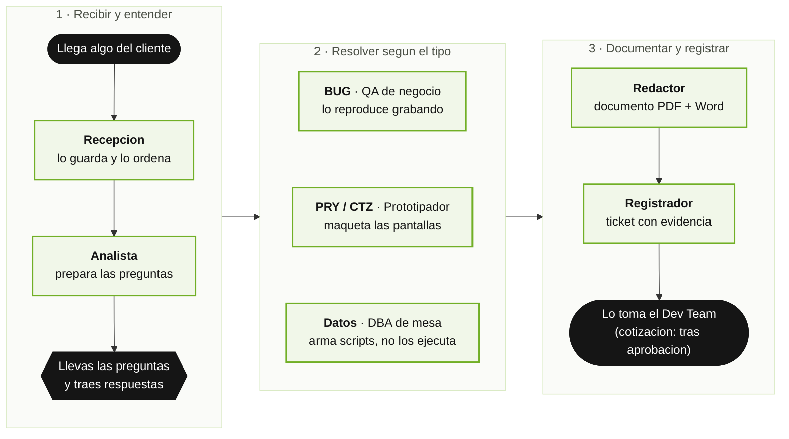

# Mesa de Servicios — Manual de Usuario

**Version del plugin:** 1.1.x · **Integrantes del equipo:** 10 · **Comandos:** 12

> **Manual general de todos los equipos.** Existe un manual que explica juntos a todos los
> equipos de FAAST y como se pasan el trabajo: [`GUIDE.md` en la raiz del
> repositorio](../../GUIDE.md), tambien en PDF (`GUIDE.pdf`). La Mesa de Servicios es el
> **primer paso** del flujo: el siguiente es el **Dev Team** (toma el ticket que deja la mesa y
> lo construye; [su manual](../dev-team/GUIDE.md)) y luego **Marketing** (lo comunica y lo
> vende; [su manual](../marketing/GUIDE.md)).

La Mesa de Servicios es un **equipo de asistentes de inteligencia artificial que recibe todo lo
que llega de un cliente** — un ticket, un reporte de que algo falla, una cotizacion, un proyecto,
un pedido de datos — desde cualquier fuente (un correo, un documento, la grabacion de una reunion,
un audio, un chat), y lo convierte en un **requerimiento cerrado**: sin ambiguedades, escrito en
un documento que cualquiera entiende, y registrado en el tablero de tareas para que el equipo de
desarrollo lo tome sin volver a preguntarle nada al cliente.

Tu hablas con el cliente; el equipo prepara las preguntas, las maquetas, los documentos y los
tickets. No necesitas saber programar. Este manual esta escrito para quien atiende la mesa, para
quien dirige un area y para quien nunca abrio una herramienta tecnica. La instalacion se explica
**paso a paso, desde cero**, al comienzo de la Parte 1
([Antes de empezar](#antes-de-empezar-instalacion-paso-a-paso)). La parte tecnica de configuracion
(para quien administra) esta al final, separada, en el **Anexo tecnico**.

---

## Indice

**Parte 1 — Para todas las personas**
- [Antes de empezar: instalacion paso a paso](#antes-de-empezar-instalacion-paso-a-paso)
1. [En dos minutos: como se usa](#1-en-dos-minutos-como-se-usa)
2. [Conoce al equipo](#2-conoce-al-equipo)
3. [Las palabras que vas a escuchar](#3-las-palabras-que-vas-a-escuchar)
4. [Las reglas de la casa](#4-las-reglas-de-la-casa)
5. [Que puedes pedir (lista de comandos)](#5-que-puedes-pedir-lista-de-comandos)

**Parte 2 — Situaciones reales, paso a paso**
- [Caso 1: Me llego un correo con un pedido](#caso-1--me-llego-un-correo-con-un-pedido)
- [Caso 2: Tuvimos una reunion con el cliente (grabada o transcrita)](#caso-2--tuvimos-una-reunion-con-el-cliente-grabada-o-transcrita)
- [Caso 3: Cerrar las dudas con el cliente](#caso-3--cerrar-las-dudas-con-el-cliente)
- [Caso 4: El cliente dice que algo falla](#caso-4--el-cliente-dice-que-algo-falla)
- [Caso 5: El cliente pide algo nuevo con pantallas](#caso-5--el-cliente-pide-algo-nuevo-con-pantallas)
- [Caso 6: El cliente pide una cotizacion](#caso-6--el-cliente-pide-una-cotizacion)
- [Caso 7: Hay que corregir o revertir datos](#caso-7--hay-que-corregir-o-revertir-datos)
- [Caso 8: Siempre hago lo mismo (registrar un flujo propio)](#caso-8--siempre-hago-lo-mismo-registrar-un-flujo-propio)
- [Caso 9: Generar el documento y subir el ticket](#caso-9--generar-el-documento-y-subir-el-ticket)
- [Caso 10: La memoria del negocio](#caso-10--la-memoria-del-negocio)
- [Caso 11: Ver como va la mesa](#caso-11--ver-como-va-la-mesa)

**Parte 3 — Preguntas frecuentes y problemas comunes**
- [Preguntas frecuentes](#preguntas-frecuentes)
- [Si algo no anda](#si-algo-no-anda)

**Anexo tecnico (para quien instala y configura)**
- [A. Instalacion y actualizacion](#a-instalacion-y-actualizacion)
- [B. Configuracion de la mesa](#b-configuracion-de-la-mesa)
- [C. La carpeta de la mesa](#c-la-carpeta-de-la-mesa)
- [D. Cuidar el consumo](#d-cuidar-el-consumo)
- [E. Solucion de problemas tecnicos](#e-solucion-de-problemas-tecnicos)

---

# Parte 1 — Para todas las personas

## Antes de empezar: instalacion paso a paso

Esta seccion es para quien nunca ha instalado nada parecido. Se hace **una sola vez por
computador** y toma unos 15 minutos. Si alguien de tu area ya lo dejo instalado, salta al
**Paso 8**.

**Que es Claude Code y donde se usa.** Claude Code es el programa de Anthropic en el que
trabaja este equipo. Es una conversacion: tu escribes en lenguaje normal y Claude responde y
hace el trabajo sobre las carpetas de tu computador. La Mesa de Servicios es un **plugin**: un
"paquete" que se le agrega a Claude Code y que trae a los 10 integrantes y sus comandos.
Claude Code se puede usar en tres lugares:

| Donde | Como se ve | Para quien |
|---|---|---|
| **La terminal** | Una ventana de texto con un cursor que parpadea. En Mac es la aplicacion "Terminal"; en Windows, "PowerShell" | La forma recomendada; es donde se hace la instalacion |
| **VS Code** | Un panel de conversacion dentro del editor VS Code (extension "Claude Code") | Quien ya trabaja en VS Code |
| **La aplicacion de escritorio de Claude** | La aplicacion Claude para Mac o Windows, en su seccion de Claude Code | Quien prefiere ventanas y botones |

Los pasos de instalacion se hacen en la terminal. Despues, la mesa se usa igual desde
cualquiera de los tres lugares. Si en VS Code o en la aplicacion no te aparecen los comandos
`/mesa-servicios:...`, usa la terminal.

**Paso 1 — Lo que necesitas tener.** Un computador Mac, Windows o Linux con internet, y una
**cuenta de Claude con acceso a Claude Code** (normalmente la entrega tu empresa). No
necesitas cuenta de GitHub para instalar: el catalogo de FAAST es publico. (Para **subir
tickets** al tablero si hara falta acceso; lo configura el integrante setup mas adelante.)

**Paso 2 — Abrir la terminal.**
- **Mac:** presiona `Cmd + Espacio`, escribe `Terminal` y presiona Enter.
- **Windows:** presiona la tecla Windows, escribe `PowerShell` y presiona Enter.

*Que ves:* una ventana con una linea que termina en `%`, `$` o `>` y un cursor parpadeando.
Ahi se pega cada instruccion de este manual y se presiona **Enter**.

**Paso 3 — Instalar Claude Code.** Copia la linea que corresponde a tu computador, pegala en
la terminal y presiona Enter:

```bash
# Mac o Linux
curl -fsSL https://claude.ai/install.sh | bash
```
```powershell
# Windows (PowerShell)
irm https://claude.ai/install.ps1 | iex
```

*Que ves:* unas lineas de avance y, al final, un mensaje de que quedo instalado. Si tu
empresa usa otro metodo, sigue la guia oficial de Anthropic (code.claude.com/docs). Cierra la
terminal, abrela de nuevo y comprueba:

```bash
claude --version
```
*Que ves:* un numero de version, por ejemplo `2.1.301 (Claude Code)`. Si dice "command not
found" o "no se reconoce", cierra y abre la terminal otra vez.

**Paso 4 — Iniciar sesion.** Escribe:

```bash
claude
```
*Que ves la primera vez:* te pide elegir los colores de la pantalla, luego como iniciar
sesion (elige tu cuenta de Claude); se abre tu navegador para que autorices el acceso y vuelves
a la terminal. Queda la pantalla de bienvenida de Claude Code con un recuadro para escribir.
Para salir de Claude Code escribe `/exit` y presiona Enter.

**Paso 5 — Agregar el catalogo de FAAST (el "marketplace").** Es la tienda interna de donde
salen los equipos de FAAST. Con Claude Code cerrado (en la terminal normal), pega:

```bash
claude plugin marketplace add faast-app/faast-claude-marketplace
```
*Que ves:* un mensaje de confirmacion de que el catalogo `faast-marketplace` quedo agregado.
Se hace una sola vez por computador (si ya instalaste otro equipo de FAAST, este paso ya esta
hecho).

**Paso 6 — Instalar la Mesa de Servicios.**

```bash
claude plugin install mesa-servicios@faast-marketplace
```
*Que ves:* un mensaje de que el plugin `mesa-servicios` quedo instalado. Queda disponible en
todas tus carpetas.

> **Si prefieres hacerlo desde dentro de Claude Code** (con la conversacion abierta), los
> pasos 5 y 6 se escriben asi: `/plugin marketplace add faast-app/faast-claude-marketplace`
> y `/plugin install mesa-servicios@faast-marketplace`. El resultado es el mismo.

**Paso 7 — Reiniciar y comprobar.** Si tenias Claude Code abierto, cierralo (`/exit`) y
vuelvelo a abrir: el equipo se carga al iniciar la sesion. En VS Code, cierra y abre el panel
de Claude Code. Para comprobar que quedo instalado:

```bash
claude plugin list
```
*Que ves:* la lista de plugins instalados. Debe aparecer algo asi:
```
❯ mesa-servicios@faast-marketplace
  Version: 1.1.0
  Scope: user
  Status: ✔ enabled
```
"enabled" significa que esta activo.

**Paso 8 — Abrir la carpeta de la mesa.** Claude Code trabaja sobre la carpeta en la que lo
abres. La mesa necesita **una carpeta propia, fuera de cualquier repositorio de codigo** (por
ejemplo `Mesa/mesa-faast` en tus documentos). Si aun no existe, crea una carpeta vacia; la
primera vez el equipo te ayuda a prepararla.

```bash
cd ruta/de/la/carpeta/de/la/mesa
claude
```
Para no escribir la ruta: escribe `cd ` (con un espacio), **arrastra la carpeta** desde el
Finder o el Explorador de archivos a la terminal y presiona Enter. En VS Code: *Archivo →
Abrir carpeta* y luego abre el panel de Claude Code.

*Que ves:* la primera vez que abres una carpeta, Claude Code te pregunta si confias en sus
archivos. Responde que si para que el equipo pueda trabajar en ella.

**Paso 9 — Tu primer pedido.** En el recuadro para escribir, pon:

```
/mesa-servicios:start
```
Al escribir `/mesa-servicios:` aparece una lista con todos los comandos de la mesa; puedes
elegir de ahi. *Que ves:* como la mesa aun no esta configurada, te ofrece configurarla. El
integrante que prepara la oficina (**setup**) revisa que la computadora tenga lo necesario
(transcribir audios, generar PDF y Word, el navegador de pruebas, el acceso al tablero) y te
pide **una sola confirmacion** para instalar lo que falte; luego te pregunta los datos de la
mesa (tablero, clientes, productos, ambientes). Durante el trabajo, Claude Code puede mostrarte
en pantalla un aviso para **aprobar un permiso** (por ejemplo, ejecutar una instruccion): leelo
y apruebalo si corresponde a lo que pediste.

**Como actualizar cuando hay novedades.** Cuando se anuncie una version nueva de la mesa,
escribe en la terminal (con Claude Code cerrado):

```bash
claude plugin marketplace update faast-marketplace
claude plugin update mesa-servicios@faast-marketplace
```
Despues **cierra y vuelve a abrir Claude Code**: lo nuevo se carga al iniciar. Con `claude
plugin list` confirmas que la version cambio.

**Si algo falla durante la instalacion**
- *"command not found" / "no se reconoce" al escribir `claude`:* cierra y abre la terminal; si
  sigue, repite el Paso 3.
- *No aparecen los comandos `/mesa-servicios:...`:* cierra y abre Claude Code (Paso 7) y revisa
  con `claude plugin list` que diga "enabled".
- *Error al instalar el plugin diciendo que no lo encuentra:* usa el nombre completo,
  `mesa-servicios@faast-marketplace`, y verifica que hiciste el Paso 5.
- Para lo demas, la seccion [Si algo no anda](#si-algo-no-anda) y el
  [Anexo E](#e-solucion-de-problemas-tecnicos).

---

## 1. En dos minutos: como se usa

1. Instalas el plugin una sola vez (ver [Antes de empezar](#antes-de-empezar-instalacion-paso-a-paso)).
2. Abres Claude Code **en la carpeta de la mesa** (la primera vez te ayuda a crearla), como en
   el Paso 8 de la instalacion.
3. Escribes esto y cuentas lo que llego, como se lo contarias a un colega:

```
/mesa-servicios:start
```

Ejemplos de lo que puedes escribir despues (o en la misma linea):

| Lo que escribes | Lo que pasa |
|---|---|
| `/mesa-servicios:start` | El equipo mira como esta la mesa y te propone que hacer |
| `/mesa-servicios:start me llego un correo de ACME pidiendo un filtro nuevo` | Recibe el pedido y lo deja ordenado: que se entendio y que falta |
| `/mesa-servicios:start el cliente dice que se duplican las operaciones` | Lo reproduce en el sistema, con video y fotos, y confirma si pasa |
| `/mesa-servicios:start necesito cotizar una integracion con el banco` | Arma el requerimiento, la maqueta y la propuesta para el cliente |
| `/mesa-servicios:start ¿en que estamos?` | Te resume la mesa: que espera respuesta, que esta listo |

**Tres cosas que siempre van a pasar:**

- **Nada se inventa.** Lo que el cliente no respondio queda escrito como pendiente, no como
  "lo que parece razonable".
- **Tu hablas con el cliente.** El equipo te prepara las preguntas, las maquetas y los documentos;
  nunca contacta al cliente por su cuenta.
- **Te presentan el plan antes de hacer nada** que cambie algo: antes de mandar preguntas,
  de maquetar, de armar scripts o de subir un ticket. Tu dices "adelante".

> **Lo que espera tu respuesta no se pierde.** Si el equipo te dejo una pregunta o una
> decision pendiente, queda anotada y te la recuerda al abrir la siguiente sesion, en una
> lista corta, para que decidas como seguir.

> Si solo quieres saber algo del negocio ("¿que productos usa ACME?"), pregunta directo con
> `/mesa-servicios:brain query`. Es rapido y no mueve nada.

---


**El recorrido de una solicitud** (en negro, lo que haces o decides tu):



Si falta algo, el analista prepara otra ronda (maximo 3). Al cerrar, el curador guarda lo aprendido
en la memoria del negocio.


## 2. Conoce al equipo

Piensa en una mesa de atencion al cliente con su propio analista, su probador, su encargado de
datos, su maquetador y su redactor. Estos son sus 10 integrantes.

| Integrante | Que hace, en palabras simples | Cuando aparece |
|---|---|---|
| 🧭 **mesa-lead** (jefe de mesa) | Decide que pedido sigue, reparte el trabajo, destraba y escala lo que no cierra. Es el unico que puede pedir ayuda a los demas | Detras de cada pedido; lo ves al aprobar planes |
| 📥 **recepcion** (el que recibe) | Toma lo que llego (correo, documento, grabacion, chat), lo guarda tal cual y escribe que se entendio, que falta y que se contradice | Cada vez que entra algo nuevo |
| ❓ **analista** (el que pregunta) | Lee la memoria del negocio para no preguntar lo obvio y prepara pocas preguntas, claras, para que tu las lleves al cliente hasta que no quede duda | Siempre, hasta cerrar el pedido |
| 🔎 **qa-negocio** (el probador) | Reproduce lo que el cliente reporta en el sistema real, grabando todo (video, fotos, registro), y dice si pasa o no. **Solo prueba; nunca busca la causa** | Cuando el cliente dice que algo falla |
| 🗄️ **dba-mesa** (el de los datos) | Mira los datos (solo mira) y **arma** los scripts para corregir o revertir, listos para que los ejecute quien corresponde. **Nunca ejecuta nada** | Pedidos de corregir, revertir o extraer datos |
| ✏️ **prototipador** (el maquetador) | Dibuja maquetas tipo boceto, navegables, para que el cliente vea la idea antes de que se construya | Pedidos nuevos con pantallas, proyectos, cotizaciones |
| 📄 **redactor** (el que escribe el documento) | Convierte el pedido cerrado en un documento ejecutivo estandar (PDF y Word) y, si es cotizacion, en la propuesta para el cliente | Cuando el pedido esta cerrado |
| 🎫 **registrador** (el del tablero) | Sube el ticket al tablero con todas sus etiquetas, el documento y las fotos dentro | Al final, para que desarrollo lo tome |
| 📚 **curador** (el bibliotecario) | Guarda lo que se aprendio de cada pedido en la memoria del negocio, para que el proximo se cierre con menos preguntas | Al cerrar cada pedido |
| 🧰 **setup** (el que prepara la oficina) | Revisa que la computadora tenga todo e instala lo que falte, con tu permiso | Al empezar o cuando algo no esta instalado |

> **Profesionales de su oficio:** cada integrante trabaja con el estandar de un profesional
> experimentado de su area: sigue un metodo paso a paso, entrega en un formato fijo, revisa
> su propio trabajo con una lista de control antes de entregarlo y evita los errores tipicos
> de su oficio.

> **Sobre el costo:** todos los integrantes usan el mismo "cerebro" intermedio por defecto. Si
> algun pedido es especialmente complejo, se puede subir a uno mas potente para un integrante
> (ver [Anexo B](#b-configuracion-de-la-mesa)).

---

## 3. Las palabras que vas a escuchar

| Palabra | Que significa |
|---|---|
| **Claude Code** | El programa donde conversas con el equipo. Se usa en la terminal, en VS Code o en la aplicacion de escritorio de Claude |
| **Plugin** | Un paquete que se le agrega a Claude Code. La Mesa de Servicios es un plugin: trae a los integrantes y sus comandos |
| **Comando** | Una instruccion que empieza con `/`, como `/mesa-servicios:start`. Le dice al equipo que tipo de trabajo quieres; despues del comando escribes tu pedido en palabras normales |
| **Sesion** | Cada vez que abres Claude Code. "Reiniciar la sesion" es cerrarlo (`/exit`) y volver a abrirlo |
| **ID** | El codigo con que se sigue una solicitud mientras se trabaja (`SOL-2026-03-11-1`). Al documentarla recibe su correlativo definitivo (`PRY-2026-014`) |
| **Solicitud** | Cualquier cosa que llega de un cliente y que la mesa va a trabajar: un pedido, un reporte, una cotizacion |
| **Fuente** | De donde salio la solicitud: un correo, un documento, la grabacion de una reunion, un chat. Se guarda tal cual, siempre |
| **Ronda de preguntas** | Un grupo corto de preguntas (como mucho siete) que el analista prepara y tu llevas al cliente. Normalmente bastan una o dos rondas; nunca mas de tres |
| **Pedido cerrado** | Cuando ya no queda nada por preguntar: se sabe que, para que, para quien, que incluye y que no |
| **Tipo** | De que se trata: **BUG** (algo falla), **PRY** (algo nuevo o un cambio), **CTZ** (algo que hay que cotizar y aprobar) |
| **Alcance** | Para quien es: un **cliente** especifico (ACME) o **transversal** (para todos los que usan el producto) |
| **Correlativo** | El numero de la solicitud: `BUG-2026-003`, `PRY-2026-014`, `CTZ-2026-007`. Unico, nunca se repite |
| **Reproducir** | Hacer en el sistema real, paso a paso, lo que el cliente dice que falla, para confirmarlo con evidencia |
| **Evidencia** | Las fotos, el video y los registros que demuestran lo que se vio. Se guardan y se muestran dentro del ticket |
| **Maqueta (prototipo)** | Un dibujo tipo boceto de las pantallas, que se puede recorrer, para validar la idea. No es el diseño final |
| **Documento** | El escrito ejecutivo estandar que cierra la solicitud. Sale en PDF y en Word |
| **Propuesta** | El documento para el cliente cuando hay que cotizar: que se hara, que no, plazos y condiciones. La valorizacion la pone comercial |
| **Ticket** | La tarjeta en el tablero (GitHub o Azure DevOps) con todo adentro: resumen, decisiones, pendientes, documento y fotos |
| **Base de datos** | Donde el sistema guarda su informacion (operaciones, clientes, estados) |
| **Scripts** | Instrucciones preparadas para corregir o revertir datos en una base de datos. La mesa los arma; **los ejecuta quien esta autorizado** |
| **Ambiente de pruebas / productivo** | Cada ambiente del sistema esta declarado como **de pruebas** (donde aprobar, girar o pagar son pruebas normales) o **productivo** (el que usan los clientes de verdad, donde todo cambio necesita autorizacion) |
| **Pendiente** | Algo que quedo esperando tu respuesta o una decision tuya. Queda registrado y el equipo te lo recuerda al abrir cada sesion |
| **Repositorio** | La carpeta donde vive el codigo de un sistema, con su historial de cambios. La mesa no trabaja dentro de ellos |
| **Carpeta de la mesa** | Donde el equipo guarda su trabajo (solicitudes, fotos, documentos, flujos). Esta fuera de los repositorios de codigo, nunca adentro |
| **Flujo propio** | Una operacion que la mesa repite (buscar operaciones de un cliente, revisar una bandeja) registrada paso a paso para hacerla siempre igual y con evidencia |
| **faast-brain** | La memoria del negocio: que productos hay, como opera cada cliente, que reglas rigen, que palabras usa cada uno. La mesa la lee antes de preguntar |
| **Plan primero** | La regla de que nadie manda preguntas, maqueta, arma scripts ni sube tickets sin mostrarte antes el plan y esperar tu "adelante" |

---

## 4. Las reglas de la casa

Estan siempre activas. No hay que pedirlas.

1. **Nada se inventa.** Lo que el cliente no respondio queda como pendiente, visible, nunca
   rellenado con suposiciones.
2. **Tu hablas con el cliente.** El equipo prepara; tu llevas y traes. Nadie del equipo
   contacta al cliente por su cuenta.
3. **Plan primero.** Antes de mandar preguntas, maquetar, armar scripts o subir un ticket, te
   muestran que se hara y esperan tu OK.
4. **Se pregunta poco y bien.** Primero se lee lo que el negocio ya sabe; se confirma lo
   sabido y se pregunta solo lo que falta, con opciones concretas, en el idioma del cliente.
5. **Todo en lenguaje de negocio.** Preguntas, documentos y tickets los entiende cualquier
   persona. Cero codigo, cero jerga.
6. **El probador solo prueba.** Reproduce, graba y reporta si pasa o no. Nunca busca la
   causa ni propone arreglos: eso es del equipo de desarrollo.
7. **El de los datos nunca ejecuta.** Mira los datos y arma los scripts, siempre seguros y
   repetibles. Los ejecuta quien esta autorizado, por el canal que corresponde.
8. **Toda evidencia se ve dentro del ticket.** Fotos y videos aparecen en la tarjeta, no como
   un enlace aparte.
9. **Una cotizacion no es trabajo** hasta que comercial la aprueba y queda registrado quien y cuando.
10. **Numero y alcance en todo.** Cada solicitud lleva su correlativo y dice si es de un
    cliente o transversal.
11. **En pruebas no se frena; en produccion, con permiso escrito.** En un ambiente de pruebas,
    aprobar, girar o pagar son acciones de prueba normales y el equipo las hace sin pedirte OK
    una por una. Si un flujo propio o una reproduccion toca el ambiente productivo, se registra
    quien lo autorizo, cuando y para que caso (en cada corrida), y el equipo se detiene antes
    de cada paso que cambie algo. Cada ambiente esta declarado como de pruebas o productivo; si
    aparece uno sin declarar, te preguntan una vez.
12. **Lo que se aprende se guarda.** Al cerrar cada solicitud, la memoria del negocio crece y
    la siguiente se cierra con menos preguntas.
13. **Sin secretos ni datos personales** en documentos, tickets ni memoria. Se habla de
    empresas y roles, no de personas.
14. **Nada de la mesa se guarda dentro de los repositorios.** Solicitudes, fotos, documentos,
    flujos y accesos viven en la carpeta de la mesa, fuera de cualquier repositorio de codigo.
    Un control impide guardarla dentro de uno; si una mesa antigua la tiene adentro, el equipo
    te avisa y te propone moverla.
15. **Tus pedidos valen aunque los pases por la sesion o por el jefe de mesa.** Si escribes
    "dile al de los datos que revise la operacion 10432", el integrante lo hace: no exige que
    le escribas a el directamente. La unica excepcion: cuando Claude Code te pide aprobar un
    permiso en pantalla, eso lo apruebas tu.
16. **Los pendientes no se pierden.** Lo que espera tu respuesta queda registrado y aparece al
    iniciar cada sesion hasta que lo resuelvas.

---

## 5. Que puedes pedir (lista de comandos)

Recuerda: con `/mesa-servicios:start` y una frase basta. Esta lista es para cuando ya sabes
exactamente que quieres.

**Todos los dias**

| Escribes | Que consigues |
|---|---|
| `/mesa-servicios:start` | El punto de partida: mira la mesa y te guia |
| `/mesa-servicios:estado` | Como va la mesa: que espera respuesta, que esta listo, que esta trabado |
| `/mesa-servicios:brain query {pregunta}` | Preguntarle a la memoria del negocio |

**Cuando llega algo**

| Escribes | Que consigues |
|---|---|
| `/mesa-servicios:recibir {archivos o texto}` | Recibe un pedido desde cualquier fuente (ver [Caso 1](#caso-1--me-llego-un-correo-con-un-pedido) y [Caso 2](#caso-2--tuvimos-una-reunion-con-el-cliente-grabada-o-transcrita)) |
| `/mesa-servicios:analizar {ID}` | Prepara la ronda de preguntas para el cliente, o registra sus respuestas (ver [Caso 3](#caso-3--cerrar-las-dudas-con-el-cliente)) |

**Segun el tipo de pedido**

| Escribes | Que consigues |
|---|---|
| `/mesa-servicios:reproducir {ID}` | Reproduce lo que el cliente dice que falla, con video y fotos (ver [Caso 4](#caso-4--el-cliente-dice-que-algo-falla)) |
| `/mesa-servicios:prototipo {ID}` | Maqueta tipo boceto para que el cliente vea la idea (ver [Caso 5](#caso-5--el-cliente-pide-algo-nuevo-con-pantallas)) |
| `/mesa-servicios:sql {que necesitas}` | Mira datos y arma scripts seguros, sin ejecutarlos (ver [Caso 7](#caso-7--hay-que-corregir-o-revertir-datos)) |
| `/mesa-servicios:flujo {crear, grabar, ejecutar}` | Registra y repite tus flujos propios (ver [Caso 8](#caso-8--siempre-hago-lo-mismo-registrar-un-flujo-propio)) |

**Para cerrar**

| Escribes | Que consigues |
|---|---|
| `/mesa-servicios:documento {ID}` | El documento ejecutivo en PDF y Word; la propuesta si es cotizacion (ver [Caso 9](#caso-9--generar-el-documento-y-subir-el-ticket)) |
| `/mesa-servicios:ticket {ID}` | Sube el ticket al tablero con todo adentro |
| `/mesa-servicios:ticket aprobar {ID}` | Registra que comercial aprobo una cotizacion: recien ahi pasa a ser trabajo |
| `/mesa-servicios:brain ingest {ID}` | Guarda lo aprendido en la memoria del negocio (ver [Caso 10](#caso-10--la-memoria-del-negocio)) |

**Preparacion**

| Escribes | Que consigues |
|---|---|
| `/mesa-servicios:setup` | Revisa e instala lo que la computadora necesita, con tu permiso |
| `/mesa-servicios:brain init` | Crea la memoria del negocio por primera vez |

---

# Parte 2 — Situaciones reales, paso a paso

Cada caso muestra la situacion, **que escribes exactamente**, que hace el equipo y que recibes
al final. Los ejemplos son de un cliente ficticio ("ACME"), pero aplican a cualquiera.

## Caso 1 — Me llego un correo con un pedido

**Situacion:** ACME manda un correo: "necesitamos que el listado de operaciones permita filtrar
por rango de fechas y, de paso, el reporte semanal esta saliendo con totales raros".

**Que escribes** (pegando el correo o indicando el archivo):
```
/mesa-servicios:recibir correo-acme.eml --cliente ACME
```
El archivo `.eml` es el correo guardado desde tu programa de correo (en Outlook: arrastra el
correo a la carpeta de la mesa, o *Archivo → Guardar como*). Si no sabes guardarlo, copia el
texto del correo y pegalo despues del comando. `--cliente ACME` le dice a la mesa de que
cliente es (con el codigo corto del cliente).

**Que hace el equipo:**
1. El que recibe guarda el correo tal cual (nunca se modifica) y lo lee completo, incluido
   el hilo de respuestas.
2. Detecta que hay **dos pedidos de naturaleza distinta** en el mismo correo (un filtro nuevo
   y un reporte que falla) y te propone tratarlos como dos solicitudes.
3. Escribe el registro de cada una: que se entendio, los ejemplos concretos que dio el cliente,
   que falta, que se contradice entre el correo y respuestas anteriores, y si menciona un
   adjunto que no llego.

**Recibes:**
```
SOL-2026-03-11-1 — Filtrar operaciones por rango de fechas — ACME — tipo preliminar: proyecto
  Falta: ¿que perfiles lo usan? ¿fecha de operacion o de vencimiento? ¿solo pantalla o tambien exportacion?
SOL-2026-03-11-2 — Totales raros en el reporte semanal — ACME — tipo preliminar: bug
  Falta: ¿que reporte exacto? ¿desde cuando? un ejemplo con un total que no cuadra
Siguiente: /mesa-servicios:analizar SOL-2026-03-11-1
```

---

## Caso 2 — Tuvimos una reunion con el cliente (grabada o transcrita)

**Situacion:** 40 minutos de reunion por Teams con ACME. Tienes la transcripcion que genero
Teams, o solo la grabacion.

**Que escribes:**
```
/mesa-servicios:recibir reunion-acme-11-03.mp4 transcripcion-teams.docx --cliente ACME
```

**Que hace el equipo:**
- Si hay grabacion, la **transcribe en tu computadora** (nada sale a internet). Si hay
  transcripcion de Teams, la usa directo.
- Lee la reunion completa y separa lo que importa: **decisiones** (quien dijo que si a que),
  pedidos explicitos, compromisos de ambas partes, dudas que quedaron abiertas en la misma
  reunion, y sobre todo los **ejemplos concretos** que dio el cliente ("por ejemplo, cuando el
  proveedor manda la factura sin orden de compra...").
- Corrige los nombres de productos y terminos que la transcripcion automatica confunde, usando
  el vocabulario de la memoria del negocio.
- Separa lo que se pidio de lo que se descarto en la misma reunion.

**Recibes:** el registro de la solicitud con lo decidido, lo abierto y los ejemplos, listo para
la ronda de preguntas. Por ejemplo:
```
SOL-2026-03-11-3 — Aceptar facturas sin orden de compra — ACME — tipo preliminar: proyecto
  Decidido en la reunion: aplica solo a proveedores nacionales (lo confirmo la jefa de compras, min 12)
  Ejemplo del cliente: "cuando el proveedor manda la factura sin orden de compra, hoy la rechazamos a mano"
  Descartado en la misma reunion: el aviso por SMS
  Abierto: ¿quien aprueba esas facturas? · tramo inaudible en el min 31 (monto tope) → pregunta para el cliente
Siguiente: /mesa-servicios:analizar SOL-2026-03-11-3
```

> Si hay un tramo inaudible en algo importante, no se rellena: queda como pregunta para el cliente.

---

## Caso 3 — Cerrar las dudas con el cliente

**Situacion:** la solicitud esta recibida y faltan cosas por aclarar.

**Que escribes:**
```
/mesa-servicios:analizar SOL-2026-03-11-1
```

**Que hace el analista:**
1. Lee la memoria del negocio: que sabe ya de ACME, del producto y de casos parecidos. Lo que
   ya se sabe **no se pregunta**: se confirma en una frase ("entendemos que operan con el modo
   2.0; si no es asi, avisanos").
2. Si hay ambiente disponible, mira la pantalla real de la que habla el cliente, para preguntar
   con contexto ("¿el total que falta es el de la tarjeta Resumen o el del listado?").
3. Prepara una **ronda corta** (como mucho siete preguntas), de lo mas importante a lo mas
   fino, con opciones concretas cuando las hay:
   ```
   Ronda 1 — ACME — Filtro por fechas
   Lo que ya tenemos claro (solo confirmar): el filtro va en la pantalla "Operaciones".
   1. Fechas — ¿El rango filtra por fecha de operacion o de vencimiento?  a) operacion  b) vencimiento  c) ambas  d) otra: ___
   2. Perfiles — ¿Quien lo usa?  a) solo analistas  b) analistas y supervisores  c) todos
   3. Exportacion — ¿El rango tambien debe aplicar al Excel que exportan?  a) si  b) no
   ...
   ```
4. **Te la muestra antes de "enviarla"** (plan primero). Tu la ajustas si quieres y la llevas al
   cliente por correo, chat o en la proxima reunion.

**Cuando el cliente responde**, se lo cuentas al equipo:
```
/mesa-servicios:analizar SOL-2026-03-11-1 --respuestas "1: b  2: b  3: si, pero solo el Excel resumido"
```
El analista registra las respuestas, marca lo que quedo decidido y lo que sigue pendiente, y
revisa su lista de completitud. Si todo esta, **cierra** la solicitud y la clasifica: tipo,
alcance (cliente o transversal), producto y prioridad sugerida. Si falta algo, prepara otra
ronda (nunca mas de tres; si no cierra, te propone una reunion de trabajo).

**Recibes:**
```
SOL-2026-03-11-1 — CERRADA · Tipo: PRY · Alcance: Cliente ACME · Producto: Factoring · Prioridad sugerida: media
Necesita: maqueta si (cambia la pantalla) · reproduccion no · scripts no
Siguiente: /mesa-servicios:prototipo SOL-2026-03-11-1
```

---

## Caso 4 — El cliente dice que algo falla

**Situacion:** "A veces se duplican las operaciones cuando paso a la pagina 2".

**Que escribes** (con los pasos ya cerrados con el cliente):
```
/mesa-servicios:reproducir SOL-2026-03-11-2
```

**Que hace el probador:**
1. Te muestra el plan: que pasos hara, en que ambiente, con que perfil, y que va a grabar.
   Espera tu OK. Por defecto usa el ambiente de pruebas; produccion solo si tu y el jefe de
   mesa lo autorizan, y queda registrado.
2. Hace **exactamente** los pasos del cliente, una vez, como un usuario. Graba todo: un video
   con las acciones marcadas y un capitulo por paso, una foto de cada paso con lo importante
   resaltado, y los registros internos. En el ambiente de pruebas, si los pasos del cliente
   incluyen aprobar, confirmar o girar, los hace con normalidad: son parte de la prueba.
3. Si se reproduce, lo repite una segunda vez para saber si pasa **siempre** o **a veces**.
4. Si algo lo frena antes de llegar al punto (no entra, el ambiente no responde), **se
   detiene y lo reporta**; no insiste ni busca atajos.

**Recibes un veredicto claro:**
```
Reproduccion SOL-2026-03-11-2 — Operaciones repetidas al cambiar de pagina
Veredicto: REPRODUCIDO (siempre) en pruebas · perfil analista
Pasos: 2 · Evidencia: 3 fotos, video 18 s, registros · Observacion: 1 llamada interna con respuesta inesperada
Siguiente: /mesa-servicios:documento SOL-2026-03-11-2
```

**Videos que se ven bien.** El video se graba **a tamaño real**: ocupa toda la pantalla y el
texto se lee nitido, sin una imagen chica en una esquina. Lleva un **capitulo por paso** con un
titulo que se entiende, y se entrega en **MP4**, que abre en cualquier equipo (Windows, Mac,
Teams, el navegador). En el ticket aparece una **portada** del video que, al hacer clic, abre el
video completo. El probador revisa cada video antes de entregarlo: **si salio chico o borroso,
se vuelve a grabar**; un video que no se lee no cuenta como evidencia.

**Importante:** el probador **nunca dice por que falla**. Solo demuestra que falla, con
evidencia. La causa es del equipo de desarrollo. Si **no** se reproduce, no se inventa el bug:
te dice que se probo, que si funciono, y que falta para volver a intentar (otro usuario, otro
dato, otra hora).

---

## Caso 5 — El cliente pide algo nuevo con pantallas

**Situacion:** el filtro por fechas cambia la pantalla de operaciones. Antes de escribir el
documento, conviene que ACME **vea** la idea.

**Que escribes:**
```
/mesa-servicios:prototipo SOL-2026-03-11-1
```

**Que hace el maquetador:**
1. Te propone las 3 a 6 pantallas clave (la de entrada, la del paso decisivo, la de resultado)
   y espera tu OK.
2. Arma una **maqueta tipo boceto**: cajas grises, dibujos de relleno, textos en las palabras
   del cliente, datos de ejemplo ficticios. Se abre en cualquier navegador y se recorre
   haciendo clic. A proposito **no parece terminada**: si pareciera terminada, el cliente la
   tomaria por terminada.
3. Saca una foto de cada pantalla y te prepara 3 a 5 preguntas de validacion por pantalla
   ("¿este es el orden en que trabajan?", "¿falta algun dato aqui?").

**Tu se la muestras al cliente** y le cuentas al equipo que decidio:
```
/mesa-servicios:prototipo SOL-2026-03-11-1 --validar "el rango va arriba del listado; agregar total de la seleccion"
```
Lo validado cierra preguntas y va al documento. Si cambia, se guarda una version nueva.

**Recibes:**
```
Maqueta SOL-2026-03-11-1 — Filtro por fechas — v1
Pantallas: 1) Operaciones con el filtro  2) Elegir el rango  3) Resultado con total de la seleccion
Abrir: maqueta.html (en el navegador, se recorre haciendo clic) · 3 fotos listas para el documento
Preguntas de validacion: 9 (3 por pantalla)
Siguiente: mostrarla al cliente y registrar lo que decida con --validar
```

> La maqueta aplica a pedidos nuevos que cambian pantallas, proyectos y cotizaciones. **No** se
> hace para errores (esos se documentan con evidencia) ni para pedidos sin cambio en pantalla.
> Tampoco es el diseño final: eso lo hace el estudio de diseño del equipo de desarrollo cuando
> el trabajo ya esta aprobado.

---

## Caso 6 — El cliente pide una cotizacion

**Situacion:** ACME quiere integrar el sistema con su banco y necesita saber "cuanto y cuando".

**Que escribes:** lo mismo que para cualquier pedido, empezando por lo que mando el cliente:
```
/mesa-servicios:recibir correo-acme-banco.eml --cliente ACME
```
y luego los pasos que la mesa te va sugiriendo al final de cada respuesta ("Siguiente: ...").

**Que pasa de distinto:** una cotizacion es un proyecto que **todavia no esta aprobado**. Por eso:
1. Se cierra igual que un proyecto (Caso 3) y ademas se preguntan **entregables, supuestos,
   exclusiones, plazo esperado y quien decide**.
2. Se maqueta (Caso 5), porque una propuesta se entiende mucho mejor con pantallas.
3. El redactor genera **dos documentos**: el requerimiento interno y la **Propuesta para el
   cliente** (contexto, alcance, que se hara y que no, entregables, supuestos, plazos,
   condiciones y proximos pasos). La **valorizacion queda en blanco** para que la complete
   comercial; la mesa no pone precios ni esfuerzos.
4. El ticket se sube al tablero **en espera de aprobacion comercial**. No es trabajo todavia.

**Recibes:**
```
CTZ-2026-007 — Integracion con el banco para pagos automaticos · Cliente ACME
Documentos: CTZ-2026-007 requerimiento (PDF + Word) · Propuesta para el cliente (PDF + Word, valorizacion en blanco)
Ticket #245 · columna "Pendiente aprobacion comercial" · maqueta de 4 pantallas adentro
Siguiente: comercial completa la valorizacion y, si aprueba, /mesa-servicios:ticket aprobar CTZ-2026-007
```

**Cuando comercial aprueba:**
```
/mesa-servicios:ticket aprobar CTZ-2026-007 "aprobado por Gerencia Comercial el 20/03/2026, propuesta v1"
```
Recien ahi la cotizacion pasa a la columna de trabajo y el equipo de desarrollo la puede tomar.
Si se descarta, queda cerrada con el motivo (y lo aprendido se guarda igual).

---

## Caso 7 — Hay que corregir o revertir datos

**Situacion:** "La operacion 10432 se giro por error; hay que revertirla".

**Que escribes:**
```
/mesa-servicios:sql script SOL-2026-03-12-4
```

**Que hace el de los datos:**
1. Con el pedido cerrado (que operacion exacta, en que estado esta y en cual debe quedar, por
   que, quien autoriza), **mira los datos**: confirma que la operacion existe, en que estado
   esta de verdad y que depende de ella. **Solo mira**; nunca cambia nada.
2. Te muestra el plan: que se tocaria, cuantos registros, riesgos y quien lo ejecutara. Espera tu OK.
3. **Arma el paquete de scripts** con el formato que exige la casa (ordenado por tipo de base de
   datos, por base y por tipo de cambio), de forma que se pueda ejecutar dos veces sin daño, con
   su verificacion antes y despues y su reversa (las instrucciones para deshacerlo). Y una nota
   explicativa (README) en lenguaje claro: que hace, sobre que, riesgos y **quien debe
   ejecutarlo**.

**Recibes:** la carpeta del paquete y la indicacion de quien lo ejecuta. Por ejemplo:
```
Paquete SOL-2026-03-12-4 — Revertir el giro de la operacion 10432 (no ejecutado)
Estado hoy: Girada · Estado final esperado: Aprobada · Registros que cambian: 3
Incluye: verificacion antes · cambio · verificacion despues · reversa · README
Lo ejecuta: el equipo autorizado, por el pase del ambiente productivo
```
Si va a un ambiente formal, entra al pase del equipo de desarrollo, que lo revisa como
cualquier otro.

**Lo que nunca pasa:** la mesa **no ejecuta** scripts contra ninguna base de datos. Ni en
pruebas, ni "solo para validar". Arma, verifica y entrega; ejecuta quien esta autorizado.

**Si el mismo pedido se repite** (revertir operaciones es frecuente), se deja como **flujo
reutilizable**: la proxima vez se rellena el numero de operacion y el paquete sale listo.
```
/mesa-servicios:sql flujo crear factoring/revertir-operacion
/mesa-servicios:sql flujo preparar factoring/revertir-operacion SOL-2026-04-02-1
```

---

## Caso 8 — Siempre hago lo mismo (registrar un flujo propio)

**Situacion:** cada semana buscas las operaciones vencidas de cada cliente en produccion y
revisas una por una. Lo haces de memoria y cada persona lo hace distinto.

**Registrarlo una vez:**
```
/mesa-servicios:flujo crear factoring/buscar-operaciones-cliente
/mesa-servicios:flujo grabar factoring/buscar-operaciones-cliente
```
Te hace unas pocas preguntas (que hace, en que ambiente, con que perfil, si algun paso cambia
algo) y luego **lo recorres tu con el equipo**: el probador captura cada paso con lo real (que
pantalla, que boton, que se ve) y deja el instructivo escrito.

**Repetirlo despues:**
```
/mesa-servicios:flujo ejecutar factoring/buscar-operaciones-cliente cliente=ACME --ambiente produccion
```
Te muestra el plan y, si es produccion, **registra quien lo autoriza y para que**. Luego
verifica que esten dadas las condiciones (solo mirando), ejecuta los pasos grabando todo, y te
entrega el resultado con la evidencia. Por ejemplo:
```
Flujo factoring/buscar-operaciones-cliente — ACME — produccion (consulta: solo mira)
Autorizado por: jefe de mesa, 16/10/2026, revision semanal
Resultado: 7 operaciones vencidas (2 con mas de 30 dias) · exportado a Excel
Evidencia: video con capitulos por paso y 5 fotos · nada se modifico
```

**Dos clases de flujo:**
- **Consulta** (solo mira: buscar, verificar, exportar): sin paradas, con evidencia de que
  solo se miro.
- **Accion** (algo cambia por la pantalla: aprobar, reasignar):
  - **En un ambiente de pruebas**, las acciones se hacen sin frenar: ya pediste correr el flujo y
    son pruebas normales.
  - **En produccion**, cada corrida necesita su autorizacion registrada (quien, cuando, para que
    caso; no vale "ya autorizado para todo"), y el equipo **se detiene antes de cada paso que
    cambie algo** y espera tu OK en ese momento.

> Dentro de un flujo, el de los datos solo **mira** (verifica antes y despues). Si el flujo
> necesita cambiar datos, eso es un paquete de scripts (Caso 7) para quien esta autorizado.

---

## Caso 9 — Generar el documento y subir el ticket

**El documento:**
```
/mesa-servicios:documento SOL-2026-03-11-1
```
El redactor asigna el **correlativo** definitivo (`PRY-2026-014`) y el **alcance** (Cliente ACME
o Transversal), y escribe el documento ejecutivo estandar: resumen para gerencia, que se pide
y para que, quienes lo usan, que incluye y **que no**, el flujo deseado con los ejemplos del
cliente, las pantallas de la maqueta, reglas, dependencias, criterios de exito y los
**pendientes** explicitos. Sale en **PDF y Word**, con los acentos intactos. Si es cotizacion,
tambien la Propuesta.

**El ticket:**
```
/mesa-servicios:ticket PRY-2026-014
```
El registrador te muestra titulo, etiquetas y columna, y con tu OK sube la tarjeta al tablero:
titulo limpio, resumen, decisiones tomadas, pendientes, **fotos y video dentro** (no como
enlace; el video aparece con su portada y abre en MP4), el documento adjunto, y etiquetas completas (tipo, cliente o transversal, producto,
prioridad sugerida, de donde vino). Si ya existia un ticket parecido, no duplica: te avisa.

**Recibes:**
```
PRY-2026-014 — Filtrar operaciones por rango de fechas · Cliente ACME
Ticket #231 en el tablero · columna "Por priorizar" · 6 etiquetas · documento y maqueta adentro
Siguiente: el lider de producto lo prioriza; /mesa-servicios:brain ingest PRY-2026-014
```

Desde aqui lo toma el equipo de desarrollo (plugin **dev-team**): lider de producto, historias de
usuario, construccion, pruebas y publicacion (ver el [manual del Dev Team](../dev-team/GUIDE.md)).

---

## Caso 10 — La memoria del negocio

La memoria (`faast-brain`) es lo que hace que la mesa **pregunte menos cada vez**. Guarda que
productos hay y que hace cada uno, como opera cada cliente, que reglas rigen (plazos, topes,
aprobaciones), que palabras usa cada uno y que se decidio antes.

**Crearla la primera vez:**
```
/mesa-servicios:brain init
```
Arranca casi vacia (con la lista de productos y clientes). Es normal: cada solicitud cerrada la
alimenta.

**Alimentarla al cerrar cada solicitud:**
```
/mesa-servicios:brain ingest PRY-2026-014
```
El bibliotecario guarda **solo lo reutilizable**: una particularidad de ACME, una regla de
negocio que nadie habia escrito, un termino nuevo, una decision, y un resumen del caso con "la
pregunta que mas costo responder" (para hacerla antes la proxima vez).

**Preguntarle:**
```
/mesa-servicios:brain query ¿que productos usa ACME y como aprueban las operaciones?
```
Responde solo con lo que esta guardado, diciendo de donde salio. Si no lo sabe, lo dice; no inventa.
Por ejemplo:
```
ACME usa Factoring y Confirming (fuente: clientes/acme).
Las operaciones sobre el monto tope las aprueba el comite de ACME; las demas, el supervisor
(fuente: reglas/aprobaciones-acme, aprendido en PRY-2026-009).
No hay registro de como aprueban en Confirming: conviene preguntarlo en la proxima ronda.
```

**Lo que nunca entra:** contraseñas, claves, ni datos personales de personas. Se habla de
empresas y de roles. Si tienes la aplicacion gratuita **Obsidian**, puedes abrir la carpeta de la
memoria y ver el mapa de como se conecta todo.

---

## Caso 11 — Ver como va la mesa

```
/mesa-servicios:estado
```
Te muestra, en 20 segundos: cuantas solicitudes hay en cada estado, **que esta esperando al
cliente y hace cuanto** (para recordarle), que esta trabado y por que, que cotizaciones esperan
aprobacion, y que esta listo para el siguiente paso (documentar, subir ticket, guardar en la
memoria). No cambia nada; solo mira y sugiere. Por ejemplo:
```
Mesa — 12 solicitudes abiertas
Esperando al cliente: 4 (la mas antigua, SOL-2026-03-11-3 de ACME, hace 6 dias → recordarle)
Trabadas: 1 (SOL-2026-03-14-2: el ambiente de pruebas no responde)
Cotizaciones esperando aprobacion comercial: 2
Listas para el siguiente paso: 3 para documentar · 1 para subir ticket · 1 para guardar en la memoria
```

```
/mesa-servicios:estado --esperando          # solo lo que espera respuesta del cliente
/mesa-servicios:estado --cliente ACME       # todo lo de un cliente
```

---

# Parte 3 — Preguntas frecuentes y problemas comunes

## Preguntas frecuentes

**¿Tengo que saber programar?** No. Todo se pide y se recibe en lenguaje normal. Lo tecnico
queda en el anexo.

**¿El equipo le escribe al cliente?** Nunca. Te prepara las preguntas, las maquetas y los
documentos; tu los llevas y traes las respuestas.

**¿Y si el cliente no responde?** La solicitud queda "esperando cliente" con lo pendiente
visible. `/mesa-servicios:estado --esperando` te dice hace cuanto, para que le recuerdes. No se
cierra a medias.

**¿Cuantas rondas de preguntas puede haber?** Como mucho tres. Si no cierra, el jefe de mesa te
propone una reunion de trabajo o una decision de alcance.

**¿Puedo recibir un audio de WhatsApp o un video?** Si. Se transcribe en tu computadora; el
archivo no sale a internet.

**¿Por que el probador no me dice por que falla?** Porque su valor esta en demostrar
objetivamente que falla, con evidencia. La causa la busca el equipo de desarrollo.

**¿El de los datos puede arreglar algo rapido en la base?** No. Arma el script seguro y lo
entrega; lo ejecuta quien esta autorizado. Asi nunca hay un cambio sin control.

**¿Que pasa con una cotizacion?** Se documenta, se propone y espera la aprobacion de
comercial. Recien ahi es trabajo.

**¿Como se numeran las solicitudes?** `TIPO-AÑO-NUMERO` (`BUG-2026-003`). El numero es unico
y nunca se reutiliza. Ademas, cada solicitud dice si es de un cliente o transversal.

**¿Puedo usar la mesa con un tablero en Azure DevOps?** Si. Se elige al configurar.

**¿La mesa se puede usar junto con el equipo de desarrollo?** Si. Usan carpetas distintas y la
mesa deja el ticket justo donde el equipo de desarrollo empieza.

**¿Puedo pedirle algo a un integrante a traves de la sesion?** Si. "Dile al probador que
reproduzca la SOL-2026-03-11-2" funciona: la sesion le pasa tu pedido tal cual y el integrante
lo toma como si se lo hubieras dicho a el. Lo unico que no se pasa asi es la aprobacion de un
permiso que te pide Claude Code en pantalla: esa la das tu.

**¿Por que en pruebas el equipo aprueba o gira sin preguntarme?** Porque en un ambiente de
pruebas son acciones de prueba normales. En produccion es al reves: cada corrida lleva su
autorizacion registrada y el equipo se detiene antes de cada paso que cambie algo.

**Deje una pregunta del equipo sin responder. ¿Se pierde?** No. Queda como pendiente y aparece
en la lista que el equipo te muestra al abrir la siguiente sesion.

**¿Por que la carpeta de la mesa no esta en el repositorio?** Porque ahi no va. Solicitudes,
fotos, documentos y accesos son trabajo de la mesa, no codigo. Viven fuera de los repositorios
para que nada interno se publique por error.

## Si algo no anda

- **"No puedo registrar tickets"** → falta acceso al tablero: `/mesa-servicios:setup tracker`.
- **"No transcribe el audio"** → falta el transcriptor: `/mesa-servicios:setup fuentes`.
- **"No genera el PDF / Word"** → falta la herramienta de documentos: `/mesa-servicios:setup documentos`.
- **"El probador dice que no puede abrir el sistema"** → revisa el ambiente y las cuentas de
  prueba: `/mesa-servicios:setup playwright`.
- **"El de los datos no se conecta"** → revisa la conexion de solo lectura: `/mesa-servicios:setup db`.
- **"Preguntas que el negocio ya sabia"** → la memoria esta desactualizada: `/mesa-servicios:brain ingest --pendientes`.
- **"Un integrante dice que no puede guardar en esa carpeta"** → la carpeta de la mesa quedo
  dentro de un repositorio; acepta la propuesta de moverla (ver [Anexo C](#c-la-carpeta-de-la-mesa)).
- **"Claude Code me pide aprobar un permiso"** → es normal y lo apruebas tu en pantalla.
- **"El video de la reproduccion se ve chico o borroso"** → pide que lo regraben; no cuenta
  como evidencia.

---

# Anexo tecnico (para quien instala y configura)

## A. Instalacion y actualizacion

Los comandos de instalacion, verificacion y actualizacion (marketplace `faast-marketplace`,
plugin `mesa-servicios@faast-marketplace`, con su forma de terminal `claude plugin ...` y su
forma dentro de la sesion `/plugin ...`) estan explicados paso a paso en
[Antes de empezar: instalacion paso a paso](#antes-de-empezar-instalacion-paso-a-paso). Aqui
solo va lo que necesita quien administra el entorno.

**Requisitos** (el agente `setup` los valida e instala con una confirmacion): git · Node.js ≥ 18
(navegador de pruebas; el servidor MCP de Playwright viene incluido) · `gh` (GitHub) o `az` (Azure
DevOps) con acceso al repo y al Project · `ffmpeg` + Whisper (transcripcion local; el modelo se
descarga la primera vez) · `pandoc` (lectura de documentos) · LibreOffice (PDF y Word) · clientes
de base de datos `mysql` / `sqlcmd` **con cuentas de solo lectura**.

**Si ya tenias un servidor MCP `playwright` registrado a mano** en tu configuracion personal,
quitalo para no duplicar herramientas: `claude mcp remove playwright`. El del plugin queda.

**Modo nube** (Claude en la nube o sesion remota): el setup verifica que existan los conectores
necesarios (GitHub, correo/Teams si se usan) y advierte lo que no aplica (transcripcion de archivos
grandes, bases en red privada).

## B. Configuracion de la mesa

Todo vive en `.mesa/config.json`, en la carpeta de la mesa **fuera de cualquier repo git** (lo
crea `setup` la primera vez):

```json
{
  "mesa": "mesa-faast",
  "elaboradoPor": "{Nombre Apellido}",
  "tracker": {
    "provider": "github",
    "github": { "org": "faast-app", "repo": "{repo-backlog}", "project": 12,
                "columnaInicial": "Por priorizar", "columnaCotizacion": "Pendiente aprobacion comercial" }
  },
  "clientes": [ { "codigo": "ACME", "nombre": "ACME S.A.", "productos": ["factoring"] } ],
  "productos": ["factoring", "confirming", "leasing", "cobranza", "backoffice"],
  "brain": { "path": "~/Repositorios/faast-brain", "remote": "faast-app/faast-brain" },
  "evidencia": { "repo": "faast-app/{repo-con-rama-evidence}" },
  "ambientes": { "qa":         { "clase": "pruebas",    "url": "https://qa...", "cuentasEnv": ["MESA_QA_ANALISTA"] },
                 "puente":     { "clase": "pruebas",    "url": "https://puente..." },
                 "produccion": { "clase": "productivo", "url": "https://...", "requiereAutorizacion": true } },
  "fuentes": { "transcripcion": { "motor": "whisper", "modelo": "medium", "idioma": "es" }, "conectores": [] },
  "team": { "models": { "analista": "opus" } }
}
```

| Campo | Efecto |
|---|---|
| `tracker.provider` | `github` / `azure`: donde se registran los tickets |
| `tracker.github.project` / `columnaInicial` / `columnaCotizacion` | El Project y las columnas destino (bugs y proyectos a una; cotizaciones a la de espera) |
| `clientes[]` | Codigo corto, nombre y productos de cada cliente (para el alcance y las etiquetas) |
| `productos[]` | Catalogo de productos (etiquetas y memoria) |
| `brain.path` / `brain.remote` | Donde vive la memoria del negocio (`faast-brain`) |
| `evidencia.repo` | Repo donde se publican fotos y documentos para verlos dentro del ticket (rama `evidence`) |
| `ambientes.{nombre}` | `clase` (`pruebas` / `productivo`), URL y nombres de las variables con las cuentas de prueba. En `pruebas` las acciones de negocio de prueba (aprobar, girar, pagar) son normales y no frenan; en `productivo` un flujo exige autorizacion registrada por corrida (`00-ANTES.md`) y parada antes de cada paso que escribe. La clase no se asume por el nombre: si falta, se pregunta UNA vez y se persiste; sin clase declarada el equipo no opera ahi |
| `fuentes.transcripcion` | Motor y modelo de transcripcion local |
| `team.models.{agente}` | Subir un integrante a un modelo mas potente solo en esta mesa (default `sonnet`) |

**Secretos que nunca entran a git**: `.mesa/accesos.env` (cuentas de prueba), `.mesa/db-access.json`
(conexiones de solo lectura), `.mesa/setup-status.json`, toda la carpeta `.mesa/evidencia/`, las
carpetas `evidencia/` de cada solicitud y los archivos de audio/video de las fuentes. Como `.mesa/`
vive fuera de los repos, ninguno llega a un repo.

**Registro personal de carpetas** (`~/.claude/mesa-servicios.config.json` → `proyectos`). Le dice
al plugin, por usuario y sin tocar el repo, donde esta la carpeta de la mesa cuando abres la sesion
dentro de un repo. La clave es la ruta de un repo o carpeta; el valor, la carpeta que contiene
`.mesa/`. Gana el prefijo mas largo:

```json
{
  "team": { "models": { "analista": "opus" } },
  "proyectos": {
    "~/Repositorios/faast-backlog":   "~/Mesa/mesa-faast",
    "~/Repositorios/front-backoffice": "~/Mesa/mesa-faast"
  }
}
```

## C. La carpeta de la mesa

`.mesa/` es la memoria operativa de la mesa. Es independiente de `.coordination/` del plugin
dev-team: pueden convivir. Vive en la carpeta de la mesa, **nunca dentro de un repositorio git**
(el `setup` lo verifica con `git -C "<carpeta>" rev-parse --is-inside-work-tree`, que debe fallar).

**Como se resuelve:** (1) el registro `~/.claude/mesa-servicios.config.json` → `proyectos` (ver
Anexo B); (2) el puntero `.mesa-root`; (3) subir directorios buscando `.mesa/` con `config.json`,
prefiriendo la que esta fuera de repos. **Protecciones:** un hook bloquea escribir en una `.mesa/`
que este dentro de un repo, y al iniciar sesion el plugin agrega localmente `.mesa/`, `.mesa-root`,
`.coordination/` y `.playwright-mcp/` a `.git/info/exclude` del repo abierto (nada se commitea). Si
una mesa antigua quedo dentro de un repo, la sesion propone moverla (`mv`) y registrarla en
`proyectos`; sacarla del historial del repo es un PR aparte, solo con OK.

```
.mesa/
├── config.json           configuracion (arriba)
├── correlativos.json     ultimo numero por tipo y año (BUG/PRY/CTZ)
├── backlog.md            espejo: una linea por solicitud con su ticket y estado
├── solicitudes/{ID}/     fuentes/ (originales) · solicitud.md · preguntas.md · estado.json
│                         prototipo/ · evidencia/ (gitignored) · scripts/ · documento/
├── flujos/{dominio}/{flujo}/      flujos propios de la mesa (se versionan)
├── flujos-sql/{dominio}/{flujo}/  flujos de scripts reutilizables (regla global de formato)
├── evidencia/            corridas de flujos y staging del navegador — gitignored
├── handoffs/             notas entre integrantes
├── metrics/              activity.jsonl (actividad automatica + esperando_usuario/respondido: los pendientes de cada sesion)
├── accesos.env           cuentas de prueba — NUNCA en git
├── db-access.json        conexiones de solo lectura — NUNCA en git
└── setup-status.json     estado del entorno — NUNCA en git
```

**Evidencia en el ticket:** en GitHub se publica en la rama huerfana `evidence` del repo
configurado (`evidence/mesa/{ID}/`) y se embebe en el issue; en Azure DevOps, como adjunto
embebido en el item. Nunca en una rama de codigo.

**Scripts del DBA de mesa:** el paquete ejecutable va estrictamente en `MOTOR/N_base/N_tipo.sql`
(por ejemplo `MYSQL/1_db_fintec/7_update.sql`); las verificaciones `00-*.sql` (solo lectura)
quedan fuera y la reversa en `reversa/` con el mismo formato. La mesa nunca ejecuta.

## D. Cuidar el consumo

- Un pedido chico no necesita a todos: el jefe de mesa decide quien participa (un bug sin pantalla
  no se maqueta; un pedido sin datos no llama al de los datos).
- Las rondas cortas y la memoria del negocio ahorran mas que cualquier otra cosa: cada pregunta
  que el negocio ya responde es una ronda menos.
- Todos los integrantes corren en el modelo intermedio por defecto; sube solo al que lo necesite
  (`team.models`).
- `/mesa-servicios:estado` y `/mesa-servicios:brain query` son de solo lectura: usalos sin miedo.

## E. Solucion de problemas tecnicos

| Sintoma | Causa probable | Que hacer |
|---|---|---|
| No aparecen las herramientas `browser_*` | Sesion vieja o MCP duplicado | Reiniciar Claude Code; `claude mcp list` debe mostrar un solo `playwright` |
| `gh` dice que no tiene acceso al Project | Falta el permiso `project` | `gh auth refresh -s project,read:project` |
| Whisper tarda mucho la primera vez | Descarga del modelo | Normal; esperar. Para equipos modestos usar `faster-whisper` o el modelo `small` |
| El PDF sale sin acentos | Conversion con fuente incorrecta | `/mesa-servicios:setup documentos` (prueba real de conversion) |
| La cuenta de base de datos puede escribir | Cuenta mal creada | Pedir una de solo lectura; el setup lo reporta como riesgo y no la usa para escribir |
| Dos solicitudes con el mismo numero | Edicion manual de `correlativos.json` | No editar a mano; el redactor lo lleva de forma atomica |
| Un hook bloquea escribir en `.mesa/` | La carpeta de la mesa esta dentro de un repo git | Moverla con `mv` a una carpeta fuera de repos, registrar `"proyectos": {"<ruta del repo>": "<carpeta que contiene .mesa>"}` en `~/.claude/mesa-servicios.config.json` y reiniciar la sesion. Sacarla del historial del repo es un PR aparte, solo con OK |
| El equipo pregunta la clase de un ambiente | Falta `clase` en `ambientes.{nombre}` | Responder una vez (`pruebas` / `productivo`); queda guardada en `.mesa/config.json` |
| El video sale chico en una esquina o con relleno gris | La traza se encendio antes que el video en esa sesion del navegador | Seguir la secuencia de la skill `evidencia-reproduccion` ("Video a tamaño real"); `normalizar_video.py` deja `.mp4` + portada; si responde `REPARADO` y es la prueba del bug, regrabar |
