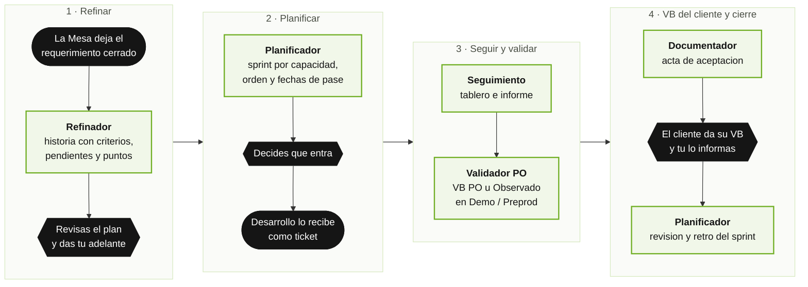
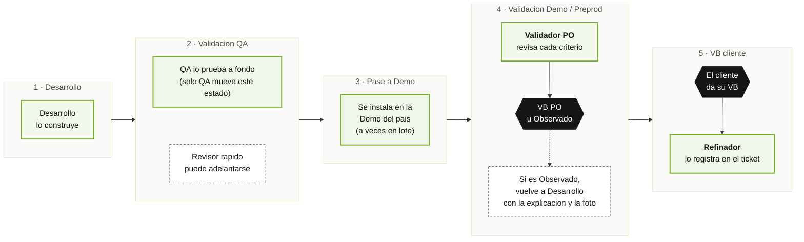
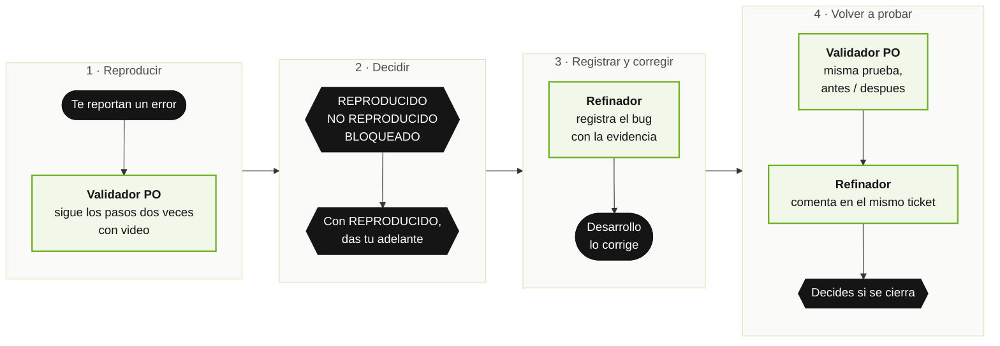

# Equipo del Product Owner (po-team) — Manual de Usuario

**Version del plugin:** 1.0.0 · **Integrantes del equipo:** 8 · **Comandos:** 9

El equipo del Product Owner es un **grupo de asistentes de inteligencia artificial que acompaña
al PO** desde que la Mesa de Servicios deja registrado un requerimiento cerrado hasta que el
cliente da su visto bueno. Escribe las historias de usuario en lenguaje de negocio, arma el
sprint con sus fechas, mantiene el tablero al dia, hace una revision rapida de lo construido,
confirma los errores antes de registrarlos, prepara actas e informes y escribe los manuales de
uso.

Tu decides; el equipo prepara. No necesitas saber programar. Este manual esta escrito para el PO,
para quien dirige un area y para quien nunca abrio una herramienta tecnica. La parte tecnica
(instalar y configurar) esta al final, en el **Anexo tecnico**.

---

## Indice

**Parte 1 — Para todas las personas**
1. [En dos minutos: como se usa](#1-en-dos-minutos-como-se-usa)
2. [Conoce al equipo](#2-conoce-al-equipo)
3. [El camino de un ticket hasta el VB del cliente](#3-el-camino-de-un-ticket-hasta-el-vb-del-cliente)
4. [Las palabras que vas a escuchar](#4-las-palabras-que-vas-a-escuchar)
5. [Las reglas de la casa](#5-las-reglas-de-la-casa)
6. [Ambientes y cuentas de prueba](#6-ambientes-y-cuentas-de-prueba)
7. [Que puedes pedir (lista de comandos)](#7-que-puedes-pedir-lista-de-comandos)

**Parte 2 — Situaciones reales, paso a paso**
- [Caso 1: La Mesa dejo un pedido nuevo](#caso-1--la-mesa-dejo-un-pedido-nuevo)
- [Caso 2: No tengo tablero: crear el backlog en GitHub](#caso-2--no-tengo-tablero-crear-el-backlog-en-github)
- [Caso 3: Armar el proximo sprint](#caso-3--armar-el-proximo-sprint)
- [Caso 4: ¿Como vamos? El tablero y el informe del dia](#caso-4--como-vamos-el-tablero-y-el-informe-del-dia)
- [Caso 5: Dar el VB PO a lo que llego a Demo](#caso-5--dar-el-vb-po-a-lo-que-llego-a-demo)
- [Caso 6: Algo quedo observado](#caso-6--algo-quedo-observado)
- [Caso 7: Me reportaron un error](#caso-7--me-reportaron-un-error)
- [Caso 8: Ya lo arreglaron: volver a probar](#caso-8--ya-lo-arreglaron-volver-a-probar)
- [Caso 9: El acta para el cliente y su VB](#caso-9--el-acta-para-el-cliente-y-su-vb)
- [Caso 10: Un manual para QA y otro para los usuarios](#caso-10--un-manual-para-qa-y-otro-para-los-usuarios)
- [Caso 11: Cerrar el sprint: que se logro y que mejorar](#caso-11--cerrar-el-sprint-que-se-logro-y-que-mejorar)
- [Caso 12: El informe del sprint para gerencia](#caso-12--el-informe-del-sprint-para-gerencia)

**Parte 3 — Preguntas frecuentes y problemas comunes**

**Anexo tecnico (para quien instala y configura)**
- [A. Instalacion y actualizacion](#a-instalacion-y-actualizacion)
- [B. Configuracion](#b-configuracion)
- [C. La carpeta del equipo](#c-la-carpeta-del-equipo)
- [D. Solucion de problemas tecnicos](#d-solucion-de-problemas-tecnicos)

---

# Parte 1 — Para todas las personas

## 1. En dos minutos: como se usa

1. Alguien instala el plugin una vez (ver [Anexo A](#a-instalacion-y-actualizacion)).
2. Abres Claude Code en tu carpeta de trabajo de PO (la del proyecto, **no** la de un
   repositorio). La primera vez el equipo te ayuda a configurarla.
3. Escribes esto y cuentas lo que necesitas, como se lo pedirias a un colega:

```
/po-team:start
```

| Lo que escribes | Lo que pasa |
|---|---|
| `/po-team:start` | El equipo mira lo pendiente y te propone que hacer primero |
| `/po-team:start la mesa dejo el #131, hay que pasarlo a HU` | Lee el pedido de la Mesa y te propone las historias con criterios y puntos |
| `/po-team:start no tengo tablero, armemos el backlog en GitHub` | Te muestra el tablero que crearia, en modo prueba, antes de crear nada |
| `/po-team:start armemos el sprint 13` | Propone que entra, que sale y por que, las fechas de pase y los riesgos |
| `/po-team:start como vamos` | Actualiza el tablero y te da el informe del dia |
| `/po-team:start revisa en Demo lo del sprint 12` | Revisa rapido cada ticket y te entrega la tabla cumple / observado |
| `/po-team:start me reportaron que no se puede aprobar en Demo CO` | Primero intenta reproducir el error; solo si se confirma, se registra |
| `/po-team:start ya arreglaron el #152` | Repite la prueba original y te muestra el antes y el despues |
| `/po-team:start cerremos el sprint 12` | Hace la revision del sprint y la retrospectiva con datos |
| `/po-team:start necesito el acta del #102` | Prepara el acta de aceptacion en PDF y Word |

**Cuatro cosas que siempre van a pasar:**

- **Te muestran el plan antes de tocar el tablero.** Crear historias, mover estados, comentar,
  subir fotos o crear un tablero solo ocurre despues de tu "adelante".
- **La revision del PO no es la de QA.** Es una revision rapida de lo pedido; QA sigue haciendo
  su prueba completa.
- **Todo en lenguaje de negocio.** Historias, comentarios, documentos y manuales los entiende
  cualquier persona.
- **Lo que queda esperando tu respuesta no se pierde.** Al abrir cada sesion, el equipo te
  recuerda las preguntas que dejaste pendientes.

---

## 2. Conoce al equipo

| Integrante | Que hace, en palabras simples | Cuando aparece |
|---|---|---|
| 🧭 **po-lead** (coordinador) | Decide que sigue, reparte el trabajo y te muestra el plan antes de tocar el tablero. Es el unico que puede pedir ayuda a los demas | Detras de cada pedido |
| ✍️ **refinador** (el que escribe las historias) | Convierte lo que llego de la Mesa en historias y bugs claros: criterios para saber si quedo bien, pendientes a la vista y tamaño en puntos. Registra los bugs **solo si se reprodujeron**, publica las observaciones y deja registrado el VB del cliente | Cuando llega algo nuevo, cuando algo queda observado, cuando se arregla un bug y cuando el cliente da su VB |
| 📅 **planificador** (el del sprint) | Arma el sprint segun lo que el equipo puede hacer, propone el orden con un metodo que puedes ver, saca lo que no esta listo y fija las fechas de Demo, Preprod y VB. Al terminar el sprint hace la revision y la retrospectiva | Antes de cada sprint, si hay que replanificar y al cerrarlo |
| 📊 **seguimiento** (el del tablero) | Lee el tablero real, calcula cuanto se avanzo, avisa lo atrasado y arma el panel visual y el informe. **Solo mira**: nunca cambia nada en el tablero | Cada vez que preguntas "como vamos" |
| ✅ **validador-po** (el revisor rapido) | Revisa en Demo o Preprod que cada criterio se cumpla, con una foto por criterio. Tambien reproduce un error antes de registrarlo y vuelve a probar un arreglo. **No reemplaza a QA** | Cuando algo llega a Demo/Preprod, cuando te reportan un error o cuando avisan que algo se arreglo |
| 📄 **documentador** (el de los documentos) | Prepara historias, especificaciones, actas e informes en PDF y Word | Cuando necesitas presentar algo |
| 📘 **manualista** (el de los manuales) | Recorre el flujo y escribe dos manuales: uno para QA y otro para cualquier persona, con fotos marcadas. Deja guardado el recorrido para repetirlo cuando cambie la pantalla | Cuando hay que enseñar a usar algo |
| 🧰 **setup** (el que prepara la oficina) | Revisa que la computadora tenga todo, crea la carpeta del equipo y configura el tablero, con tu permiso | Al empezar o si algo no funciona |

---

## 3. El camino de un ticket hasta el VB del cliente

El equipo del PO esta **entre la Mesa de Servicios y el equipo de desarrollo**. La Mesa deja el
requerimiento cerrado; este equipo lo convierte en trabajo listo para construir, lo entrega a
desarrollo **como ticket en el tablero** y lo acompaña hasta que el cliente dice "esta bien".



Una vez en desarrollo, cada ticket recorre **cinco etapas** (el ciclo de pase FaaST):



| Etapa | Que significa | Quien la mueve | Que hace el equipo del PO |
|---|---|---|---|
| **Desarrollo** | El equipo de desarrollo lo esta construyendo | Desarrollo | Responde dudas; no cambia la historia a mitad de sprint sin avisar |
| **Validacion QA** | QA lo prueba a fondo | **Solo QA** | Puede revisar antes para detectar algo temprano, sin reemplazar a QA |
| **Pase a Demo** | Se instala en la Demo del pais | Desarrollo | Fija la fecha y avisa si algun ambiente recibe los cambios por lotes |
| **Validacion Demo / Preprod** | El PO revisa en Demo (y en el Preprod del cliente, si tiene) | PO | El revisor rapido da **VB PO** u **Observado** |
| **VB cliente** | El cliente dice "esta bien" | PO, con la confirmacion del cliente | Prepara el acta y deja registrado quien, cuando y como dio el VB |

Los nombres exactos de los estados y de los ambientes son los de tu tablero: se configuran una
vez y el equipo los usa siempre. Si un ticket queda **Observado** en cualquier etapa, vuelve a
desarrollo; en el tablero se ve en rojo en la etapa donde se observo.

---

## 4. Las palabras que vas a escuchar

| Palabra | Que significa |
|---|---|
| **Historia de usuario (HU)** | La descripcion de algo que alguien necesita hacer: quien, que y para que |
| **Criterios de aceptacion** | Las condiciones que se revisan para saber si quedo bien. Se escriben como "Dado… cuando… entonces…". Cada historia tiene entre 3 y 8, incluidos los casos limite del negocio |
| **Pendientes** | Las preguntas que siguen abiertas en una historia, con a quien se le hacen (PO, Mesa o cliente) y que pasa si no se responden |
| **Definicion de hecho** | La lista que dice cuando una historia esta terminada de verdad: construida, aprobada por QA, con VB PO y, si aplica, con VB del cliente |
| **Definition of Ready (lista para el sprint)** | Lo que una historia debe cumplir para entrar a un sprint: criterios claros, pendientes resueltos, tamaño razonable, entrega definida y quien da el VB |
| **INVEST** | Seis preguntas para saber si una historia esta bien armada: que se pueda entregar sola, que diga que y para que (no como), que aporte valor, que se pueda estimar, que quepa en un sprint y que se pueda probar mirando la pantalla |
| **Puntos** | El tamaño de una historia (1, 2, 3, 5, 8, 13). Mas grande que 8 se divide antes de entrar al sprint |
| **Sprint** | El periodo de trabajo (por ejemplo, dos semanas) con un objetivo y un conjunto de historias |
| **Capacidad** | Cuantos puntos puede hacer el equipo en un sprint |
| **Pase** | Instalar lo construido en otro ambiente (Demo, Preprod) |
| **Pase en lote** | Un ambiente que no recibe cada cambio apenas se termina, sino todos juntos en una fecha |
| **Demo / Preprod** | Copias del sistema donde se muestra y valida antes de produccion. Preprod es la de un cliente |
| **Ambiente de pruebas / productivo** | Cada ambiente se declara de una de las dos clases. En uno de pruebas el equipo hace las acciones de prueba normalmente; en uno productivo solo mira, salvo que autorices cada accion |
| **VB PO** | El visto bueno del PO despues de su revision rapida en Demo o Preprod |
| **Observado** | Algo que no cumple un criterio; vuelve a desarrollo con la explicacion y la foto |
| **Reproducir** | Hacer en el sistema los pasos de un error reportado para confirmarlo. Resultado: **REPRODUCIDO**, **NO REPRODUCIDO** o **BLOQUEADO** (no se pudo llegar) |
| **Revalidar** | Volver a hacer la misma prueba despues de un arreglo. Se entrega el par de fotos **antes / despues** |
| **VB cliente** | El visto bueno del cliente; cierra el ciclo |
| **Acta de aceptacion** | El documento que el cliente firma para dar su VB |
| **Review y retro** | Al cerrar el sprint: que se logro contra lo comprometido, y que mejorar (como mucho tres acciones, cada una con responsable) |
| **Tablero / backlog** | Donde vive el estado de cada ticket (GitHub Projects o Azure DevOps) |
| **Dashboard** | La vista visual del tablero que arma el equipo: sprints, etapas, puntos, fechas y alertas |
| **Modo prueba** | Una simulacion que muestra exactamente que se crearia en GitHub, sin crear nada |
| **Evidencia** | Las fotos (y a veces videos) que muestran lo revisado; se ven dentro del ticket |

---

## 5. Las reglas de la casa

1. **Plan primero.** Nada se crea, mueve, comenta ni sube al tablero sin tu "adelante". Lo que
   solo mira (estado, tablero, informes) corre directo.
2. **La revision del PO no reemplaza a QA.** El revisor rapido nunca pone estados de QA ni da algo
   por probado.
3. **Todo en lenguaje de negocio.** Titulos limpios, sin codigos ni palabras tecnicas. Lo tecnico,
   si hace falta, va aparte, rotulado como anexo.
4. **Nada se inventa.** Si falta informacion, se pregunta a la Mesa (no al cliente); lo pendiente
   queda escrito en la historia.
5. **Un error se confirma antes de registrarlo.** Ningun bug entra al tablero sin una
   reproduccion con resultado **REPRODUCIDO** (de la Mesa o del revisor rapido). Si insistes en
   registrar uno no reproducido, queda marcado como "requiere informacion", nunca como bug
   confirmado.
6. **Solo entra al sprint lo que esta listo.** Lo que no cumple la lista para el sprint se propone
   sacar, con el motivo.
7. **La clase del ambiente manda.** En un ambiente de pruebas el equipo prueba con normalidad; en
   uno productivo solo mira, salvo que autorices cada accion (ver
   [seccion 6](#6-ambientes-y-cuentas-de-prueba)).
8. **Las fotos se ven dentro del ticket**, nunca como un enlace suelto.
9. **Sin claves ni datos personales** en fotos, tickets, documentos ni manuales. El equipo nunca ve
   las claves de las cuentas de prueba.
10. **Nadie cierra tickets por su cuenta.** El VB del cliente se registra; cerrar es una decision
    tuya, y solo si la configuracion lo permite.
11. **Nada fijo a mano.** Organizacion, tableros, estados, ambientes, clientes y personas salen de
    la configuracion.
12. **No se promete una fecha** al cliente sin que el planificador la revise contra la capacidad.
13. **Al equipo de desarrollo se le pide trabajo con tickets**, no de otra forma.
14. **La carpeta del equipo nunca vive dentro de un repositorio.** Va en la carpeta del proyecto
    o del PO; un control automatico impide guardarla dentro de un repositorio.

**Quien publica cada cosa en el ticket** (un solo responsable por cosa, para que no haya
comentarios repetidos):

| Que se publica | Quien lo publica |
|---|---|
| Historias, bugs y preguntas a la Mesa | Refinador |
| **VB PO** (comentario, fotos y etiqueta) | **Validador PO** |
| **Observado** | **Refinador** (el validador solo sube las fotos y se las pasa) |
| Resultado de volver a probar un arreglo | Refinador, en el mismo ticket |
| VB del cliente | Refinador, con los datos que tu le das |
| Sprint y fechas de pase | Planificador |
| El tablero en GitHub (crear o completar) | El comando del tablero, con tu OK |
| Tablero, dashboard e informes | Nadie escribe en el tablero: solo se lee |

---

## 6. Ambientes y cuentas de prueba

**Los ambientes.** Al configurar, tu declaras cada ambiente (Desa, QA, Demo de cada pais,
Preprod de cada cliente) y su **clase**:

| Clase | Que hace el equipo |
|---|---|
| **De pruebas** | Crea operaciones, aprueba, gira o paga como parte normal de la revision, sin pedirte OK paso a paso |
| **Productivo** | Solo navega y mira. Antes de cualquier boton que registre algo, necesita tu autorizacion para **esa** accion. Si no la tiene, ese criterio queda "no evaluado — requiere autorizacion" y sigue con los demas |

La clase **nunca se supone por el nombre** (un Preprod puede tener datos reales del cliente). Si
un ambiente no tiene clase, el equipo te la pregunta una vez y la recuerda.

**Las cuentas de prueba, sin que nadie vea las claves.** El revisor rapido y el manualista entran
al sistema con cuentas de prueba. Las claves las escribes **tu**, en un archivo de tu
computadora; el equipo solo conoce el **nombre** de cada cuenta y el navegador pone la clave por
su cuenta.

1. Pide la configuracion de ambientes:
   ```
   /po-team:setup ambientes
   ```
   → el equipo crea el archivo `accesos.env` dentro de la carpeta del equipo, con los nombres y
   sin valores, por ejemplo:
   ```
   PO_DEMO_CO_EJECUTIVO_USUARIO=
   PO_DEMO_CO_EJECUTIVO_CLAVE=
   ```
2. Abre ese archivo en tu editor (VS Code, Bloc de notas o TextEdit en texto plano). La carpeta
   `.po-team` esta oculta: en Mac la ves con `Cmd + Shift + .` en el Finder; en Windows, con
   **Vista → Elementos ocultos**.
3. Escribe cada valor despues del signo `=` y guarda.
4. **Reconecta el navegador del equipo:** en Claude Code escribe `/mcp` y reconecta el servidor
   de navegador del equipo del PO, o cierra y vuelve a abrir la sesion. Las cuentas se leen al
   arrancar; sin este paso, el equipo no las ve.
5. Listo. El equipo comprueba que cada cuenta este cargada (responde **OK**, **VACIA** o
   **FALTA**) sin ver nunca el valor.

> **Nunca pegues una clave en la conversacion.** Si el equipo necesita una cuenta que falta, te
> dice que nombre completar en `accesos.env`; no te pide el valor.

---

## 7. Que puedes pedir (lista de comandos)

Con `/po-team:start` y una frase basta. Esta lista es para cuando ya sabes que quieres.

| Escribes | Que consigues |
|---|---|
| `/po-team:start` | El punto de partida: mira lo pendiente y te guia |
| `/po-team:estado` | Un vistazo rapido sin consultar el tablero: pendientes, arreglos sin volver a probar, sprints sin cerrar, acciones abiertas de la retro |
| `/po-team:refinar {#ticket o texto}` | Historias o bugs listos, con criterios, pendientes y puntos ([Caso 1](#caso-1--la-mesa-dejo-un-pedido-nuevo)) |
| `/po-team:refinar --estimar` | Solo proponer o revisar los puntos |
| `/po-team:refinar --observacion #n` | Devolver una observacion a desarrollo ([Caso 6](#caso-6--algo-quedo-observado)) |
| `/po-team:refinar --vb-cliente #n` | Registrar el VB del cliente ([Caso 9](#caso-9--el-acta-para-el-cliente-y-su-vb)) |
| `/po-team:tablero` | Te pregunta cual quieres: el tablero generico, el de Organizacion PO, las validaciones del sprint o crear un backlog en GitHub ([Caso 4](#caso-4--como-vamos-el-tablero-y-el-informe-del-dia)) |
| `/po-team:tablero crear-backlog` | Crear el tablero en GitHub, con plan de prueba antes ([Caso 2](#caso-2--no-tengo-tablero-crear-el-backlog-en-github)). Tambien `agregar` (completar uno existente) y `verificar` (revisar su salud) |
| `/po-team:sprint planificar {N}` | La propuesta del sprint con orden, fechas y riesgos ([Caso 3](#caso-3--armar-el-proximo-sprint)). Tambien `replanificar`, `fechas` y `riesgos` |
| `/po-team:sprint cierre {N}` | Revision y retrospectiva del sprint ([Caso 11](#caso-11--cerrar-el-sprint-que-se-logro-y-que-mejorar)) |
| `/po-team:validar {#n o --lote sprint N}` | La revision rapida con fotos ([Caso 5](#caso-5--dar-el-vb-po-a-lo-que-llego-a-demo)). Con `--video`, tambien video; con `--artifact`, una pagina con todas las validaciones del sprint |
| `/po-team:validar --reproducir "…"` | Confirmar un error antes de registrarlo ([Caso 7](#caso-7--me-reportaron-un-error)) |
| `/po-team:validar --revalidar #n` | Volver a probar un arreglo, con antes y despues ([Caso 8](#caso-8--ya-lo-arreglaron-volver-a-probar)) |
| `/po-team:documento {hu, especificacion, aceptacion, sprint} …` | Documentos en PDF y Word ([Caso 9](#caso-9--el-acta-para-el-cliente-y-su-vb), [Caso 12](#caso-12--el-informe-del-sprint-para-gerencia)) |
| `/po-team:manual {flujo}` | Manual QA y manual de usuario ([Caso 10](#caso-10--un-manual-para-qa-y-otro-para-los-usuarios)) |
| `/po-team:setup` | Revisar e instalar lo necesario, configurar el tablero y los ambientes |

---

# Parte 2 — Situaciones reales, paso a paso

Los ejemplos usan tickets y clientes ficticios; aplican a cualquiera.

## Caso 1 — La Mesa dejo un pedido nuevo

**Situacion:** la Mesa de Servicios registro el #131: el cliente quiere ver el IVA de cada gasto
en el resumen de la operacion.

**Que escribes:**
```
/po-team:refinar #131
```

**Que hace el equipo:**
1. El refinador lee el ticket completo: el documento de la Mesa, lo que se decidio con el cliente
   y lo que quedo pendiente. Si la Mesa tiene su memoria del negocio, la consulta para usar las
   mismas palabras y no preguntar lo que ya se sabe.
2. Revisa que no exista ya algo parecido en el tablero.
3. Escribe la historia: quien la usa, que necesita y para que; **entre 3 y 8 criterios** que
   cubren el camino normal y los casos limite del negocio (permisos, montos, moneda, fechas,
   doble envio); que incluye y que no; **pendientes** con a quien se le preguntan; donde se
   validara y quien da el VB; la **definicion de hecho**; y los puntos propuestos con su motivo.
4. Revisa la historia con las seis preguntas INVEST. Si es muy grande, propone dividirla por paso,
   regla, pais, cliente o perfil, nunca por partes tecnicas.
5. Te muestra el plan: "crear 1 historia de 5 puntos en el tablero, relacionada con #131".

**Recibes** (despues de tu "adelante"):
```
Creada: #140 Mostrar el IVA de cada gasto en el resumen de la operacion (5 pts, propuesta)
Siguiente: /po-team:sprint para incluirla
```
Si el pedido de la Mesa tenia dudas sin resolver, no se inventan: el equipo escribe las preguntas
en el ticket de la Mesa (tambien con tu OK, porque escribe en el tablero), la historia queda
"pendiente de informacion" y la pregunta aparece en tus pendientes hasta que llegue la respuesta.
Una historia con pendientes abiertos **no entra al sprint** hasta resolverlos o hasta que tu los
aceptes.

---

## Caso 2 — No tengo tablero: crear el backlog en GitHub

**Situacion:** el equipo trabaja con GitHub pero todavia no tiene un tablero (Project) con el
ciclo de pase FaaST.

**Que escribes:**
```
/po-team:tablero crear-backlog
```

**Que hace el equipo:**
1. Te pregunta **una sola vez** lo que falte: organizacion, nombre del tablero, repositorio donde
   viven las historias, fecha de inicio del primer sprint, duracion y cuantos sprints crear.
2. Arma el **plan en modo prueba** (no crea nada) y te lo muestra: el tablero, las columnas del
   ciclo FaaST (No iniciado · En desarrollo · Desarrollo terminado · En QA · Validado por QA ·
   Pase a Demo · En validacion · Observado · Bloqueado · VB cliente, o las de tu configuracion),
   los campos Puntos, Sprint, Prioridad y fechas de Demo, Preprod y VB, los sprints con sus
   fechas y las vistas.
3. Si ya existe un tablero con ese nombre, te pregunta si se usa ese o se elige otro nombre.
   **Nunca borra ni renombra un tablero.**
4. Espera tu "¿Lo creo en GitHub?". Sin un si claro, no escribe nada.
5. Lo crea. Si se corta a mitad (por ejemplo, por la red), se vuelve a lanzar y sigue donde
   quedo, sin duplicar.

**Recibes:** el enlace al tablero, que se creo y que se reutilizo, y lo poco que queda por hacer a
mano en GitHub (agrupar y ordenar las vistas).

**Si ya tienes un tablero:** `/po-team:tablero crear-backlog agregar` lo completa con lo que le
falte, y `/po-team:tablero crear-backlog verificar` revisa su salud. En ambos casos **cada ticket
conserva su estado**: las columnas existentes se mantienen y se agregan las nuevas, nunca se
reemplazan.

---

## Caso 3 — Armar el proximo sprint

**Que escribes:**
```
/po-team:sprint planificar 13
```

**Que hace el equipo:**
1. Calcula cuanto puede hacer el equipo: lo configurado o lo que logro en los ultimos sprints (si
   hay ambos, usa el menor). Si avisas feriados o ausencias, lo ajusta.
2. Propone el **orden con un metodo que puedes ver**: primero lo imprescindible y luego lo
   deseable; dentro de cada grupo, (valor + reduccion de riesgo) dividido por el tamaño. Muestra
   la cuenta, no solo el resultado. Lo regulatorio, lo comprometido con un cliente y los errores
   criticos suben aunque puntuen bajo, diciendo por que. **La prioridad final la decides tu.**
3. Aplica la **lista para el sprint** y propone **sacar**, con el motivo, lo que no la cumple: sin
   criterios claros, con pendientes abiertos, sin entrega definida, demasiado grande, sin estimar o
   bloqueado.
4. Propone las fechas de Demo, Preprod y VB cliente (respetando los ambientes que reciben cambios
   por lote) y avisa los riesgos.

**Recibes:**
```
Sprint 13 · 20/10 – 31/10 · capacidad 30 pts (configurada 32 / velocidad 30)
Objetivo: que el cliente reciba el detalle de gastos en su liquidacion
Entra (28 pts): #140 (5), #141 (3), …
Propongo sacar: #118 — sin criterios claros (→ refinar) · #125 — 13 pts, dividir
Fechas: Demo 04/11 (en lote) · Preprod Cliente A 07/11 · VB cliente 11/11
Riesgos: MEDIO — #141 depende de un dato que el cliente aun no envia
¿Adelante? (asigna el sprint a 7 tickets)
```
Si a mitad de sprint cambia algo, `/po-team:sprint replanificar` propone un intercambio
explicito ("entra #150 de 5 pts, sale #133 de 5 pts").

---

## Caso 4 — ¿Como vamos? El tablero y el informe del dia

**Que escribes:**
```
/po-team:tablero diario
```

**Que hace el equipo:** si no le dices cual, te pregunta que tablero quieres:

| Opcion | Que ves |
|---|---|
| **Tablero generico** | Indicadores, el avance de cada sprint por etapa, los tickets por etapa, fechas, cambios y riesgos |
| **Organizacion PO** | Indicadores, cambios desde la ultima revision, una tarjeta por sprint con su avance, fechas comprometidas y lo que pide atencion |
| **Validaciones del sprint** | Una pagina con cada ticket revisado: casos, fotos, bloqueos, decisiones y bugs |
| **Crear un backlog en GitHub** | Ver [Caso 2](#caso-2--no-tengo-tablero-crear-el-backlog-en-github) |

Luego lee el tablero real, ubica cada ticket en su etapa, suma los puntos, compara con la ultima
revision y arma el panel. Si tu sesion lo permite, lo publica como una pagina privada que puedes
abrir y compartir cuando quieras; si no, te deja el archivo. **No cambia nada en el tablero.**

**Recibes** el informe, con lo urgente primero:
```
Sprint 12 (06/10–17/10): 34 pts · VB cliente 26% · avance ponderado 58%
Cambios: #104 paso a Validado por QA · #130 quedo observado en Demo CO
Atencion: ALTO — la fecha de Demo del 20/10 esta en riesgo (2 tickets aun en QA)
Siguiente: /po-team:refinar --observacion #130
```

---

## Caso 5 — Dar el VB PO a lo que llego a Demo

**Que escribes:**
```
/po-team:validar --lote sprint 12 --ambiente demo-co
```

**Que hace el equipo:** el revisor rapido entra a la Demo con la cuenta de prueba configurada y,
ticket por ticket, recorre solo los criterios de cada historia por el camino normal, con una foto
por criterio (unos 10-20 minutos por ticket; si son mas de ocho tickets te avisa antes cuanto va a
tardar). Si un criterio no se cumple, toma la foto, lo anota en palabras simples y pasa al
siguiente ticket. **No busca por que falla** y **no reemplaza a QA**. Respeta la clase del
ambiente: en uno productivo solo mira.

**Recibes:**
```
| Ticket | Titulo | Pts | Veredicto | Criterios |
| #123 | Filtrar operaciones por fecha | 3 | ✅ VB PO | 3/3 |
| #130 | Total con IVA en el resumen | 5 | ⚠️ Observado | 1/3 — el total no incluye el IVA |
Nota: revision funcional rapida del PO; no reemplaza la validacion de QA.
¿Publico las fotos y el resultado en cada ticket?
```

Con tu OK: en los tickets con **VB PO**, el **revisor rapido** sube las fotos, comenta y pone la
etiqueta de VB PO. En los **Observados**, el revisor sube las fotos y el **refinador** publica la
observacion (ver [Caso 6](#caso-6--algo-quedo-observado)). El VB PO solo se marca por una revision
en Demo o Preprod; si te adelantas en Desa o QA, queda solo como comentario.

Con `--artifact` queda ademas una pagina con todas las validaciones del sprint, que se actualiza
en la misma direccion en cada ronda. Con `--video` se graba tambien un video por ticket.

---

## Caso 6 — Algo quedo observado

**Que escribes:**
```
/po-team:refinar --observacion #130
```
**Que hace el equipo:** el refinador redacta la observacion en lenguaje de negocio (que se
esperaba, que se vio, en que ambiente, cuando y con que perfil) con las fotos dentro del ticket,
pone la etiqueta de observado, quita la de VB PO si la tenia y lo devuelve a desarrollo. Es **un
solo comentario**, con las fotos que ya subio el revisor. Si lo observado es algo distinto a lo
que pedia la historia, propone un bug nuevo relacionado.

---

## Caso 7 — Me reportaron un error

**Situacion:** alguien te dice "en Demo CO no se puede aprobar una operacion como Jefe
Comercial". Todavia nadie lo comprobo.

**Que escribes:**
```
/po-team:validar --reproducir "en Demo CO el Jefe Comercial no puede aprobar una operacion" --ambiente demo-co
```

**Que hace el equipo:** el revisor rapido sigue los pasos del reporte como un usuario, grabando
video y con una foto marcada en el punto del problema. Luego hace una **segunda
pasada limpia** para saber si pasa siempre o a veces. Sin buscar causas y sin probar con otros
datos para "hacerlo fallar".



**Recibes** uno de tres resultados:

| Resultado | Que significa | Que sigue |
|---|---|---|
| **REPRODUCIDO** (siempre, o a veces: "1 de 2") | El error existe | Te ofrece registrarlo: `/po-team:refinar` arma el bug con los pasos, lo esperado y lo obtenido, el ambiente, la severidad sugerida y el video dentro del ticket |
| **NO REPRODUCIDO** | Se siguieron los pasos tal cual y el sistema respondio bien | No se registra bug. Te muestra lo que si se vio y te ofrece devolverlo a la Mesa con eso |
| **BLOQUEADO** | No se pudo llegar (ambiente caido, falta un acceso o un dato) | No se registra bug. Te dice que falta para volver a intentar |

> Si el error lo reporto un cliente y la Mesa no lo reprodujo, a veces conviene devolverlo a la
> Mesa: su flujo de reproduccion graba todo. Lo decides tu.

---

## Caso 8 — Ya lo arreglaron: volver a probar

**Situacion:** desarrollo avisa que el #152 esta arreglado e instalado en Demo.

**Que escribes:**
```
/po-team:validar --revalidar #152
```

**Que hace el equipo:** el revisor rapido repite **exactamente** la prueba original (mismos pasos,
mismo perfil, datos equivalentes), con video, en una carpeta nueva para no mezclarla con la
primera. Arma el **par antes / despues** de cada punto.

**Recibes** el veredicto: **Corregido**, **Corregido con observaciones** (un detalle menor que no
bloquea) o **Sigue fallando**. El refinador lo comenta en el **mismo ticket**, con las fotos
nuevas, y **te pregunta si lo cierra**. Nunca lo cierra solo.

---

## Caso 9 — El acta para el cliente y su VB

**Que escribes:**
```
/po-team:documento aceptacion #102
```
**Recibes** el acta en PDF y Word: que se entrega, cada criterio con su resultado y su foto, donde
y cuando se valido, las observaciones pendientes y el espacio para la firma del cliente. Si
todavia no hay VB PO para algun criterio, el acta lo muestra como "pendiente de validacion" (no
se inventa).

Cuando el cliente responde que esta conforme:
```
/po-team:refinar --vb-cliente #102
```
El equipo te pregunta quien dio el VB (cargo y empresa), cuando y por que medio (correo, acta
firmada, reunion), y lo deja registrado en el ticket. Cerrar el ticket es una decision tuya.

---

## Caso 10 — Un manual para QA y otro para los usuarios

**Que escribes:**
```
/po-team:manual aprobar una operacion como Jefe Comercial --ambiente demo-co
```
**Que hace el equipo:** recorre el flujo una vez en el sistema y escribe dos manuales del mismo
recorrido:
- **Manual QA:** que se necesita antes, con que perfil y datos, cada paso numerado con lo que
  deberia pasar, y una lista para verificar el resultado.
- **Manual de usuario:** en palabras simples, una foto por paso con numeros que señalan donde
  hacer clic, consejos y preguntas frecuentes.

Si el flujo se corta a mitad, te lo dice en palabras simples y el manual queda en borrador con lo
recorrido. En un ambiente productivo se detiene antes de cada accion que registre algo (lo ideal
es documentar en uno de pruebas).

**Recibes** ambos en PDF (y Word, y la version web).

**Cuando cambie la pantalla:** el manualista deja guardado el **recorrido repetible** (cada paso
con como encontrar cada boton). Para actualizar el manual, vuelves a pedirlo:
```
/po-team:manual aprobar una operacion como Jefe Comercial
```
→ te propone repetir el mismo recorrido, compara pantalla por pantalla y genera la version
siguiente (v2, v3…) con una seccion "Cambios respecto a la version anterior". Si un paso ya no se
puede hacer, te lo informa como cambio de pantalla y pregunta el nuevo camino; no lo adivina. Las
versiones entregadas nunca se sobreescriben.

---

## Caso 11 — Cerrar el sprint: que se logro y que mejorar

**Que escribes:**
```
/po-team:sprint cierre 12
```

**Que hace el equipo:** el planificador mira primero las acciones de la retro anterior y despues:
- **Revision (que se logro):** comprometido contra logrado en cada etapa (puntos que llegaron a
  QA, a Demo, a VB PO y a VB cliente), si se cumplio el objetivo, fechas comprometidas contra
  reales, observados, bloqueos y lo que pasa al siguiente sprint con su motivo.
- **Retro (que mejorar), con datos y no con opiniones:** busca patrones, como historias observadas
  por criterios ambiguos, tickets que esperaron el pase en lote o fechas perdidas por dependencias
  conocidas.
- **Acciones:** como mucho **tres**, cada una concreta, con responsable y fecha de revision.

**Recibes** el resumen y la retro guardada; el sprint queda marcado como cerrado. No escribe en el
tablero. Las acciones abiertas aparecen en `/po-team:estado` hasta la proxima retro.

---

## Caso 12 — El informe del sprint para gerencia

**Que escribes:**
```
/po-team:documento sprint 12
```
**Recibes** un informe en PDF y Word: objetivo del sprint, puntos comprometidos y logrados por
etapa, resultado de cada ticket, fechas comprometidas versus reales, riesgos y proximos pasos.

---

# Parte 3 — Preguntas frecuentes y problemas comunes

**¿Tengo que saber programar?** No. Todo se pide y se recibe en lenguaje normal.

**¿El equipo cambia cosas en el tablero sin preguntarme?** No. Siempre te muestra el plan antes.
Mirar el tablero, el informe y el estado no cambia nada.

**¿La revision rapida del PO reemplaza a QA?** No. QA hace la prueba completa; el PO revisa que
se cumpla lo pedido por el camino normal antes de mostrarlo al cliente.

**¿Por que el revisor no me dice por que falla algo?** Porque su trabajo es mostrar que no se
cumple, con la foto. La causa la busca el equipo de desarrollo.

**Me dijeron que algo falla. ¿Por que no lo registran de inmediato como bug?** Porque primero se
confirma ([Caso 7](#caso-7--me-reportaron-un-error)). Asi desarrollo no pierde tiempo en errores
que no existen o que faltan datos para entender.

**¿Por que en Demo el equipo aprueba o gira sin preguntarme?** Porque ese ambiente esta declarado
de pruebas y esas son acciones de prueba normales. En uno productivo es al reves: solo mira, salvo
que autorices cada accion.

**¿El equipo ve las claves de las cuentas de prueba?** No. Tu las escribes en `accesos.env`; el
equipo solo usa el nombre de cada cuenta y el navegador pone la clave
([seccion 6](#6-ambientes-y-cuentas-de-prueba)).

**Deje una pregunta sin responder. ¿Se pierde?** No. Al abrir la siguiente sesion aparece en una
lista corta de pendientes, hasta que la respondas.

**¿Por que no veo la carpeta del equipo en el repositorio?** Porque no va ahi. La carpeta
`.po-team` vive en la carpeta del proyecto o del PO, nunca dentro de un repositorio.

**¿Puedo usarlo con Azure DevOps?** Si. Se elige al configurar. Crear el tablero automaticamente
(Caso 2) es solo para GitHub.

**¿Funciona junto con la Mesa de Servicios y el equipo de desarrollo?** Si. Usan carpetas
distintas. La Mesa deja el requerimiento cerrado; este equipo lo refina, lo entrega a desarrollo
como ticket y lo sigue. No necesita que los otros equipos esten instalados.

**¿Quien ve el panel publicado?** Solo tu, hasta que decidas compartirlo.

## Si algo no anda

- **"No puedo leer el tablero"** → `/po-team:setup tracker` (permiso de lectura de Projects).
- **"Hay tickets 'sin etapa' en el panel"** → un estado del tablero no esta asignado a ninguna
  etapa: `/po-team:setup tracker`.
- **"El revisor no puede entrar al sistema"** → revisa que la cuenta este completa en
  `accesos.env` y reconecta el navegador (`/mcp`) o reinicia la sesion; si sigue,
  `/po-team:setup ambientes`.
- **"Me pregunta si el ambiente es de pruebas o productivo"** → es normal la primera vez;
  respondes y lo recuerda.
- **"No genera el PDF o el Word"** → `/po-team:setup documentos`.
- **"Dice que no puede guardar en esa carpeta"** → es el control que impide guardar el trabajo
  del equipo dentro de un repositorio. Acepta la propuesta de moverla (ver
  [Anexo C](#c-la-carpeta-del-equipo)).

---

# Anexo tecnico (para quien instala y configura)

## A. Instalacion y actualizacion

```bash
# 1. Agregar el marketplace (una sola vez)
claude plugin marketplace add faast-app/faast-claude-marketplace

# 2. Instalar el plugin
claude plugin install po-team@faast-marketplace

# 3. Actualizar cuando haya cambios publicados
claude plugin marketplace update faast-marketplace
claude plugin update po-team@faast-marketplace
# → reiniciar la sesion de Claude Code despues de actualizar
```

Dentro de una sesion tambien sirven `/plugin marketplace add …` y `/plugin install …`. Al abrir
una sesion, el equipo compara tu version con la publicada y te avisa si hay una nueva.

**Requisitos** (el agente `setup` los valida e instala con una confirmacion): git · `gh` con los
permisos `project` y `read:project` (`gh auth refresh -s project,read:project`), o `az` con la
extension de Boards · Node.js ≥ 18 (el servidor Playwright MCP viene incluido en el plugin) y el
navegador (`npx playwright install chromium`) · LibreOffice (`soffice`) para PDF y Word ·
python3 · `ffmpeg` opcional (videos a tamaño real; sin el, la evidencia queda en fotos).

## B. Configuracion

Todo vive en `.po-team/config.json` (lo crea `setup` desde `templates/po-team/config.json`,
preguntando una sola vez y leyendo los campos y estados reales del tablero):

| Campo | Efecto |
|---|---|
| `tracker.provider` | `github` o `azure` |
| `tracker.github.org` / `repoDefault` / `repos` | Donde se crean y leen HUs y bugs |
| `tracker.github.projects[]` / `projectDefault` / `sprintVia` | Projects (numero, alias) y nombres de campos: Status, puntos, sprint, prioridad, fechas de Demo, Preprod y VB. `crear-backlog` los registra solo |
| `tracker.etiquetas` | Etiquetas de HU, bug, VB PO, observado PO, VB cliente, pendiente de informacion, no reproducible, cliente y ambiente |
| `tracker.reglas.estadosSoloQA` | Estados que solo mueve QA humana (el equipo nunca los asigna) |
| `tracker.reglas.cerrarIssues` / `estadosFinales` | Si el equipo puede cerrar issues (por defecto `false`) y que estados equivalen a cerrar |
| `ciclo.etapas[]` | Que estados y/o etiquetas del tablero corresponden a cada etapa del ciclo |
| `ciclo.estadosObservado` / `estadosBloqueado` / `diasAlertaSinMovimiento` | Alertas del tablero |
| `ambientes` | Desa, QA, Demo por pais y Preprod por cliente: nombre, **`clase` (`pruebas` \| `productivo`)**, URL, nombres de variables de cuentas (`cuentasEnv`) y `paseEnLote` |
| `clientes[]` | Codigo, nombre y ambientes de cada cliente |
| `capacidad` / `estimacion` | Puntos por sprint, uso de velocidad, duracion, escala y maximo por historia en un sprint |
| `redaccion.prefijoAmbienteEnBugs` | Titulo de bugs de Demo/Preprod con prefijo del ambiente |
| `evidencia` | Repo, rama (`evidence`) y carpeta donde se publican las fotos para verlas en el ticket |
| `documentos` / `manuales` / `tablero` / `validacion` | Carpetas de salida, aprobadores del acta, direcciones de los paneles publicados |
| `brain.path` (opcional) | Ruta local de `faast-brain` de la Mesa: el refinador y el manualista lo **leen** (nunca escriben) |
| `team.models` | Subir un integrante a un modelo mas potente (por defecto `sonnet`; `setup` fijo en `haiku`; nunca `fable`). Tambien en `~/.claude/po-team.config.json`; gana el del proyecto |

Ejemplo de un ambiente:
```json
{ "clave": "demo-co", "nombre": "Demo CO", "clase": "pruebas", "url": "https://…",
  "cuentasEnv": ["PO_DEMO_CO_EJECUTIVO_USUARIO", "PO_DEMO_CO_EJECUTIVO_CLAVE"], "paseEnLote": true }
```

**Cuentas de prueba:** `.po-team/accesos.env` (permisos `600`) con una linea `NOMBRE=` por usuario
y por clave. El PO completa los valores en su editor. El servidor Playwright MCP del plugin las
carga como **secretos** al arrancar: el equipo escribe el NOMBRE de la variable y el navegador pone
el valor; nadie lee el archivo. Despues de completarlo hay que **reconectar el MCP (`/mcp`) o
reiniciar la sesion**. `scripts/accesos.py` responde `OK` / `VACIA` / `FALTA` sin mostrar valores.

## C. La carpeta del equipo

`.po-team/` vive en la **carpeta del proyecto o del PO**, **nunca dentro de un repositorio git**.
Un hook bloquea escribirla dentro de un repo; al abrir la sesion, otro hook imprime su ruta
absoluta, agrega `.po-team/` al `.git/info/exclude` local del repo abierto y lista los pendientes
abiertos. Si una carpeta antigua quedo dentro de un repo, la sesion propone moverla con `mv`.

Si abres Claude Code desde un repositorio que no esta dentro de la carpeta del proyecto, el
vinculo se registra por usuario en `~/.claude/po-team.config.json`:
```json
{ "proyectos": { "~/Repositorios/front-backoffice": "~/Proyectos/backoffice" } }
```

```
~/Proyectos/backoffice/                 carpeta del proyecto o del PO (NO es un repo)
└── .po-team/
    ├── config.json                     configuracion
    ├── accesos.env                     cuentas de prueba (valores los pone el PO)
    ├── setup-status.json               estado del entorno
    ├── backlog.md                      espejo: una linea por item refinado
    ├── project-state/                  plan y estado del backlog creado en GitHub
    ├── sprints/sprint-{N}.json         objetivo, capacidad, comprometidos, sacados, fechas, riesgos
    ├── retros/retro-sprint-{N}.md      revision, retro y acciones del sprint
    ├── tickets/{numero}/               validaciones, reproducciones y revalidaciones (fotos, video)
    ├── tickets/lote-*.md|json          resultados de validaciones en lote (insumo del panel)
    ├── validaciones/{sprint}-{amb}/    pagina de validaciones del sprint con su evidencia
    ├── tablero/                        tablero-datos.json, paneles HTML, snapshots/, informes/
    ├── documentos/                     documentos de negocio (HTML, PDF, DOCX)
    ├── manuales/{flujo}/               recorrido, steps.yaml, capturas y los dos manuales
    ├── handoffs/                       notas entre integrantes
    └── metrics/activity.jsonl          actividad y pendientes
```

El navegador del equipo escribe primero en `~/.faast-mcp/po-team/` (fuera de cualquier repo); al
terminar, cada integrante mueve lo suyo a la carpeta del ticket.

## D. Solucion de problemas tecnicos

| Sintoma | Causa probable | Que hacer |
|---|---|---|
| `gh` no lee el Project | Falta el permiso | `gh auth refresh -s project,read:project` |
| `crear-backlog` no puede escribir | Falta el permiso `project` | `gh auth refresh -s project`; el plan en modo prueba igual se puede ver con `--offline` |
| No aparecen las herramientas `browser_*` | Sesion vieja | Reiniciar Claude Code; `claude mcp list` |
| La cuenta aparece `VACIA` o `FALTA` | `accesos.env` sin completar o MCP sin reconectar | Completar el valor y reconectar (`/mcp`) o reiniciar la sesion |
| Varios servidores `playwright` | dev-team, mesa-servicios o marketing instalados | Normal: cada plugin trae el suyo con su carpeta. Quitar solo uno personal duplicado |
| Un hook bloquea escribir en `.po-team/` | La carpeta esta dentro de un repo | Moverla con `mv` fuera del repo, registrarla en `~/.claude/po-team.config.json` → `proyectos` y reiniciar |
| El PDF sale sin acentos | Conversion incorrecta | `/po-team:setup documentos` (prueba real) |
| Tickets "Sin etapa" | Mapeo incompleto | Completar `ciclo.etapas[].estados` con `/po-team:setup tracker` |
| El panel no se publica | La sesion no tiene la herramienta de artifacts | Se entrega el archivo local `tablero.html` |
